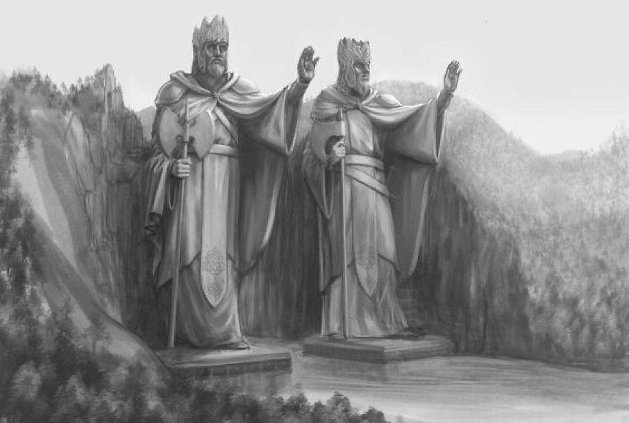
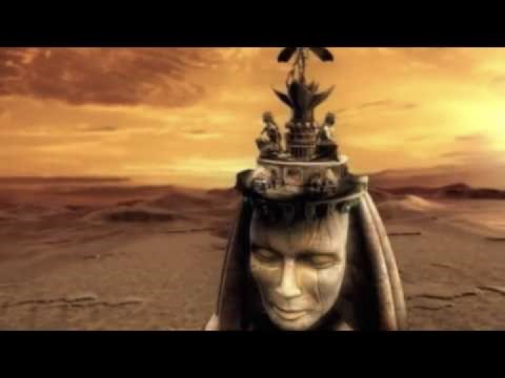
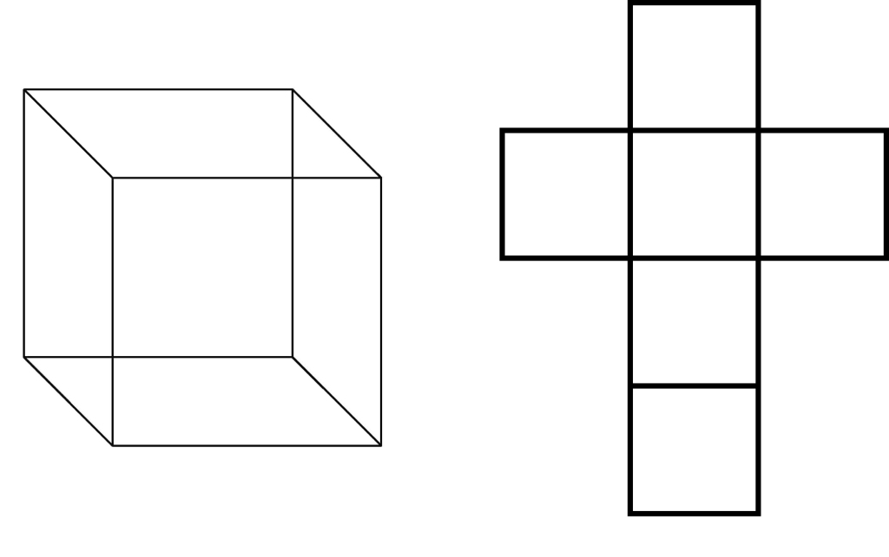
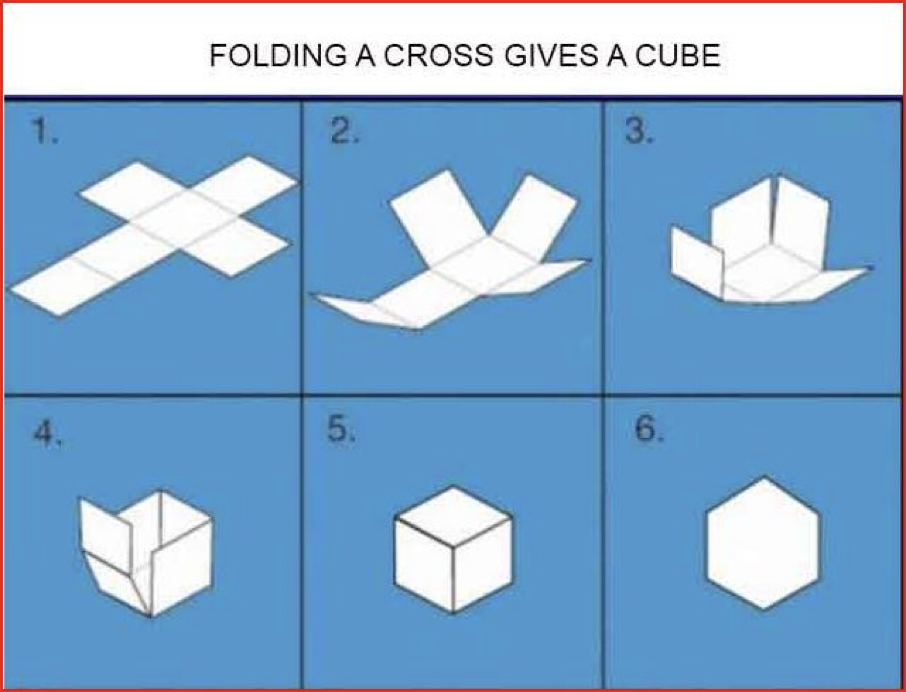

(part 1 – Introduction)

> 𝐈 𝐮𝐧𝐝𝐞𝐫𝐬𝐭𝐚𝐧𝐝 𝐭𝐡𝐞 𝐆𝐚𝐦𝐞 𝐧𝐨𝐰. 𝐈𝐭’𝐬 𝐜𝐥𝐞𝐚𝐫 𝐟𝐨𝐫 𝐦𝐞 𝐭𝐡𝐚𝐭 𝐭𝐡𝐞𝐫𝐞 𝐚𝐫𝐞 𝐜𝐨𝐧𝐬𝐞𝐪𝐮𝐞𝐧𝐜𝐞𝐬 𝐨𝐟 𝐝𝐞𝐧𝐲𝐢𝐧𝐠 𝐭𝐡𝐞 𝐩𝐫𝐨𝐠𝐫𝐚𝐦 𝐢𝐭𝐬 𝐩𝐨𝐰𝐞𝐫.
>
> Ra Uru Hu

_(This article was written back in the now "distant" 2020. The author has evolved and built on it a great deal since then, but this information still holds many essential layers, has its place in the process and deserves to be published here too ☺)_

You can be living a perfectly nice life (or at least imagine you are), and then you start writing about archons – or, worse, dealing with them. For me this is a process that has been going on for a long time: if I rewind the tape, in step with the self-awareness it demanded, my active observations go back about 5–6 years. Around that time, through a series of circumstances, I had the perfect conditions to engage more seriously and deeply with esotericism and the occult, to turn inwards and devote myself to knowledge and reading. I got the chance to live in isolation (before it was cool), I could train and meditate diligently, I kept a very clean diet (no preservatives, junk food or any other substances – or information streams – that close the mind), and all this created the perfect setting for "sinking" into the depths of the Mystical. I began studying the various religions and mythologies (especially Islam and the mythologies of Sumer and Ancient Egypt, as well as the magical art and, naturally, every conspiracy "floating around"; of course I also read everything available on the Bulgarian "eso airwaves"). I didn't skip history and cultural studies as disciplines either, mostly because I was studying something similar at university at the time (and so drawing quite heavily on the related egregores, which hold a lot of information). I also studied Semitic languages. In a word, I'd buried myself in occult literature and the search for the "big truth" like a kid in a candy store. It's funny to note that this period started with strong frustration on my part about everything to do with conspiracies, aliens and astrology (which I've been practising for quite a few years now), and my general reaction was "don't bother me with this nonsense". But getting into certain subjects, along with certain experiences, turned my attitude 180 degrees and shot me straight "into the deep shit". It's hard for me to say exactly what unlocked it, but I suspect that, besides the combination of factors, a specific trigger for unlocking my genetic memory of "past lives" was learning Arabic and Hebrew, and reading the Quran (which is a very solid egregore containing many activation codes – unlike the Bible, which has been so watered down, mostly by translations and over-exposure, that almost nothing of its originally embedded energy and intention remains). Interestingly, studying the history of the early caliphates also triggered an extremely strong auto-regression in me – I literally couldn't pass my damn exams, because after barely 20 minutes of reading I'd "pass out" into a doze (as if someone flipped my switch, and as a result I'd slip into dreamlike awareness of parallel realities), from which I'd wake in a strange state, to put it mildly, with strange memories and knowledge "out of nowhere". Pretty quickly I came to the books of Morning Sky and the work of Paralelreality, which struck me as "the plain truth itself" (like, come ooon, how are you not seeing this???...). That's when the real movie started, because these works are loaded with a particular energy that simply "drops the veil" of the illusion and pokes viciously at the very foundations of the code. All this expanded my consciousness and shot me straight into the world of OBEs. After all that, let's say I closed my eyes to the world and truly began to see... this time.

During this period I started having extremely strong out-of-body experiences, [astral projections](/en/blog/categories/astral), and a series of more unpleasant and stressful experiences (I even triggered an "autoimmune disease" back then – long story short, bottom line, the only things I'm not allergic to are meat and certain fruits – carnivorous, eh?). My encounters were unforgettable too – not of the 3rd, 4th or 5th kind, but straight of the 10th (I had an incredibly lucid OBE in which I walked around naked in front of the frozen stares of aliens, who asked me telepathically "why did you get out of the chamber again" – I'll tell you about it in detail another time ;D).

But before we get to the weird side of the internet again, one thing at a time...

Luckily, I was smart enough to keep notes and a [dream journal](/en/sonovnik), so that I wouldn't miss anything from this process. Of course, not everything is written down or preserved, and I can no longer remember everything, let alone with the unique, powerful energy the experience was imprinted with in the moment, but... still, it's there in black and white.

(I'm warning you now that this article is a bit subjective and runs entirely on the right hemisphere – that is, my own experiences and intuitive insights. I don't care where the information comes from, and I won't waste my time and energy needlessly rationalising it. I'm simply sharing my experience here.)

**In the end, everything started to revolve around the damn archons.**

So, my first encounters with the archons – and actually the first time I learned the name – were in a dream. Before that I had never even heard the word (at least I have no conscious memory of it), strange as that (uneducated) fact may be... I think that by then I'd already gone quite deep into the subject, my OBEs were becoming brutal, more and more lucid and controlled, and so I got "caught" hanging around where I shouldn't. I still remember the dream in which I met the archons quite well. We were a group of people – apparently we knew each other in the so-called "astral", and I think we were in a parallel dimension too (most "dreams" are essentially experiences in "parallel dimensions", and the "astral" is a kind of layer between them – a crossing and overlapping of images). I don't remember exactly what happened before we entered something like an underground tomb. The dominant tones were light grey and everything looked somehow very dusty – that was the feeling that stayed with me (with us – I could sense the others in the group). I have a faint memory that we had backpacks and were carrying something in them, something we had... stolen? Crystals, maybe, who knows... I stared at the walls and saw them gradually start to crumble, and human bodies take shape out of them, which, now that I think about it, remind me exactly of this:

_These are the beings from the Linkin Park video [In the End](https://www.youtube.com/watch?v=eVTXPUF4Oz4)._

_(By the way, at the start of that video there is a rather interesting coded text that stylistically resembles Hebrew a little, but is in fact a simple geometric substitution cipher called the **[pigpen cipher](https://en.wikipedia.org/wiki/Pigpen_cipher)**, which – unsurprisingly – was used by the Freemasons and the Rosicrucians (whose literature is extremely valuable, btw, and on which I'll be publishing a lot of research in the future). You can find more about a possible decryption [here](http://scienceblogs.de/klausis-krypto-kolumne/2017/07/22/who-can-decipher-this-encrypted-text-in-a-linkin-park-video/). I haven't bothered checking further – it isn't in my synchronistic thread for now...)_

These human bodies turned out to be beings coming to life (they had been "asleep" for a long time, and our actions woke them), gradually taking shape and stepping out of the walls. Then came a palpable fear and panic, and someone shouted: _"Archons, archons, run..."_. At that moment everyone bolted, super organised, like in the movies (at least it was super fun :DDD), and I could watch from the side as everything moved like a film reel (which made me wonder a little how natural this experience was – movement "like a film reel" in a dream points to the use of psychotronic generators to create dreams). These beings started chasing us in some strange way – who knows how, because they obviously weren't walking (!!!), but seemed to fly, or rather move through space-time (???); but I'm telling you, I've never dreamed or done running like that :D The panic was **sinister**. Let me lay on the drama a bit more: we felt we had awakened an ancient force that should never have been awakened (so if we messed something up – sorry... ;D). We were afraid that if they caught us, it would all be "over". The end itself. A terrible end. Other details of the dream's storyline – before and after – escape me now. The only thing I remember is that we reached something like a **bus stop** (a symbol of moving from one dimension or level to another, or from one cluster of the astral to another). The next thing I remember is waking up drenched in sweat and immediately writing the name "archons" in the dream journal next to me.

I have no idea how the dream ended, but I now assume that all of us getting into the car was the "exit" from the astral (actually, I'm no longer sure I should call it the astral...). I don't remember the exit itself – probably because I no longer had enough energy to hold that memory trace...

_(By the way, let me open an interesting bracket here: usually the very start of a dream, the entry into an experience like this, isn't remembered later in waking consciousness, and it takes deliberate training before the dreamer starts remembering the beginning of their dreams too. Interestingly, twice I decided to try a magic spell I'd stumbled upon by chance, to become lucid from the very start of the dream – and it worked! Interesting details popped up as well. The first time I saw a big grey levitating, spinning cube in the middle of a desert, and on the square itself was the face of a Grey. The other time was when I was trying to reach the archetype of Lucifer and see what's hidden behind it – I remember entering some dark space in my dream and was just about to open the door to see "his face" when I was attacked by 2 extremely vicious black dogs. That was certainly the so-called "astral guard", and it really is used quite often when something has to be kept secret and protected. I don't know whether it was the astral form of some magician, an egregore or someone's actual alien image, but the feeling I got from the dogs was that they were guarding someone's female image, the original source of the archetype. The cube with the Grey, on the other hand, is the typical "lock" that has to be opened for the subject's consciousness to become accessible, since most "dreams" really are "realities" programmed by the Greys and their technologies. In this case I'm 100% convinced it was a reprogramming dream – and I had a crazy number of those at the time.)_

I think that's when the really serious energetic problems in my life began, and further down I'll explain what I mean. Actually, I'm not entirely sure whether there were that many big problems, or whether my awareness of them simply "sharpened". After all, raising the "vibrations" (a.k.a. the scalar potential of consciousness) opens our field of vision to many existing levels of reality that had gone unnoticed until then. This is as much a philosophical question (of perspective) as it is a question of mechanics.

But why is it important for me to share my experiences with the archons? Why do they exist at all? And what am I fighting for?

First, because my Higher Self obviously wants it.

Second...

The etymology of the name tells us that **archon means "ruler"**.

**What do they rule?**

**Obviously some kind of system... Every system needs levels of management, hierarchies, in order to function. And so it needs rulers** or **overseers**. In [Gnosticism](/en/blog/categories/gnosticism) the archons are the seven planets: Saturn, Jupiter, Mars, the Sun, Venus, Mercury and the Moon. And what do you think they rule? The Matrix we live in... Astrology... yep ☺ But I'll talk about that in great detail later... In short, that's how my acquaintance with the archons, and my research into them, began ☺

**A few philosophical aspects...**

Now, if I'm to philosophise, I'll say that the purpose of the archons and organic portals is to make the game we play here more interesting and challenging. Otherwise there'd be no point in playing. And _on the one hand that's true_. On the other hand, though, they inevitably exist because they are part of the mechanism of the code and are its **keepers** – that is, this is simply the mechanism by which things happen. The truth, however, is that their purpose is to keep us at **low levels of consciousness** – something known in esotericism as "low density" or 3D. The archons are the control mechanism of the simulation and the matrix that keeps us trapped in an outward focus – attention turned outwards – preventing us from finding the inner one: attention turned inwards, the inner labyrinth, the way out of the matrix. They use various mechanisms aimed at blocking high self-awareness and the expansion of consciousness. This is a mechanism embedded in the genes, and the whole of genetics can be described as a **genetic imperative** whose purpose is to "push" the matrix in a certain direction. It is programmed in sync with 2 or 3 main "crystals" of dark matter that carry consciousness. They form 2 things – **the body, or the subconscious (in [Human Design](/en/blog/categories/astralen-dizain) this crystal is called the Design crystal)** and **the personality**, or what we think we are (this is the so-called **Personality crystal**). In addition, as part of the polar fragmentation of consciousness, a **super-subconscious** develops, which forms in the embryo around the third month of pregnancy.

I'll explain all of this in detail – the whole mechanism of incarnation and genetic imprinting, step by step – when the time comes...

What worries me more, though, is their other, much more essential purpose and function, with which they get on the nerves of everyone who has set out on the road to "disclosure": these programs are in reality a tool in the hands of players outside the matrix for manipulating and "blocking" us at low levels of semi-awareness, or for outright total robotisation and homogenisation. The archons themselves are keepers of gates (that is, of portals), but they can be used in various ways and by various players, depending on the mechanics of the system and the goal. Either way, they obey one common principle and the genetic imperative of the Game. Yes, they make sure the code "runs" as it should, but at the same time they can serve as guiding "stations" that help us fulfil our potential – which, however, is again set by a genetic program. But since we live in duality, everything has a flip side too. And this is exactly where they can be **hacked**... by whoever knows the code, of course :))) That's also the whole idea of the true [magical art](/en/blog/categories/magick) – manipulating the codes of the simulation in our favour, that is, fighting determinism and working with the free will of the Ego, as far as we still have it. It's important to note that the Earth is, in principle, a field of sharp conflict in the evolution of consciousness – between determinism and limited free will.

I want to stress that the topic of archons will be a study of the whole system of the Simulation, unfolding gradually. Human Design will have a very tangible presence in it, as will astrology and the philosophy of the Rosicrucians. My research also includes the works of [Blavatsky](https://en.wikipedia.org/wiki/Helena_Blavatsky) and [Alice Bailey](https://en.wikipedia.org/wiki/Alice_Bailey), as well as the disciplines of demonology, angelology, Gnosticism, [tarot](/en/blog/categories/taro) and much more. It's something I've been working on for years. All these teachings and systems are different paths to, and different aspects of, one and the same truth – the astrogenetic and astral code of homo sapiens and how the Game works in this part of the Universe, and in particular on the Earth platform. All these systems of information have "leaked" from various sources of alien and earthly factions (including the Society of Enki – the cult of the serpent) and come from renegades seeking to hand over the code of the matrix. On the other hand, the popularisation and commercialisation of these sciences has again been pushed by certain factions – precisely to reinforce obedience to this deterministic code. You understand that this is the "divide and rule" scheme, and in general you should run from any egregorial interpretation of the teachings. The system itself works with concepts such as code, resistance, potential, reaction-response, purpose, environment, motivation, transference and so on. My whole study will be based on the "revelation" of Ra Uru Hu, presented through the [Human Design](https://www.jovianarchive.com/) system, since it is the most precisely ordered stream of information we have about our local matrix. Because we live in a quantum system, it obeys the law of information – namely, that information must spread freely through the system for it to be connected and functioning. Or, as they say, nothing stays hidden, as long as you know how to look ;) Of course, the alien polarities are fully aware of this fact, which is why they play it on the principle: **"If they must know about this, we'll tell them exactly what they need to know."** Although in essence what is taught as Human Design is yet another cycle of propaganda from one particular faction, the system should be taken very seriously and studied almost obsessively – there is a lot of truth and incomparably precise information in it.

Let me make one principle clear right now. All information – 100%, everything poured into the "esoteric" information space (and into the political and scientific ones too – everything is part of the whole, and the illusion of separation is created artificially: "divide and rule"), whether delivered as channelling, a blog, a book, or any teaching or personality that is a bit more famous and visible, is a programmed or partly programmed event, and the personality in question is **a plant (conscious or not) of one of the factions.** This isn't paranoia. It's a fact. It's the game. That's simply how things work! I don't rule out – in fact I'm more and more convinced – that quite a few of these popular speakers are shapeshifters... Think about it. We live on a completely sterile, programmed and controlled platform. **The planet plays the role of a prison with various functions** (it wouldn't be a lie to say we're under **planetary quarantine** – pun intended). Why should there be anything here that doesn't belong to the game? That would be a paradox of the game itself (I don't feel like talking about the paradoxes now – let's leave them aside; trust me, we're not among them, there are few of them, and they're part of another game too...). Unless the source of information is here as an **Observer**, I'd hardly expect objectivity. **Observers are "incarnated" envoys of various observing factions, and they are usually here on an official mission**. They are not allowed to speak. They only observe and gather information from personal experience – to see things "on the ground" and then, naturally, "report" to their faction as well as to the various Committees. Of course there's a game here too, because many of them can be "activated" and reprogrammed to serve a particular agenda. Beyond that, they can't freely spread the truly valuable information without filters. All information carries a propaganda and personality filter and follows the 90/10 rule – 90% mind-blowing truths and exactly 10% manipulative lie or distortion, which is both deliberate and a mechanism of linguistic programming. So they simply can't. That's the law – that's how the code is written. And the deeper you go into knowledge and awareness, the clearer this becomes. We could hardly think without language and its limitations. Simply put: everyone hears what they want or what they can (according to the level, experience and path they've reached – and from that point of view, everyone follows their own fractal). Every being will inevitably refract information through its own filters of experience and biography. As Nietzsche said, every philosophy is nothing but our own autobiography, and all speech is essentially philosophy, even when it claims scientific completeness. Consciousness is simply above any empirical observation, and our perception and perspective keep changing. That doesn't mean there is no truth, or that we aren't fixed on certain paths – **fractals** – which keep consciousness "stable" and "in experience". It only means that truth is subjective in how it is expressed and perceived, not that it doesn't exist as essence and form... It also means that we very often talk about the same thing without understanding each other, and vice versa... Linguistic-genetic programming really is fun :)))

So, if the Observers do speak up, they are "pulled out" immediately. The moment an observer manages to break their programming, along with the general resistance they meet from the program's settings, and decides to speak, they lose their status as a high member of the Empire or the Federation (depending on who sent them here) and become – or remain – a political prisoner on Earth. I guarantee most of them don't want that. Still, I suspect there are a few, but that doesn't change the fact that the information they give is slightly coloured by the perspective of their faction and its interests, "fossilised" in the collective consciousness over millions of years. There's no way to be "objective" (whatever the hell that means...). Personally, I've become convinced that quite a few popular esoteric figures are just more players; about others, honestly, I still wonder... Either way, there's hardly a version in which you get to not play your personal destiny.

And yet there is a truth about the mechanics of things, because this is science – logos – and it corresponds to a certain historical factuality. If things happen, they are part of a system.

And so...

**Why are there archons and organic portals at all?**

The Matrix is a sum of phenomena. It is a fairly complex but quite stably running complex of systems whose goal is **absolute control**. And there are many forms of control. Here are some of them:

1. The Earth is a **farm**. For anyone who has seriously set out on the path of esotericism and self-knowledge, the concept that **the Earth is a prison and a farm** should be as clear as day – otherwise, sorry, but you're not even at the start of the path yet. I assume this is read mainly by people who handle **energy** well and have a **feel** for things – that is, not the clueless masses or organic portals. Simulation and farm (harvest) are spoken of in literally every esoteric, religious, Gnostic and mythological text and every more serious occult one, and not reading between the lines is simply inexcusable. Again – absolutely every mystical teaching talks about it. All secret teachings since the beginning of recorded history have aimed to reveal the "secret of secrets", the so-called philosopher's stone, and this secret can be found everywhere as a coded message for those who can read between the lines – and in places it is written in black and white. The farm has many purposes – from siphoning energy, through mining resources, to using physical bodies as food, and of course the process of "harvesting" consciousness.

2. The Earth is a **prison**. The planet is a prison for aliens who have "offended" one of the factions. Usually the bigger "shots" are sent here, who also tend to do some work for the factions (pre-programmed), used as information mules. The Earth is where the especially "guilty" are locked up – those at high levels of consciousness, that is, advanced ones whose isolation from the affairs of the galaxy, once and for all, is imperative, and the idea, of course, is to "push" and "shove" them back into low levels of consciousness. This also applies, of course, to the middle levels of consciousness, as well as the lower ones that developed on Earth, with the ultimate goal that everything that can't be reprogrammed into biorobots for the Empire is pushed into so-called 2D – a symbol of which is the cross itself, which is nothing but a two-dimensional representation of the 3D cube, which in turn is a representation of the 4D [tesseract](https://en.wikipedia.org/wiki/Tesseract), and so on.

   
   

   And if anyone doesn't believe there is life in the second dimension, I advise them to read [Flatland](https://en.wikipedia.org/wiki/Flatland) or watch this episode of the iconic series **[The Orville](https://en.wikipedia.org/wiki/The_Orville)**:

3. **The Earth is a field of Play at a new level**. Philosophy aside – on a more practical, **political level** (ha!), I'd say things take on rather concrete dimensions. As one of the (former?) colonies of the Empires, the Earth is a place of all kinds of **experiments**, where the following groups can be distinguished:
   - previous players on the platform (Atlanteans and others, moderately advanced, still mostly of the light polarity – after all, this currently counts as the fifth version, or fifth race, of the simulation);

   - alien prisoners (this group is truly diverse and deserves a whole article of its own) – usually highly advanced consciousnesses, but not only. You also find the typical ossified alien incarnations stuck in dark or light patterns at a low level;

   - the "beloved" organic portals – creatures that carry vital force and matter but have no ego-will, that is, no consciousness;
   - other random and temporarily generated forms of the simulation that aren't independent consciousnesses.

I won't describe the history of the matrix itself, or its mechanics, for now; I'll only look at certain technical aspects. For now I'm more inclined to accept the theory that this matrix quite literally, physically exists (that is, we're not on a ship and this isn't a training simulation like in Star Trek, say, lol), but I still don't rule out the possibility of **"training simulations"** (which would mean I'm currently writing to myself and maybe 5–10 other people :))) I don't rule out that I may be going through one myself before my actual "placement" in a real planetary colony... :)

BUT more likely everything is meta-real, and "reality" itself is programmed at the quantum level through a widely connected range of technologies – the nano- and biotechnology of **black goo (the black oil)**, various kinds of "crystals" implanted in the Earth's mantle and in the cells of human bodies, the grids around the Earth that act as various deflectors, as well as the directed neutrino emitters and converters (mainly on the other planets of the Solar System, and in star systems in the constellations of Ursa Major, the Pleiades and, of course, our beloved star – Sirius :P), and with them the various technological and social complexes serving the primary genetic programming. It's a rather large, well-oiled, working technological complex that I'll describe gradually. Unless I'm stopped. I'll also describe the technology behind astrogenetic programming, which I study specifically.

Back to reality... kind of...

Why do we talk about **programming** at all? Because life as we know it today on Earth didn't arise by chance. It's true that everything in the Universe rests on a mathematical law, but here we can speak of secondary and even tertiary programming built on the original matrix. We have layers of programming upon programming. **At every level, however, guardian programs are created to be responsible for the process, and they are precisely the differentiation that separates and formats the individual realities**. That is, there is compression and multiple distancing from the original source, and at each of these levels there is a different form of consciousness and perception. Consciousness programming consciousness. I assume most of you are familiar with the books of Morning Sky (again and again), and if you aren't, it would be good to fix that, because they are the most reliable and complete resource we have on the true history, and everything else should be built on top of and around them. Without history we'll wander in meaningless theorising. There is a reason and a chain of cause and effect behind everything, and history helps us see these threads of reality. The language and stories in his books are quite concrete and precise, and any other channelling is best fitted to them, although they too have their political distortion. E'Asha Ashayana's work is also quite solid, but the pseudo-light propaganda about Christ consciousness (a.k.a. Enki and Ea-Su) is too much for me. Alice Bailey's work also has a lot of information slipped into it, as do a number of other books I won't list now. As I said, the information is scattered, but it comes together into a pretty nice puzzle if you follow the synchronicities and the path of logic. No channelling is perfect, and RMS has his distortions too, but... that's exactly why you have to think and search, instead of taking information ready-made and parroting it just because it "raises our vibrations". Anything can raise your vibrations (and other things too), as long as it's imprinted with the right energy. Here it's more about the exceptional energy of this information, which directly "opens" consciousness and triggers very strong synchronicities and strange experiences – something only truth does. You should seek the expansion of consciousness, not just "raising your vibration"...

Anyway, it's good to remember that the moment someone talks to you too sweetly or in clichés, promising to come and save you and that everything will be roses, you've swallowed a solid dose of bullshit. There are many observers who started speaking the truth but were later reprogrammed by the archons. A more critical eye is needed, and unfortunately I see that most people don't know life itself and its harsh pragmatism; they're like small, innocent children drawn like moths to various "little lamps" of enlightenment and knowledge. These are the "young and light incarnations". Just because someone charges you with "positive" energy doesn't mean they'll pass on valuable information as conscious knowledge. Listen, and read between the words. I find the people for whom all this is "complete nonsense" just as worrying, but I give them a solid ignore from the start, since they strike me as dry rats, and the theory says they're usually agents of the matrix itself or organic portals :)

Speaking of the source of the "light vibration", here's something to think about:

   https://www.youtube.com/watch?v=fCa-v2CeyY0

_A scene from the series ["V"](https://en.wikipedia.org/wiki/V_(2009_TV_series)), in which Anna and her daughter – a hybrid of the alien reptilian race and humans – "irradiate" people with thought-forms through a machine that implants a feeling and experience of "bliss" and "light" in the population._

Of course, I probably won't be completely thorough and objective either, since I also represent a certain faction (at least I don't pretend to be "pure" ;O). (Editor's note: as of 2023, I think I'm quite objective by now...)

BUT! No one and nothing is 100%, and that doesn't depend only on the subject's intentions or knowledge, but also on how information gets distorted as it passes through language from consciousness to consciousness. Nobody is 100% of the whole truth, but everyone is a 100% fractal of the whole truth! So rely on what resonates with you and what you can trust intuitively. My origin (at least as far as I remember it) is in an old dark **Sirian faction of RA** – known in the collective consciousness as the **Ursa Major** Hierarchy. I am a renegade and a prisoner. I'm exiled here for my betrayal of the official court and the Sirians' treaty with the Draconian queen. Anyway, the formation I come from is one of the architects of the local simulation. So the information here comes directly from one of the original sources – the architects of the **local** game (not to be confused with the higher layers of the Game).

An important point is that only the dark side can speak the truth here, if it chooses to, but people at the level of personality are programmed in such a way that they couldn't take in this information. Information from the dark side is too direct and heavy in vibration, with no emotion or "sweetness" in it, no moral opposition or accusation, so the ordinary person, programmed to react to emotional stimuli, will simply be repelled, because it suppresses their ego or some other aspect of the personality. **True information is beyond egregores**. Again, all of this is code. It's extremely easy to manipulate a person through their emotional body and their ego body (which are aspects of the personality). The Hierarchies did this on purpose. So consciousness here operates through these traps. On the one hand, emotion needs to be expressed; on the other, it can become the cause of a "fall". This is astrogenetic programming, and it is very hard to overcome. And again – it controls the personality and the body. A large part of humanity is programmed to be emotionally vulnerable, while another part is influenced by this conditioning and more inclined to accept what is said by someone who merely claims to be emotionally open and kind to them. That, as you can guess, opens many doors for manipulation. If you're not willing to outgrow your own fractal and look at the truth from different directions, it's a recipe for failure as a consciousness. _(Editor's note: as of 2023, after the events of recent years and now towards the end of Pluto's cycle in Capricorn, I do see that things are starting to change, and quite a few people are weighing the truth coolly and impartially.)_ Again, things aren't one-sided – the emotional body is a source not only of enormous physical strength but of spiritual strength too, and it is the centre through which the catalysis of so-called spiritual progress takes place. It's no accident that it is the target of all the reprogramming done by the factions. That's exactly why it matters so much for hacking and control. Get it? Here's something else to think about on the subject, again from the series "V":

https://www.youtube.com/watch?v=smDRrHh6vdg

**In short, emotions can be a source of illusions or of truth, and we can't do anything about that. What we must remember is to seek our own sense of things.**

**– May the Force be with us –**
