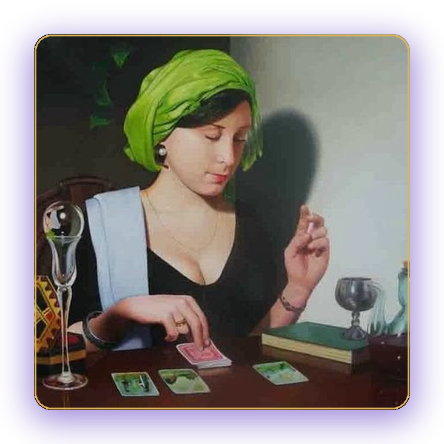
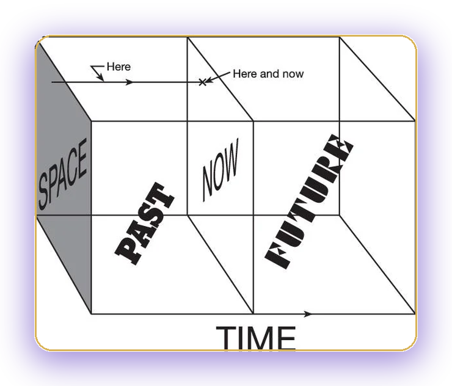
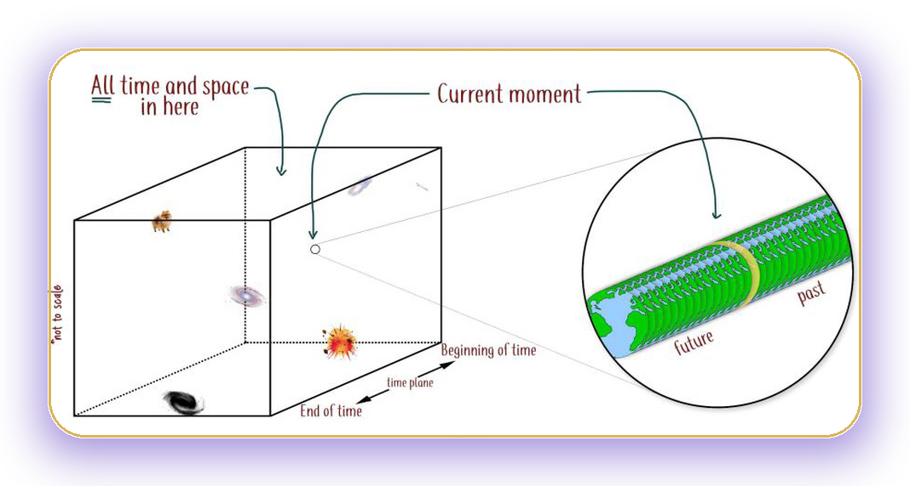
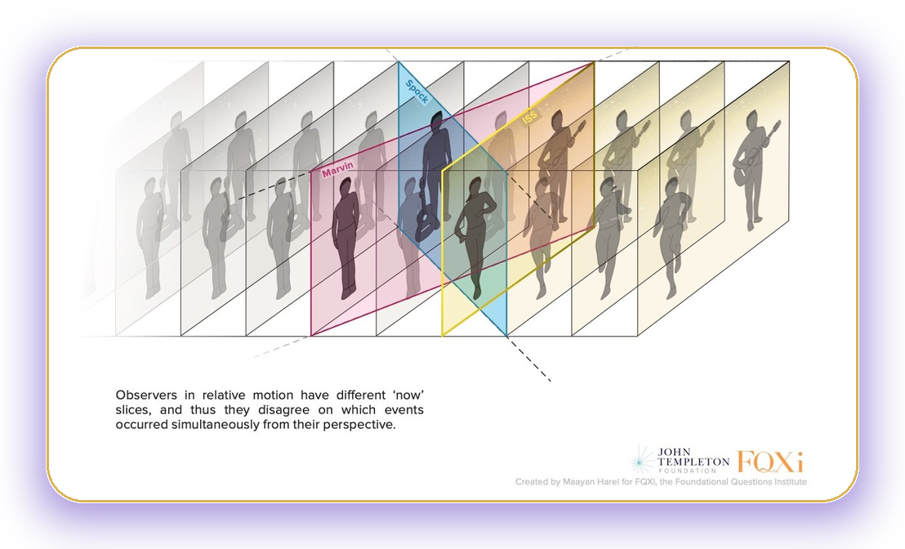
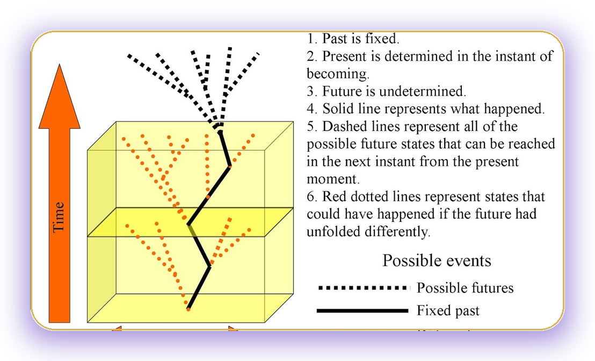
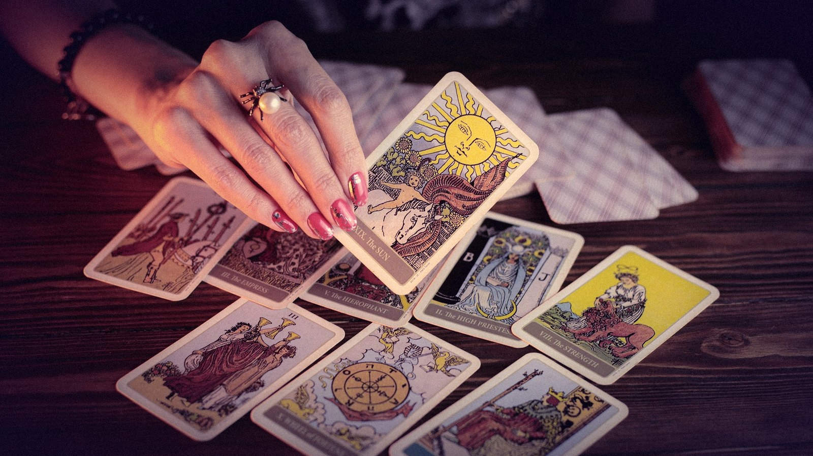
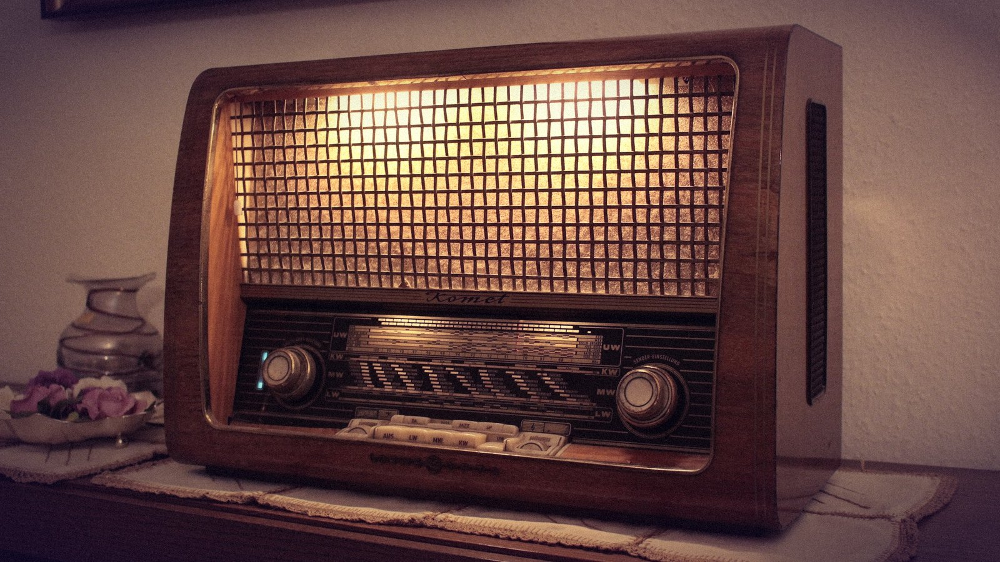
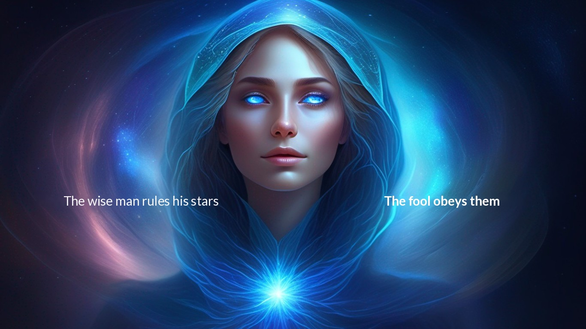

There is one question that haunts us all: **“Are the cards always right?”**

And I'll confess – it haunts me too. Partly because the answer is crystal clear to me, and yet it isn't.

Let's see why.

As an experienced reader, I know beyond doubt that the cards ALWAYS show something. The reader's work is to discover WHAT.

*The answer is far more intricate than it first appears. In this article we will only skim the surface, touching on a few key points. A fuller exploration awaits in my book “Tarot Prisms”, once it is published – hopefully in 2027.*

The magic of tarot divination is rooted in the depths of quantum physics, the science of timelines, the exercise of free will and the manipulation of the astral planes. Let us unravel the question point by point. To say whether tarot is always right, we need to understand how all of this works – from the quantum field to consciousness itself. Because the cards are not outside us; they are WITHIN us. They simply mirror frames from the stream through which our consciousness is at once passing and immersing itself.

What exactly are we capturing when we draw a card? Where does the information come from? Do the cards show the future – or do they reflect a particular potential our consciousness is already moving through?

**In truth, the cards are us.**

Our consciousness dips into a particular energy-information matrix and absorbs the picture from there (be it the Ether, the Astral or something else...). Imagine your consciousness as a radio receiver picking up different stations. The frequencies shift with location, and at times there may be interference – accidental or not so accidental – that breaks up the signal.

Let us look at a few core principles.

## 1. The focal point – what do the cards actually reflect?

So, in short: YES, the cards are ALWAYS right.

The question is – about WHAT.

The cards reflect a certain picture of reality, but that picture may not be yours, or may not be accurate. It may also be shifting constantly. All of this is rooted in the way time works as a loop: we are always standing at the point of NOW, creating both past and future from it through feedback loops.

**It is vital for a tarot reader to have a well-trained FOCUS!**

Centring yourself and holding your focus are the only ways to be sure you are in command of the chaos that a clairvoyant reading channel truly is.

Focus is the instrument that assures you your Consciousness is your own – that you are the medium, and not, say, some demon speaking through you as its host. Sadly – and I say this with genuine regret, but it is a fact – a great many people who present themselves as tarot readers are possessed by demons. That phenomenon deserves an article of its own.

The importance of the focal point stems from the way I see time: not as a linear sequence of past, present and future, but as a far more complex structure in which different time states are interwoven. Demons are beings that can naturally leap across such non-linear points – which is why it is so important to learn to avoid them, and the way to do so is through FOCUS.

Let us begin with this: when you draw a tarot card, it “seals” or mirrors what your consciousness is passing through AT THAT MOMENT. It is your mental, emotional and spiritual focus – your inner picture – in that instant. Any wavering shows up in the cards immediately. They are not a static phenomenon sitting outside your consciousness, waiting to be chosen. In a sense, they ARE YOUR CONSCIOUSNESS. Your consciousness explores itself through these images.

This inevitably brings you face to face with a few inner “demons”, too – the ones that would like you to project a certain negative reality in order to feed on it.

When you choose a card, your consciousness is already passing through a particular frame of reality, and so the card reflects exactly that momentary FOCUS. That is why the focal point matters so much. When working with tarot, it is essential to learn to “gather” your thoughts rather than scatter them, and to remove every distraction, inner or outer.

If, at the moment of reading, your mind is wavering between several different scenarios, this can colour the interpretation of the cards as well.

**Any energetic disturbance, sensation (astral) or stray thought (remember that we think in images) is reflected instantly in the cards you draw.**

Say you ask about the course of a relationship, while at the same time longing for closeness, fearing rejection and expecting a break-up. You are not observing one clearly defined inner position, but several competing focal points.

That is precisely why the same reading can sometimes be so hard to interpret (I explore how to tell intuition from fear in [“Intuition or Fear?”](/en/blog/intuition-or-fear)).

**The clearer the focal point, the clearer the information we are trying to read.**

For this reason it is often – and wrongly – said that only someone else can read tarot for you. That is not true. Every reader must read for themselves and learn to cultivate their own Inner point. More on this in the upcoming article “Can we read tarot for ourselves?” in the [Tarot section](/en/blog/categories/taro), and on the small ritual that gathers your focus before a spread in [“A Few Quick Tips for Effective Tarot Readings”](/en/blog/tips-for-effective-tarot-readings).

## 2. The quantum block universe – does the future exist before we live it?

Here we enter one of the most fascinating ideas about the nature of time.

In physics and philosophy there is a model known as the Block Universe.

**Time is not static – past, present and future exist all at once.**

**The illusion of time's flow** comes from our consciousness “passing through” an already existing block structure.

**We are simply living one particular trajectory** through this space-time.

According to the philosophical position called [eternalism](https://en.wikipedia.org/wiki/Eternalism_(philosophy_of_time)), past, present and future share the same ontological status. They are parts of a single four-dimensional structure of space-time.

In this model, time is not necessarily something that flows and creates new moments. Rather, our consciousness experiences, one after another, different positions within the space-time structure.

Picture a strip of film.

Every frame is already there, yet you see only one frame at a time. The sequence of perception creates the sense of movement and development.

Illustration: <a href="https://fqxi.org/">FQXi – Foundational Questions Institute</a>

It is a fitting metaphor for how we might imagine time in the context of tarot.

If different time states exist as parts of a larger structure, an intriguing question arises: could our consciousness receive information about events it has not yet lived through?

In my conception, tarot is one of the tools through which we can explore such information.

The cards need not create the future. They may reflect certain of its potential configurations.

This does not mean, however, that physics has proven any such mechanism of divination. The block universe is a philosophical interpretation of time that offers us an interesting model for a metaphysical exploration of tarot.

## 3. Quantum uncertainty – why is the future not always fixed?

Here we must distinguish two things: the existence of potential timelines, and their realisation.

Tarot cards, for their part, work as a tool for **gathering information** from the “quantum field” of possibilities. These possibilities are not fully determined; they are like probability states that may materialise depending on a person's actions and conscious intentions.

In quantum physics there is a principle known as **“quantum uncertainty”** – [Heisenberg's uncertainty principle](https://en.wikipedia.org/wiki/Uncertainty_principle). It holds that we cannot predict a particle's behaviour with absolute precision – its position and momentum always remain somewhat undetermined. This is not a limitation of our instruments, but a fundamental property of reality itself.

If we carry this principle into the world of divination, we might say that **the cards, too, reflect potential possibilities rather than fixed outcomes**. They are not a mathematical formula that always returns the same answer. Instead, they reveal **probabilities** that depend on many factors – including our actions, our intentions and even our energetic state at the moment of drawing.

Here tarot takes on an entirely different meaning.

Instead of seeing it as a tool that must pronounce a single outcome, we can use it to explore the likely configurations of the future.

The cards show a certain scenario, but that scenario exists amid many variables. Our decisions, the behaviour of others involved, outside circumstances and our momentary focus can all alter the course of events.

So a prediction need not come true exactly as we interpreted it. It may have been accurate for a particular configuration of potentials – and then the conditions changed.

## 4. Branching universes – many possible scenarios

Here we can bring in the interpretation of quantum mechanics known as the [Many-Worlds Interpretation](https://en.wikipedia.org/wiki/Many-worlds_interpretation), associated with Hugh Everett.

According to this model, the different possible outcomes of quantum processes are realised in different branches of the universal quantum structure. Every quantum event can create a **branching** – many parallel timelines.

The block universe, then, is **not one whole and fixed**, but **a multitude of branching block universes**.

And so the future is not fully fixed: **different potentials exist as possibilities until they are lived**.

This is one interpretation of quantum mechanics, not an accepted proof that parallel timelines exist and are accessible to human consciousness. But as a metaphysical point of departure, the concept is utterly compelling.

Imagine you stand before an important decision. Each option opens a different sequence of events.

In one scenario you accept an offer. In another you turn it down. In a third you postpone the decision, and an entirely different opportunity appears.

These are different storylines we can explore through tarot.

According to many spiritual teachings and contemporary theories of the multiverse, **timelines** are parallel realities existing side by side. Every decision or action we take leads us onto a different timeline, and so changes our future. Cards used for divination can “read” the potential timelines that are most probable at a given moment.

Sometimes they show the most likely scenario under present conditions. At other times they reveal an alternative we have not yet considered.

And here a crucial point emerges: **not every timeline we can observe symbolically is necessarily the timeline we will live.**

## 5. Free will – can we change what was foretold?

Of course.

If we truly want to ;)

And this is where **free will** comes in. We are not slaves to predictions. Every decision we make can change the timeline we are on. If, for instance, the cards foretell a negative outcome, but we recognise the potential mistake and change our behaviour, we can avoid what was predicted. This illustrates the **self-fulfilling prophecy**: if we believe a prediction completely and make no attempt to change it, it may come to pass precisely because of our actions (or inaction).

Here lies one of the great contradictions in the traditional understanding of divination.

If the future can be predicted, does that mean it is already determined? And if it is determined, what is the point of free will?

My answer is that we should not treat a prediction as a final verdict.

When the cards show a certain development, they may be reflecting the direction a situation is heading under present conditions. But conditions can change.

We can change our own behaviour, make a different decision, end a pattern or take an action that opens new possibilities. And so the potential timeline changes, too.

Say the cards show professional stagnation. Instead of accepting it as inescapable fate, we can examine what is causing it, what our part in it is and which actions would shift the situation. Afterwards, the original prediction may no longer hold.

This does not mean the cards were wrong. They may have reflected a real trend that we subsequently changed.

But we must be careful not to use this logic to explain away every unfulfilled prediction. Sometimes the interpretation was simply wrong.

## 6. The astral and potential storylines

In occult thought, the astral dimension holds a special place in the study of timelines.

In various esoteric systems the astral is seen as an intermediate plane between physical reality and all the other layers of existence. It is home to images, thought-forms, energetic structures and many expressions of consciousness.

The astral dimension is a place where time does not exist in the usual sense. There, all potential timelines exist at once as **energetic patterns** or **storylines**. When we read the cards, we are in effect “tuning in” to the astral dimension to draw out information about these potential lines.

Yet not everything that exists in the astral can materialise in our physical world. Some storylines remain mere potentials, because the necessary energetic conditions – or the right actions on our part – are missing. This explains why the cards sometimes “get it wrong”: they show a potential that is never realised.

Not every potential line has what it needs to be realised. Not every possibility reaches the physical plane. And not every piece of information we receive necessarily concerns the future we will live.

This is especially important when we work with predictive spreads.

## 7. Timing – why do the cards not always know when?

One of the hardest tasks in tarot is determining timing. For the simple reason that linear time is an artificial construct. And on top of that, tarot also gathers information from non-linear info-matrices – such as the [collective unconscious](https://en.wikipedia.org/wiki/Collective_unconscious).

We may arrive at a remarkably accurate reading of an event and still be unable to say when it will happen, because in that matrix we see the sequence of events rather than their precise timing. Or, as an acquaintance of mine puts it: the universe does not run on the Gregorian calendar...

There are, however, ways of establishing an event with precision, and they belong to the methodology of [Astral Design](/en/blog/categories/astralen-dizain).

So, if you read tarot for yourself and do not know the astrological systems that can pin down accurate timing, it is important to remember the following.

Sometimes the cards show a development we expect within days, and it unfolds months later. At other times an event that seems distant happens almost at once.

Why?

Because the timeframe of a situation depends on many factors. An event may require certain actions from us, decisions from other people or a change in outside circumstances.

Timing is a key factor in divination. The cards can foretell an event, but **when** exactly it happens depends on a complex interplay of factors. For example, if the cards foretell career success but we fail to take the necessary steps at the right moment, that success may be delayed or even cancelled.

This is also where **higher beings** come in – spirit guides, angels or other conscious energies. They can influence the timing of events, steering us towards the right timeline or giving us signs that help us make the right decision at the right moment.

This, however, is a separate esoteric model, not something we can establish merely because an event has been delayed.

My advice, if you practise tarot as a non-professional, is not to cling too tightly to time predictions. It is often far more important to understand what is unfolding than to know the exact date.

## 8. The self-fulfilling prophecy – when the prediction creates the event

Here we return to one of the most fascinating mechanisms in tarot work.

As we explored in the [previous article](/en/blog/intuition-or-fear), every reading involves an interaction between consciousness and the information received. Sometimes the prediction itself can shape how the situation unfolds.

Suppose the cards show conflict in a relationship.

If we accept that forecast as inevitable, we may unconsciously start looking for signs of the coming conflict – growing more suspicious, reacting more sharply, or changing how we behave towards the other person.

And so the original prediction begins to shape reality.

This is the mechanism known in psychology as the [self-fulfilling prophecy](https://en.wikipedia.org/wiki/Self-fulfilling_prophecy).

From the standpoint of my model, we can also see it as a process in which the information from one reading becomes part of our next energetic and mental focus. In other words, we do not merely observe the potential timeline – we begin to interact with it.

Herein lies one of the dangers of tarot. We must not forget that interpretation can change our behaviour. That is why we should never turn every prediction into absolute truth.

## 9. Interference in the tarot channels – can the information be distorted?

This is a subject rarely discussed, yet it is extremely important.

**There are three main ways your reading can be interfered with – through a distortion of the channel, through an entity, or through a person.**

When someone else reads for us, they inevitably bring their own consciousness, expectations and patterns of interpretation. Their perception may influence how the cards are read. They may project their own fears and limitations onto our situation.

In the wider occult model, we can also consider the hypothesis of outside influences on the information channel itself. This may be read as interference in the process of tuning in to a particular timeline.

Quite often, various entities and beings from other dimensions and realities meddle in readings too – they love to play at destiny policies, or have a very specific agenda for their interference (draining energy, for instance – more about them in [“Archons, Organic Portals and Other Vile Cr(e)atures”](/en/blog/archons)). We touched on this in the Focal point, and on how important it is to hold it so as not to fall into delusion.

Another way a reading can be influenced is through accidental crossing of channels. As I said, human consciousness is like a radio receiver, picking up different stations depending on where it is. Without going into needless detail and physical terminology, I will only note that sometimes our channel is overlaid or broken up – because, for example, we may not be in the right place or reading at the right time.

**Still, it is important to tell a real change in the situation from a change in our perception of it. Not every contradictory spread means outside interference.**

**Sometimes the reason is far simpler: we have changed the question, our focus or our emotional state.**

**That is precisely why personal practice, concentration and the capacity for self-observation matter so much.**

We need to know our own channels of perception, because outside influence is the inevitable agenda of many beings who will want to project the realities they desire.

## 10. Our choices reshuffle the cards

Here we reach the most important part.

If we accept that tarot reflects potential developments rather than an inescapably fixed future, a fascinating question arises: can we do a new reading and get a different result after changing our own behaviour?

Of course we can.

Not because the cards arbitrarily change their answers – but because the situation itself may have changed in the meantime.

Imagine this: you do a reading about a particular professional opportunity. The cards show delay, obstacles and no realisation.

Instead of waiting, you take concrete action. You reach out to new people, change your strategy, find an alternative source of funding.

Some time later, you read again.

The result is different.

**This does not mean the first reading was wrong. It reflected the earlier configuration of the situation. In the meantime you changed the conditions – and with them, the potential outcome.**

In this sense we can say that our choices, and the way a situation develops, reshuffle the cards. I have managed, through awareness and will, to rearrange a situation literally within seconds.

That is exactly why we should not use tarot as a substitute for free will. On the contrary – we should use it to understand where we stand, what possibilities we have and how we can change course. A [tarot journal](/en/blog/how-to-keep-a-tarot-journal) is the perfect exercise for this – only it will show you, in black and white, which lines you have changed.

## So, are the cards always right? My honest assessment

Let me return to the original question.

My answer remains YES – but with one very important qualification.

The cards can be seen as a mirror of a particular configuration of information, potentials and states of consciousness. But that does not mean every interpretation of ours is correct, nor that every event shown must come to pass.

**Sometimes we misread the symbols. Sometimes we have lost our focus. Sometimes a reading mirrors our fears rather than the outer situation. At other times we receive information about a potential timeline that we then change through our own actions. Sometimes the storyline itself shifts... Sometimes there is outside interference which, if we are deft, we manage to thwart. The reasons can be MANY! Tarot is a boundless universe, and its field of exploration is as vast as the consciousness we temporarily inhabit.**

A skilled reader who is also clairvoyant will sense all these possible fluctuations and know where to “reach in” to draw out the information that is needed – and available – at that moment!

It is important to remember that the cards reflect certain information, and it is up to us to read it correctly.

For me, tarot is not merely a system for predicting the future. **It is a tool for engaging with the symbolic layer of reality ([synchromysticism](/en/portal)), for observing potential timelines and for exploring our own part in how they unfold. Tarot is a tool for communicating with many channels of information.**

And perhaps the most important thing to understand is that we are not passive observers of our own fate.

We take part in creating it.

**The cards can show you where you are heading. But that does not mean you are bound to keep going in the same direction.**

**The choice, in the end, is yours. Whether you realise it or not.**

## Frequently asked questions

Are the cards always right?

The cards always reflect something – the question is what. Sometimes they show your momentary focus, sometimes a potential timeline you later change, and sometimes the interpretation was off, or the channel disturbed.

Why didn't the cards' prediction come true?

Because the cards show probabilities, not verdicts. Conditions may have changed – through your decisions or other people's actions – the storyline may have remained a mere potential, or the reading may have been coloured by fear, lost focus or outside interference.

Can tarot show exactly when something will happen?

Rarely with precision, because the cards capture the sequence of events more than their calendar date. For accurate timing, tarot is combined with astrological methods – I write about them in the [Astral Design](/en/blog/categories/astralen-dizain) section.

