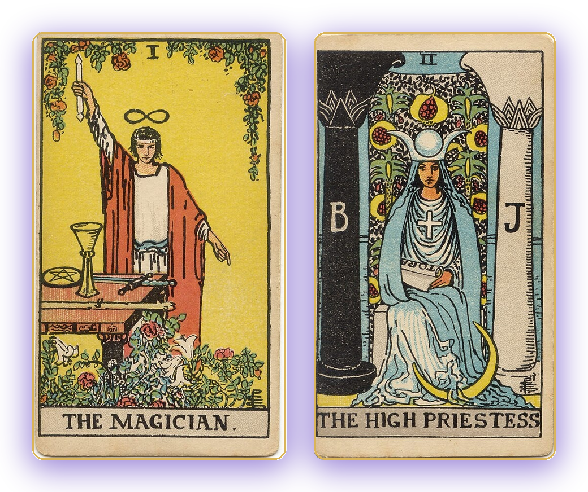
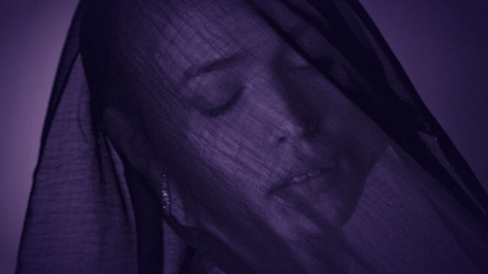
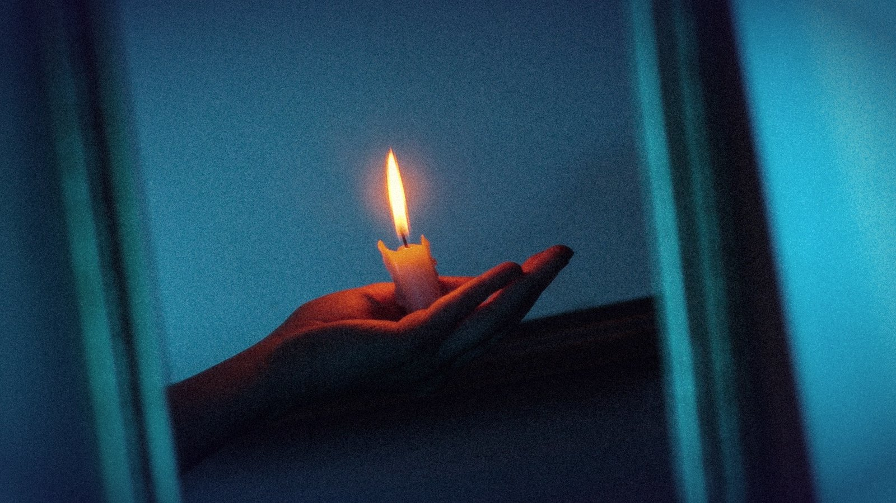
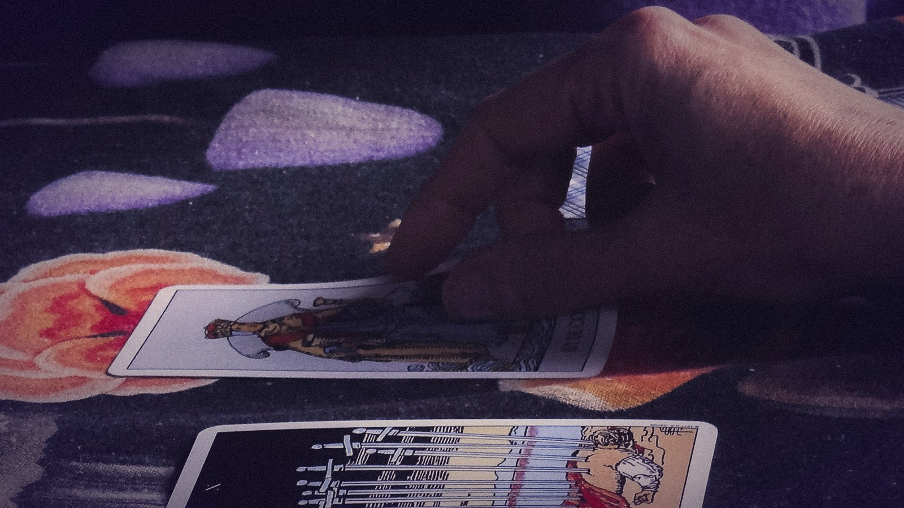
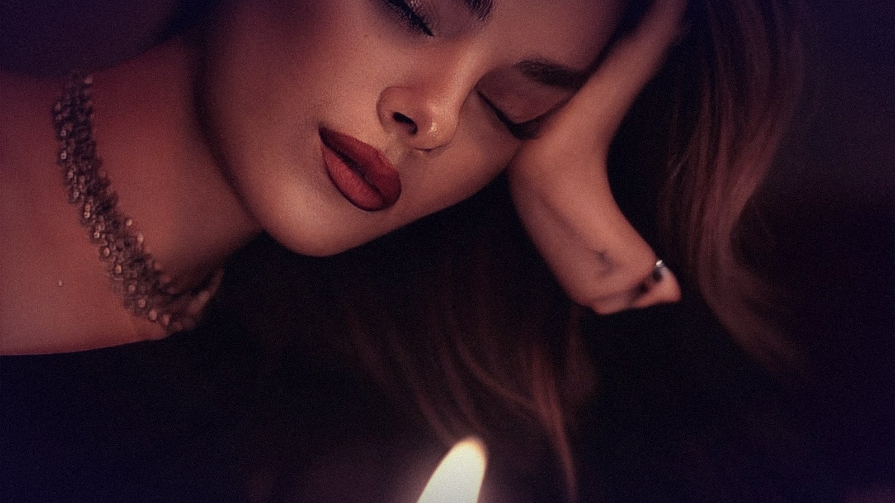

This is a question on which I hold a very clear position – and today I want to share it with you.

One of the questions asked most often by students of tarot is how far we should trust our intuition. Is it enough to know the meanings of the cards, or must we develop the ability to sense their message beyond the traditional interpretations?

The answer is clear: intuition is one of the most important elements of tarot work. In fact, it is precisely what gradually turns a mechanical reading of symbols into a living dialogue with the archetypal language of the system.

Books can teach us what the Empress symbolises, what the Magician's astrological correspondences are, or how to interpret the Seven of Swords. But they cannot hand us a ready answer for how these symbols interact in a particular situation, nor for the connections we might discover between them. Every single card – to say nothing of the countless possible combinations – holds thousands of possible readings. We are wading into the chaos of an ocean of information.

And that is the space where intuition begins to work.

For me, tarot is not a system to be learned by heart. It is a system with which we must build a particular kind of relationship. And for that we need to develop the ability to take in information not only through the intellect, but through the subtler mechanisms of consciousness.

## 1. Intuition as a way of perceiving symbolic information

First, we must distinguish intuition from a mere guess.

We often use the word “intuition” for any spontaneous feeling that arises in the mind. But not every such feeling is intuitive knowledge. Sometimes it is the product of fear, desire, prior conviction or an unconscious association (I explore the difference in detail in [“Intuition or Fear?”](/en/blog/intuition-or-fear)).

In the context of tarot, I would describe intuition as the ability to perceive connections and meanings that are not immediately obvious on a conscious, logical level.

We might, for example, draw three cards whose traditional meanings seem unrelated. Yet when we look at them together, the combination may spontaneously spark a particular association, image or understanding of the situation.

Sometimes that association comes closer to the heart of the question than any mechanical application of textbook meanings.

This does not mean we should neglect traditional symbolism. Quite the opposite. The better we know the system, the more material intuition has to work with.

**Intuition and knowledge of the symbols are not opposites. They complete each other.**

## 2. Intuition and the archetypal language of tarot

One reason tarot allows for so many levels of interpretation is its [archetypal](https://en.wikipedia.org/wiki/Jungian_archetypes) structure.

The Major Arcana, for instance, portray universal principles and patterns of human experience – creation, knowledge, power, transformation, destruction, sacrifice, transition and completion.

These symbols are never exhausted by a single meaning.

Depending on the context, the Magician may stand for creative will, the power to manifest, the handling of resources, or the interplay between different planes of reality.

The High Priestess may be linked to intuitive knowledge, hidden information, inner observation, or access to content that has not yet surfaced into conscious expression.

As we work more deeply with the archetypes, we gradually stop seeing the cards as separate pictures. We begin to recognise the principles that stand behind them. (How a card shifts its meaning with the prism through which we read it, I show in detail in the article on [The World](/en/blog/the-world-tarot-card).)

This is exactly where intuition comes into its own.

It lets us move from the literal image to its symbolic content, and discover its different expressions in the context at hand.

## 3. Intuition as a bridge between the conscious and the unconscious

From a psychological point of view, intuitive perception can be seen as a process in which the brain processes information and [recognises patterns](https://en.wikipedia.org/wiki/Recognition-primed_decision) without these necessarily reaching our awareness as step-by-step logical conclusions.

In Jungian psychology, intuition is one of the [four basic psychological functions](https://en.wikipedia.org/wiki/Psychological_Types), alongside thinking, feeling and sensation.

Jung regarded it as the function through which we perceive possibilities, relationships and potential developments that are not directly available to the senses.

This is an interesting point of departure for tarot work.

When we observe a particular combination of cards, we may set in motion associative processes that link the symbols to knowledge, experiences and unconscious content we already carry.

Sometimes we grasp the whole meaning of a combination before we can explain logically how we got there.

That is one of the ways intuitive knowledge reveals itself.

In an esoteric context, we can also see this process as an interplay between the conscious mind and the deeper layers of the psyche.

The cards provide the symbolic material; intuition takes part in recognising it and weaving it together.

## 4. Intuition and the synchronistic principle

For me, this is one of the most fascinating sides of tarot.

If we look at the system through the prism of [synchromysticism](/en/portal), intuition is not merely the ability to read images. It is also the ability to notice the links between symbols and the events unfolding in our reality.

In a reading we may draw a particular card that later begins to reappear in our daily life in various guises.

It might be a recurring image, a theme in a conversation, a dream, a chance meeting or an event that carries a similar archetypal structure.

What matters is not only noticing the coincidence, but being able to place it in context.

What is the link between the original reading and the later event? What does the symbol have in common with the process we are observing? Is this a real pattern, [selective attention](https://en.wikipedia.org/wiki/Frequency_illusion), or an association we built after the fact?

These are the questions we should be asking.

Carl Gustav Jung's concept of [synchronicity](https://en.wikipedia.org/wiki/Synchronicity) deals precisely with meaningful coincidences between inner psychic states and outer events that cannot easily be explained by ordinary cause and effect.

Tarot offers a rich symbolic setting in which to observe such phenomena. (To see what this looks like in real life, read my [“Experiences in Synchronicity”](/en/portal/synchronistic-experiences-pt-1).)

In this sense, intuition is the ability to recognise meaningful connections before we hold all the information.

## 5. When does intuition turn into projection?

Here we must be especially careful.

As we explored in [“Intuition or Fear?”](/en/blog/intuition-or-fear), whenever we work with tarot we inevitably project part of our momentary state onto the cards.

This means that not every spontaneous feeling should be taken as an intuitive message.

Sometimes fear masquerades as a premonition. Desire poses as inner certainty. A belief formed in advance begins to look like information received from outside.

If, for example, we expect a situation to turn out badly, we may take the first unpleasant association as an intuitive warning.

Yet it may simply be mirroring our own emotional state.

That is why it is important to learn to distinguish between:

- **Intuitive perception** – the spontaneous recognition of a connection or meaning.
- **Psychological [projection](https://en.wikipedia.org/wiki/Psychological_projection)** – transferring our own fears, desires and beliefs onto the symbols.
- **Intellectual interpretation** – the conscious application of what we know about the cards' meanings and correspondences.
- **Prior expectation** – looking for confirmation of an assumption we have already made.

These processes can run side by side. Good practice therefore asks not simply that we trust our first feeling, but that we learn to examine it.

## 6. Can we develop our intuition through tarot?

We certainly can develop a finer ability to read symbols intuitively.

But not through endless card-drawing or mechanical memorisation of meanings.

What we need is an individual practice of observation.

Here are a few practices I find especially helpful:

### One card a day

Draw a card and write down your first impression before checking its meaning. Notice the images, colours, figures and details. What draws you in? What repels you? What is your first association?

At the end of the day, return to the card and see whether you found any links to what you lived through. You can start today with the [tarot card of the day](/en/card-of-the-day).

### Intuitive reading before reference

In every reading, form your own interpretation first. Only then look up the traditional meanings. This way you can tell your personal associations apart from the symbolic foundation of the system (more on the power of first impressions in [“A Few Quick Tips for Effective Tarot Readings”](/en/blog/tips-for-effective-tarot-readings)).

### Working with combinations

Do not stop at individual cards. Draw two or three and try to read their shared story. Be curious about the dynamics between them, not only their separate meanings.

### A synchronicity journal

Record the cards you have drawn and the coincidences you notice afterwards. Do not force connections. Over time you will see which associations prove meaningful – and which come from [over-eager pattern-seeking](https://en.wikipedia.org/wiki/Apophenia). How to set up such a journal, I describe in [“How to Keep a Tarot Journal”](/en/blog/how-to-keep-a-tarot-journal).

### Observing your own state

Before every reading, notice your emotional state. Are you calm, anxious, distracted, or fixed on a particular outcome? This matters, because the momentary imprint of your consciousness shapes how you perceive the cards (I write about the focal point in detail in [“So Now What? Are the Cards Always Right?”](/en/blog/are-the-cards-always-right)).

## 7. Intuition and the Higher Self

From an esoteric point of view, we can also see intuition as a possible way of reaching deeper levels of consciousness.

In various occult traditions, intuitive knowledge is linked with inner sight, spiritual discernment and the capacity to perceive information beyond the limits of ordinary rational thought.

In some systems this is associated with the Higher Self, in others with the spiritual heart, the [buddhic](https://en.wikipedia.org/wiki/Buddhi) plane or certain aspects of higher consciousness.

In the context of tarot, we can see this possibility as an interplay between the symbolic language of the cards and the deeper layers of our own consciousness.

I would not automatically accept every intuitive feeling as a message from the Higher Self. It is important to keep our capacity for discernment.

But I do believe that it is precisely through systematic work with the symbols that we can develop a finer sensitivity to our own inner processes.

This matters especially when we read for ourselves, because we gradually build our own language of dialogue with the system.

## Conclusion: intuition is the bridge between the symbol and its meaning

We can learn all 78 cards, study their astrological, kabbalistic and numerological correspondences and memorise hundreds of combinations.

But that still does not mean we know how to work with tarot.

True mastery comes when we begin to recognise the symbols as parts of a single whole and develop the ability to perceive their meanings in the context at hand.

Intuition matters precisely because it lets us move beyond mechanical knowledge. It connects the separate symbols, sets associative processes in motion and helps us discover relationships that are not immediately visible.

Yet it must be cultivated together with self-observation and the capacity for critical interpretation.

For me, tarot is not simply a system we read, but a language we gradually learn to converse in.

And the better we know our own consciousness, the better we can understand the symbols through which we explore reality.

**Because intuition does not replace knowledge of tarot. It is what brings that knowledge to life.**

## Frequently asked questions

Can you read tarot by intuition alone, without knowing the meanings?

You can begin that way, but intuition works best on solid ground. The better you know the symbolism, the more material your intuition has to build connections with.

How can I tell whether an impression is intuition or projection?

Ask yourself what you expected before you drew the card. If the impression merely confirms a fear or a wish, it is probably projection. Write your impressions down and test them over time.

How can I develop my intuition with tarot?

Through one card a day, forming your own interpretation before you check the book, working with card combinations, keeping a synchronicity journal and observing your own state before every reading.

