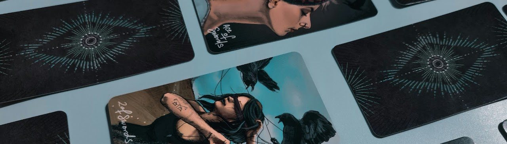
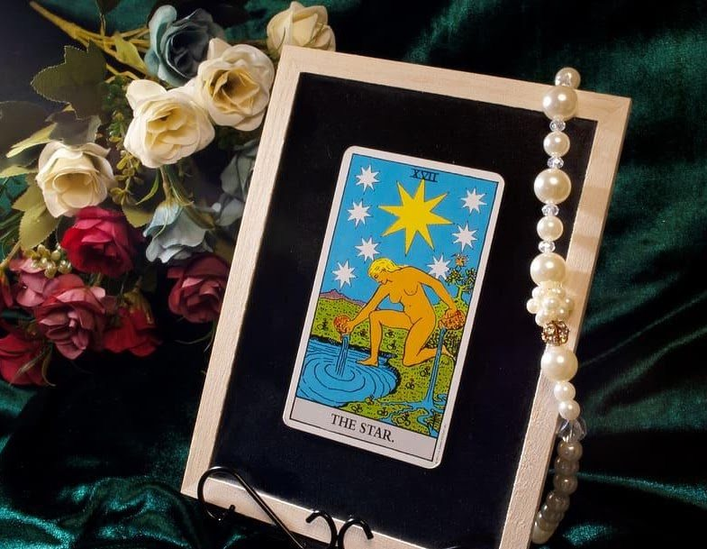

Tarot cards are not just a divination tool – they are a powerful method of self-reflection, personal growth and connection with the Higher Self through intuition. One of the most effective ways to deepen your understanding of the cards and track how your spiritual practice evolves is **keeping a tarot journal**.

If you are **serious** about learning Tarot, a journal is one of the most valuable things you can do for yourself. It is your personal intuitive partner, helping you understand the cards, yourself and the energies you work with.

I started keeping a journal years ago, almost by accident, and it became one of the most powerful tools in my practice. In this article I'll tell you why a tarot journal matters and how, step by step, to make it truly useful and inspiring – so that it helps you grow both in your practice and in your personal life.

## What is a tarot journal?

A tarot journal is a notebook, file or app where you record every spread you do: the date, the question, the cards you drew, your interpretation and – later – what actually happened. Over time it becomes your own **tarot dictionary**, an archive of your readings and a chronicle of your path.

## Why keep a tarot journal: 5 benefits

Before we get to the "how", it's important to understand the "why".

1. **A deeper understanding of the cards**

   This is an extremely effective way to learn. When you write down your interpretations and observations, you build a deeper relationship with the symbolism and meaning of every card. The journal becomes your personal tarot dictionary and encyclopaedia, and shows how the cards work **for you** and which synchronicities and meanings they lead you to.

2. **Tracking your personal growth – and your memory**

   The journal lets you see how you develop over time – in your practice and in your life. It reminds you of old readings and unfinished business. Many beginners think tarot is only for fleeting readings. Not at all. This is exactly where you can do shadow work and follow your progress over the years – how the layers of meaning in the cards, and even the colours themselves, shift after every leap in consciousness, and how that leads to particular chains of cause and effect. It will also remind you of important readings you'd forgotten. That one will be a real WOW moment for you.

3. **Developing your intuition**

   When you regularly write down your feelings and impressions of the cards, you train your intuition and sharpen it. If you doubted an interpretation, you can come back to it months later, check whether your hunch was right and build more confidence in your own abilities.

4. **Spotting recurring cards**

   Certain cards or archetypes often show up again and again. The journal helps you notice these patterns and read them in the context of your life. That way the big picture comes together far better than if you relied on memory – because, trust me, you forget a crazy amount :) Personally, I put coloured sticky tabs on the pages and mark different themes and recurring cards with different colours. It definitely clicks when you see that 70% of your tabs are green :))) The Three of Cups that many times? The Universe is trying to tell me something ;)

5. **Checking whether your readings really work**

   For me this is the most useful thing a tarot journal does. There is no stronger feeling of illumination than seeing how things unfolded a year later – and realising the cards were actually spot on, but your vision and interpretation back then were more limited, and you couldn't even have imagined some of the events. That is exactly how real experience builds up and how you learn the new, true meanings of the cards. Sadly, it's also how I realised how far our fate is fixed by decisions made long ago... Turning the Wheel of Fortune really is hard. That's why keeping a tarot journal is essential from the very start of your tarot journey.

## How to keep a tarot journal, step by step

1. **Choose the right medium**

   The whole point of a tarot journal is that it lasts – for years, even decades. It doesn't matter whether you prefer a classic handwritten journal, a digital document or a notes app. What matters is that it's comfortable and inspires you. I personally love handwritten journals, because writing helps me focus and activates certain parts of the brain. I also love the craft side of it – there's a special magic in that. If you're more inventive, you can even make yourself a tarot grimoire.

2. **Write down the date and the question**

   Every entry should include the date and the question (or theme) of the spread. It's a good idea to note the day's astrological transits too, as they may affect the reading. The date is key – please don't forget it. It happens even to me :)

3. **Describe the cards and your first impressions**

   Write down which cards came up and what your first impression was. Don't worry about being subjective – this is your private space. And it's fine if you write nothing on the day of the reading: you can come back to it when you feel ready and inspired. I've analysed a spread for months and only reached the final answer about a year later. There's always something new to see.

4. **Add your interpretations**

   Describe how you understand the cards in the context of the question. Include the emotions you feel, the associations that come to mind, your synchronicities and mystical meanings.

5. **Note the connections between the cards**

   Pay attention to how the cards interact. Is there a common theme? Any contradictions? Track the numbers, colours and figures, and write down the astrological and I Ching correspondences of the cards. These observations are key to a deeper understanding.

6. **Come back and review your journal**

   **The most important thing of all – this is why you keep a journal.** Review your old notes regularly. You'll see how you've grown, how the cards predicted certain events and how your interpretations have changed over time.

## Paper or digital tarot journal?

Both have their advantages:

- **A paper journal** strengthens focus and intuition, and writing by hand is a ritual in itself.
- **A digital journal** is extremely convenient: you carry it everywhere, you can use notes and hashtags to track synchronicities and recurring cards, search by date, and upload a photo of the spread directly. It saves time and makes reviewing easier.

If you can, print your digital journal and turn it into a physical one too. If you're a serious researcher, you'll combine both approaches.

## What to write down after every spread

Here is a short template you can copy into your journal:

- ✔️ date and time of the reading (and the day's transits);
- ✔️ the question or theme;
- ✔️ the cards drawn and their positions in the spread;
- ✔️ your first impression;
- ✔️ your interpretation;
- ✔️ **later:** what decision you made and how things turned out, plus any new insights.

## Original ideas for your tarot journal 💡

1. **Add visual elements**

   If you love drawing or making collages, sketch the cards, add colour or stick in pictures that remind you of their messages.

2. **Create your own tarot dictionary**

   Set aside a few pages for each card and record your personal interpretations, emotions and associations. I also note interesting and original meanings from the guidebooks of different decks, and as they pile up, the picture becomes much more colourful and multi-layered. A good idea is to get a bigger notebook and split it in two – one half entirely a dictionary of meanings and associations.

3. **Track your energy states**

   Write down how you feel before and after the spread, whether you were in high or low vibrations and what you'd been doing. A very clever trick is to combine your tarot journal with your [dream book](/en/sonovnik): draw a card for the day and one for the night, and record your dreams and experiences.

4. **Create a "predictions vs reality" section**

   If you do spreads about the future, compare the predictions with what actually happened. It's a great way to learn from your mistakes. Without it, there's really no way to learn tarot properly.

You'll find more practical advice in the article ["A Few Quick Tips for Effective Tarot Readings"](/en/blog/tips-for-effective-tarot-readings).

## Frequently asked questions

How often should I write in my tarot journal?

After every spread, even if it's just one card for the day. Regularity matters more than volume.

Should I also record readings for other people?

Yes, but only with their permission and without personal details. These entries build experience fast and show how the cards work for different people.

Can I start a journal if I'm a beginner?

That's the best time. The sooner you start, the more valuable your archive will be a year from now.

## A few last words...

Keeping a tarot journal isn't just a practice – it's a **metaphysical process** of exploration and **creating reality**. It will help you trace your path, develop your intuition and build a unique bond with the cards. It may even help you manifest what you want – I'll let you in on that secret another time ;) Don't be afraid to experiment and make your journal truly your own – it's a reflection of your personal spiritual and/or witchy path.

In the end, it will also become **your autobiography**.

So grab a notebook, pick up your deck and start writing today! Who knows – maybe in a few months you'll come back to your first notes and be amazed at how far you've come :)

If you'd like us to look at your spread together, see [readings](/en/consult).
