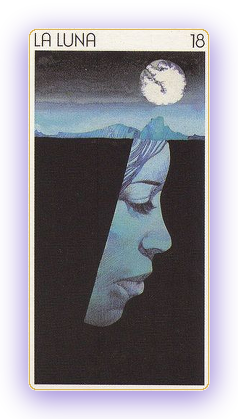
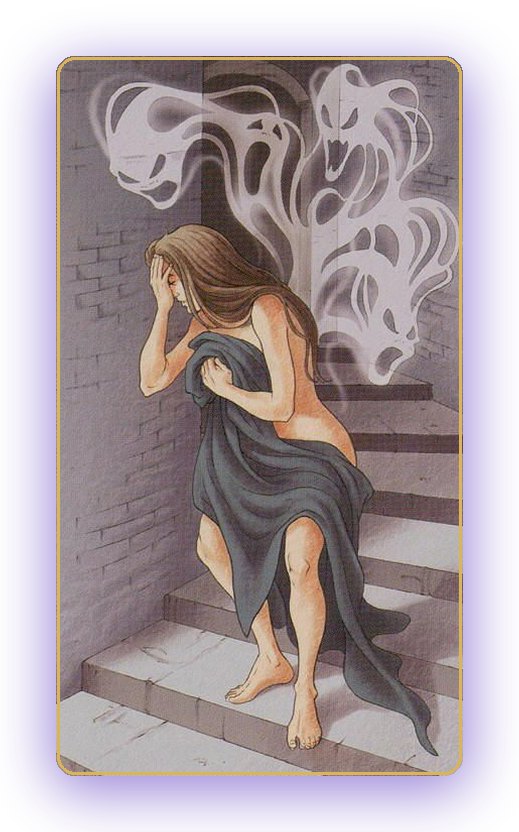
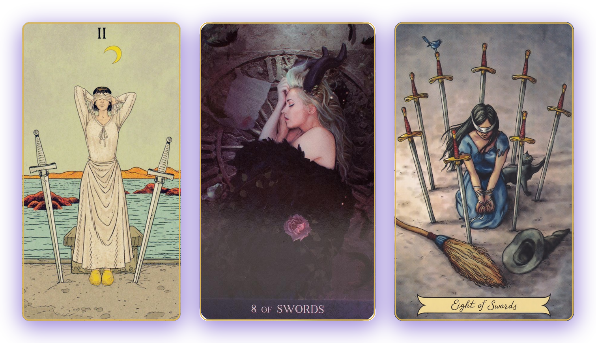
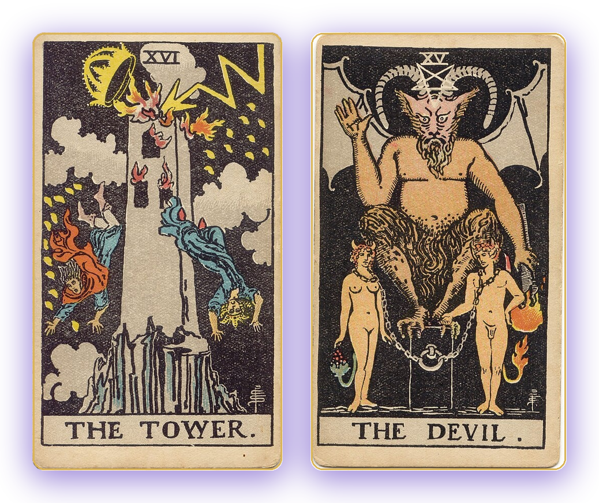
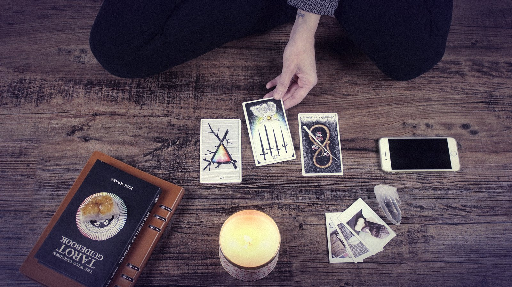
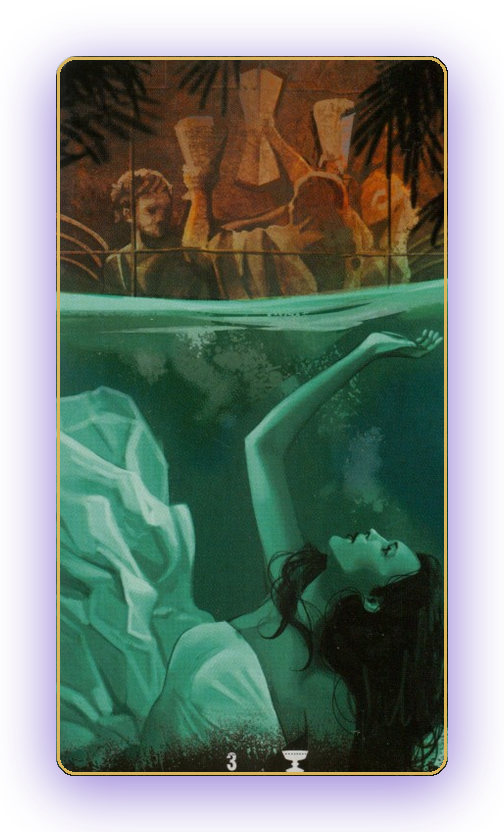

It is a question you ask me often – and one I ask myself in almost every reading. So today I want to talk about one of the finest lines in tarot work: the line between intuition and fear.

One of the greatest challenges in tarot is learning to tell intuitive perception apart from our own psychological projections. At first glance it seems simple: intuition whispers one thing, fear another. In practice, the border between them is often blurred.

Especially when we ask a question charged with emotion, the mind is already interpreting before we have turned the first card. We carry expectations, wishes, suspicions, scenarios built in advance. Sometimes we do not even realise how tightly we cling to a particular answer.

And so an essential question arises: **when we sense something, how do we know it comes from intuition – and not from the fear we are trying to confirm?**

## Intuition is not the same as an emotional reaction

We often use the word “intuition” for any strong inner feeling. Yet the intensity of an experience is no proof of its truth.

We may feel an overwhelming premonition that is really the product of anxiety, insecurity or pent-up expectation. Equally, we may have a quiet, barely perceptible sense that later proves far more important to understanding the situation.

Psychologically, intuition can be seen as a form of [rapid pattern recognition](https://en.wikipedia.org/wiki/Recognition-primed_decision) – the brain processes information without the process necessarily reaching conscious attention. That is why we sometimes know something is wrong without being able to say why.

In the esoteric tradition, however, intuition runs deeper. It is regarded as the capacity to perceive beyond ordinary linear analysis – through symbols, archetypes, inner knowing and immediate recognition.

Personally, I believe it matters not to conflate these two perspectives – but not necessarily to set them against each other either. The psychological view helps us understand the mechanics of perception; the esoteric model offers another way of making sense of the experience.

Either way, the need remains to test our own perceptions.

## Fear seeks confirmation; intuition seeks observation

One of the most useful differences between intuition and fear lies in how each of them handles information.

Fear usually [seeks confirmation](https://en.wikipedia.org/wiki/Confirmation_bias) of a hypothesis it already holds. If we fear being abandoned, we may begin to read every gesture of the other person as proof of their drifting away. If we fear failure, even neutral circumstances can start to look like warnings.

Fear narrows the field. It picks a single scenario, fixes our attention upon it and gradually filters all incoming information through its own lens.

Intuitive perception, at least in its ideal form, does not demand confirmation. It allows for observation, waiting and correction. There is no need to turn a feeling into a conclusion at once, or to act on it straight away.

This does not mean intuition is always calm, or that fear is always loud. Real danger can provoke a powerful reaction, and anxiety can show itself as a quiet, persistent doubt.

So I would not use emotional state as the only yardstick. What matters more is to notice what a feeling does to our perception.

**Does it allow us to see more – or does it make us see only what we fear?**

## Projection – when we see our own material in the cards

In psychology, [projection](https://en.wikipedia.org/wiki/Psychological_projection) is the mechanism by which we attribute to the outer world material that springs from our own psyche: a wish, a fear, a suspicion, a repressed feeling or a disowned part of ourselves.

In tarot this mechanism is particularly fascinating, because the cards form a symbolic system with many possible meanings. Their images can awaken quite different associations depending on a person's experience, emotional state and inner conflicts.

The Tower, for instance, may be read as destruction, liberation, sudden realisation or the breaking of an outworn pattern. If someone already fears losing their job, they may reach automatically for the most threatening reading. Yet the Tower could just as well signal a breakthrough – an insight that moves them to tear down the old routine and leave of their own accord, or simply to change the way they see things. A tendency towards fatalism and negativity in tarot is, sadly, all too common.

A reading can be coloured by a suggestion already lodged in the querent's mind.

And here lies a curious paradox: sometimes the cards really are showing us something important, yet we fail to recognise it, because our own fears dictate how we read it.

That is why I believe tarot work demands not only a knowledge of symbolism, but a serious measure of **self-observation and self-refinement**. We need to know our own psychological mechanisms in order to tell the information we perceive from the meanings we add to it ourselves.

## Archetypes and the subconscious – why do the cards stir such strong reactions?

Tarot can be seen as a system of archetypal images portraying universal human experiences: loss, transformation, power, dependence, choice, maturation, liberation and the closing of a cycle.

In Carl Gustav Jung's analytical psychology, archetypes are fundamental structures of the [collective unconscious](https://en.wikipedia.org/wiki/Collective_unconscious). They are not ready-made symbols, but patterns through which the psyche organises and expresses certain experiences.

From this perspective, tarot can serve as a kind of projective system. The cards offer symbolic material through which the mind can recognise and bring to the surface content that would otherwise remain hard to reach.

But there is one important detail.

When we draw a card that strikes us deeply, it does not automatically foretell a particular event. It may have stirred an inner conflict, a memory or a fear that is asking to be seen.

The Devil, for instance, may draw our attention to dependence, attachment or a loss of personal autonomy. Yet before we conclude that someone out there is manipulating us, it is worth checking whether the card describes our own stance towards the situation.

**Sometimes the most important information in a reading is not what the other person will do, but what is happening within us.**

## Synchronicity and the question of inner knowing

In the esoteric context, intuition is often linked with [synchronicity](https://en.wikipedia.org/wiki/Synchronicity).

When we ask a question and draw certain cards, we may perceive the combination as a symbolic mirror of the situation we are exploring. Within the [synchromystic model](/en/portal), this can be seen as an interplay between the observer's inner state and the symbolic language of the Matrix.

But here a distinction must be made.

Not every coincidence is a message. Not every card that seems uncannily accurate is proof of outside intervention or a pre-written script.

Synchronicity gains meaning through context, repetition and its link to lived experience. That is precisely why we should observe events over time rather than build a whole theory around a single sign (if you are curious what this looks like in practice, see my [“Experiences in Synchronicity”](/en/portal/synchronistic-experiences-pt-1)).

The observer's intuition plays an enormous role here, together with their trained capacity for pattern recognition: when does a sign lead us to an intuitive message from the Higher Self, and when is it simply a projection of our own subconscious?

A card may point us towards something we had already sensed but never managed to put into words. Equally, our own expectations may lead us to find a connection that does not really exist.

Learning to tell these two possibilities apart is part of developing intuitive perception.

## How to recognise your own projections in a tarot reading

There are several practical approaches that can lead to a more objective interpretation.

### 1. Observe your first reaction

When you turn a card, write down the first association that arises. Do not edit it, and do not rush to explain it. Only then turn to the traditional symbolism and the card's other possible meanings.

This lets you trace the difference between your spontaneous perception and your conscious interpretation.

### 2. Ask yourself what you want to see

Before every reading, it helps to establish your own emotional position. Are you hoping for a particular answer? Do you dread a particular card? Do you want the cards to confirm something you have already decided?

This does not invalidate the reading. On the contrary – it shows you the filter through which you are receiving the information.

### 3. Look for an alternative interpretation

If a card seems unequivocally negative, try exploring its other possible meanings. Not to talk yourself into a more pleasant scenario, but to avoid the automatic conclusion. The same card shifts its meaning with the question and the prism through which we read it – I show this in detail in my article on [The World](/en/blog/the-world-tarot-card).

### 4. Do not ask the same question over and over

Repeating a reading until you get the answer you want usually deepens the confusion. It can heighten anxiety and create an illusion of consistency between interpretations that are really the products of passing states of mind.

There is a difference between repeating a question and asking it from different angles – the latter is the “cross-examination” technique I describe in [“A Few Quick Tips for Effective Tarot Readings”](/en/blog/tips-for-effective-tarot-readings).

### 5. Test your interpretations over time

[Keeping a tarot journal](/en/blog/how-to-keep-a-tarot-journal) is one of the best ways to develop more reliable judgement. Record the question, the cards, your first impression and how the situation unfolded.

This allows you to see which of your intuitive readings prove helpful – and which more often reflect fears or prior expectations.

## Intuition and the Higher Self

From the esoteric perspective, intuition is often seen as a channel for receiving information from a higher level of consciousness, which we usually call the Higher Self.

This model holds that human consciousness is not exhausted by rational thought and the ordinary mechanisms of perception. The Higher Self is a wider vantage point from which the individual personality can receive guidance for its own growth and choices.

But there is a catch: **not every inner feeling is a message from the Higher Self.**

If we take every thought, impulse or hunch for spiritual information, we risk turning our own wishes and fears into absolute truths.

To my mind, genuine work with intuition demands the very opposite – cultivating the ability to question our own perceptions without necessarily dismissing them.

In this sense tarot can be a valuable tool for building a bridge to the deeper layers of consciousness. Not because every card hands us a ready answer from the Higher Self, but because symbolic language lets us explore material that often lies beyond our immediate attention. That is also why, in the [tarot card of the day](/en/card-of-the-day), every message ends with a question for reflection rather than a verdict.

## The most important skill: not identifying with every feeling

For me, developing intuition does not mean starting to believe every inner hunch. It means knowing our own consciousness well enough to recognise the different sources of information.

Fear can be a useful signal when it warns us of a real risk. Desire can show us what truly matters to us. Projection can reveal material we have not yet brought to awareness.

But fear can also be planted by [negative entities](/en/blog/archons), or be the voice of our own subconscious and its dread of the new – and desire can turn out to be an unhealthy obsession. **Duality is part of the Game, and discernment is the most important skill of a soundly developed spirituality.**

Discernment and intuition are ways of processing information and of perceiving, and both can be refined through experience, observation and awareness of our own mental patterns.

Ultimately, tarot is not only a practice of reading symbols. It is also a practice of reading ourselves.

The better we know our own fears, desires and unconscious patterns, the less likely we are to mistake them for the information we are seeking.

**Because one of the greatest challenges in tarot is not understanding what the cards are telling us, but discovering how well we can hear them – without letting our own fears speak in their place.**

## Frequently asked questions

How can I tell whether a feeling is intuition or fear?

Notice what it does to your perception. Fear narrows – it picks one scenario and hunts for evidence. Intuition widens – it allows for observation, waiting and correction without insisting on an instant conclusion.

Is it wise to read tarot for myself when I am very anxious?

You can, but with extra care. Before you draw, name what you hope – and dread – to see. Write down your first impressions and return to the reading once the emotion has settled.

Why shouldn't I ask the same question again and again?

Because repeated readings tend to mirror your passing state of mind rather than bring new information, and they deepen the confusion. If you need clarity, ask from a different angle, or wait for the situation to unfold.

If you'd like us to look at your spread together, see [readings](/en/consult).
