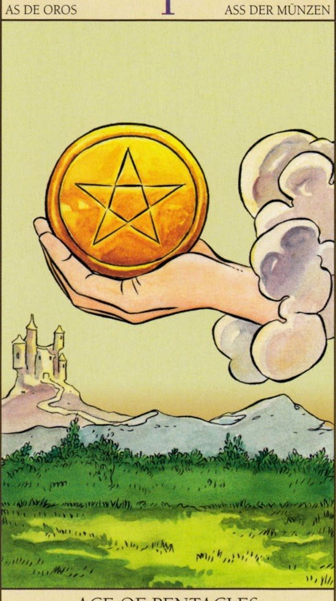
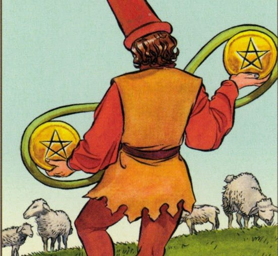
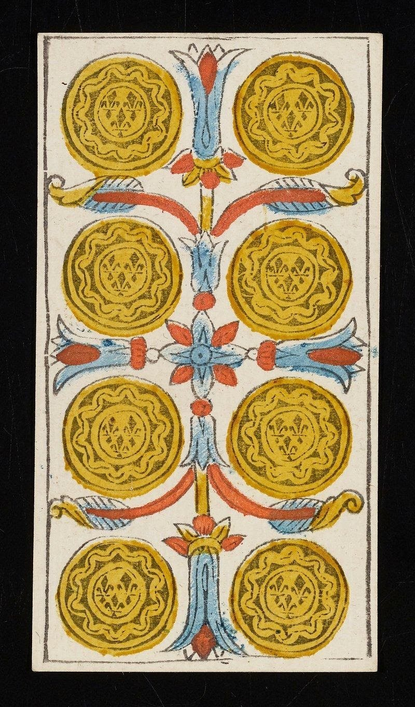

I'm going to present my experience with tarot in love questions in a slightly different light – with a healthy dose of sobering criticism that suits my Capricorn-Sun nature perfectly. When we ask the cards about love, especially about a potential or just-beginning relationship, we're often after a concrete, practical answer, not a fairy tale with its head in the clouds. **The Pentacles** are the ideal ground for that sobering look.

## What do the Pentacles mean in a love reading?

The Pentacles (coins, disks) are the earth suit of Tarot. In a love reading they speak less about emotions and experiences and more about **grounding** the relationship: does the union have a future, is the partner reliable, is the material foundation secure, are we stable enough for something serious. That's why a lot of Pentacles in a spread usually point to a more serious relationship – and to the more sober questions around it.

The sequence from Ace to King can also be read as the process a possible relationship goes through – from the first opportunity to a mature partnership. Here is what each card means.

## The meaning of the Pentacles cards in love

### Ace of Pentacles – opportunity

The Ace of Pentacles clearly shows **opportunity**. The invitation has been made, or will be – the portal of possibility is open. BUT! Someone may be keeping you as an option, waiting to take it up because he thinks you're a very good catch. In the most positive version, luck has fallen into his lap from the sky and he can't miss this chance. He's happy with what he's drawn but doesn't know what to do with it. Often the card shows that the man realises he'll have to take a more traditional approach and offer some material "bait" – he'll offer you something, make a gesture. The other cards will tell you whether that will really happen or whether he'll just keep thinking about it.

The Ace of Pentacles isn't a bad card, but like every ace it's more of an idea than an action. The potential is there and the opportunity is not to be missed, but how things unfold depends on the other cards. It's something you've been waiting for a long time, but other factors will be needed before anyone acts on it.

### Two of Pentacles – hesitation

Like every two, here the person simply doesn't know what to think – weighing things up and calculating. There's a double game... in what, it's not clear (the other cards will show). Don't get your hopes up – he's most likely weighing you against another option. If that's not the case, he's wondering what choices he has from a purely practical point of view and waiting for your reaction, answer or hint before he does anything or starts talking to you. Inaction, hesitation. It can also mean a need for more communication and exchange, for physical contact, before action is taken. Wordplay, practical conversations, whims. He may use a trivial excuse to get in touch.

### Three of Pentacles – conversation

There's a need for conversation and discussion, for clarifying values and positions in the relationship. The two isn't working, or the ideas that came with the ace need clarifying. The key word is **communication** – communicate! As a prediction – he may contact you to clear something up, to move things forward. Conversations are likely, including about where the relationship is going (as, by the way, the Temperance card also shows). The start of a venture, but everything is still fluid and under negotiation. Meetings. He may even take you on a short trip or introduce you to his friends. A third person may also be meddling... Hopefully not his mother… but it could be a friend or an ex/current partner. And as always with threes – careful, you're not alone.

### Four of Pentacles – stability and standstill

Things have now solidified in reality – and stagnated. The person doesn't want to, or can't, budge from the situation and won't do more than is absolutely necessary. If he isn't acting, he doesn't see any practical benefit in it, or he's too closed up in his feelings. The key word is **ambition** – where is it taking him, and does he have any at all? Drive is needed.

The good news is that one of the [Human Design](/en/blog/categories/astralen-dizain) gates that corresponds to this card is called "The Marrying Maiden" and governs exactly finding a solid partner to build something with. This could be your provider... if he decides to be. If he isn't doing anything, he's wondering whether you're the keeper for him and whether you match his ambitions for a home and stability.

The negative side shows emotional unavailability and blockages: the person doesn't want to feel, has walled himself in and protects himself through inaction. Expect coldness. In the positive sense, he wants to keep the status quo because you're very precious to him – he guards you like a treasure. But if he turns into a cheapskate – leave him, he's saving that money to impress someone else ;)

### Five of Pentacles – hardship and lack of care

One of the nasty cards in Tarot. I can't remember a single time it came up for me and showed anything good. Maybe because we really do rarely find someone we'll stay with "for poorer, in sorrow and in hardship, till death do us part". Things may not end here, but they get hard. Arguments about money, resources, agreements. "But you said you'd do one thing, and something else happened…" There was a need for security that wasn't met, and now one of the partners feels bad. In the worst case – a broken heart: "I'm with you as long as I have to be…"

The positive reading is *difficulty at the beginning* – that's the literal name of Gate 3 in Human Design, one of the gates that correspond to this card. The other cards of the same gate are The Hierophant, the Four of Wands and the King of Pentacles, and their shared theme is family and marriage. The man is asking himself: "Can I be the provider for our future family? Am I enough for this woman? Can I give her a home, security, a future?" The relationship needs care that is missing right now. In simpler circumstances, the person just doesn't feel cared for and paid attention to. A lack of loving communication. Or he simply has no money to call you right now… let it go.

### Six of Pentacles – generosity

After the musings of the five comes a positive step forward. Someone has decided to invest in you. Hooray! A generous partner who wants to impress and come across as wealthy and important. He does expect you to appreciate it, though – and to put him on a little pedestal. Expect a gesture, a gift, a signal – and yes, he'll call you.

### Seven of Pentacles – reassessment

Did you appreciate the gesture? Time to reassess the situation: do we go on or not? "As I sowed, so I reaped. How did we get here?" The figure in the classic Rider–Waite–Smith tarot sits wondering what he got wrong and what he could have done better – or, more rarely, enjoys what he has achieved. Quite often things break off at this stage, and the card generally points to **short-lived relationships**. In the positive sense, the seeds are sown and we're waiting to see what will grow – the relationship needs a vision. In the negative – suspicion, distrust, a feeling that someone has misled us. The situation loops until the lesson is learned and the cycle moves on to the eight – infinity.

### Eight of Pentacles – working on the relationship

We've weighed things up and made a decision – either we work on the relationship, or we mind our own business. It may be a relationship that needs a looot of work, or things may be at an early stage. The person is demanding and looks at you under a magnifying glass. In the negative version – empty ambition, vanity; he has plenty of options, so he doesn't seek you out.

Look at the sums of the numbers too: 3 + 5 = 8 – if you don't communicate through the three, the five is waiting for you… and the cycle turns. 4 + 4 = 8 – double stability or double barriers. Either way, this is a rather cautious person. If the card comes up but he isn't getting in touch, he's busy with his work – that's what he has decided.

The classic interpretation is an engagement, but let's not rush :))) The eight is infinity – and a truly long cycle: you'll either work on the relationship or on the lessons of its failure. That's why in long-term questions it can mean an engagement – a decision about a long-term project in life. The card tells us to learn the lesson and develop new skills.

### Nine of Pentacles – the self-sufficient woman

The fulfilled woman. Venus in Virgo. The woman whose whims are satisfied – "this is the woman I want to take care of and give everything to". Or the self-sufficient woman: "This woman has everything, what does she need me for?" In a more prosaic reading, he expects you to take the next step and show more initiative. Your aura of a successful woman scares him; he may think you're mercenary (which means he's poor ;D) or feel you're out of his league. He may even decide to leave you alone because he thinks you don't need him. If things failed in previous cycles, the card shows you need to develop self-sufficiency. In the positive sense – he wants to surround you with luxury. The nine is the bridge to completion – the ten.

### Ten of Pentacles – home

Home. Completion. Happiness. The person I see as my life companion... or just a flatmate :))) In a more prosaic sense, someone will visit you or invite you to their place, or you'll have a situation involving housing. Yes, he may invite you over to watch Netflix (although that's more the Ten of Cups – the Ten of Pentacles is a more serious card). The ten is the logical outcome of things. If this person isn't getting in touch and the card comes up, you've settled your accounts, moral dilemmas and family values and everything is clear – the end of a cycle with tangible results.

### Page of Pentacles – the young one who hesitates

The young spirit who already sees the opportunity clearly and is delighted with it – "look how well I've done". More prosaically, this is the man who thinks you're a sure thing for him and sits there wondering whether to call. He's got you on the hook. In the negative aspect – immaturity, an overly friendly or boyish attitude, indecision: there's an opportunity, but he doesn't take it. In a serious relationship it can show the birth of a boy. In other circumstances – a gesture, an offer, something the partner does for the first time. But this is a young player who at most will outplay himself...

### Knight of Pentacles – the classic suitor

Here the boy is decisive and more mature – a methodical, consistent young man. Persistent, punctual, confident. Expect his actions to follow his words. He's a bit slow, but that's for the best if you're patient. He'll court you steadily and traditionally – a dinner invitation is likely.

In the negative aspect: whatever he's set his mind on, that's how it'll be. Inflexibility, material stubbornness – he'll dump you without batting an eyelid because he has goals to chase. Run from the negative side of this card – it's one of the nastiest. Once, when it came up as my card of the day, an ex dumped me with the excuse that he didn't have the money for us to see each other (an absolutely stupid excuse – he was simply stingy and selfish), and in a badly spelled message too, without even waiting for my reply. That is the Knight of Pentacles in the negative. The funniest part is that all day I'd been expecting him to ask me out to dinner (the card's positive expression).

### Queen of Pentacles – the woman to start a family with

You are the lady of his house. One of the most positive cards – I've rarely seen a negative side to it, except reversed or when it shows that this energy is missing from the situation. If it comes up, the person really likes you and sees potential with you because you're "serious". He sees you as a calm, balanced, earthily beautiful woman, sometimes a bit stubborn – his typical woman to start a family with: secure, reliable, decent, well-mannered and caring. He needs more of your femininity. It can also simply mean that you'll be seeing each other at home a lot.

The reversed position shows that he thinks you're "easy", or that you can't be relied on – here today, gone tomorrow – or that you have views and morals he doesn't like.

### King of Pentacles – the mature man and provider

And here is the finale of the whole pentacle odyssey! In my readings this is often a person too busy with his business and projects, who has no time for you at all right now. The King is always a big shot who stays put on his throne, and with the Pentacles even more so. He has literally turned his head away. You come second. He's waiting for you to get in touch. He has already stated what he offers. If you're looking for a new man in your life, this is someone currently focused on making money, with women as a side matter. There's doubt in the card too. It may take time before he gets in touch – or he may never do it.

In the positive aspect this is the card of a harmonious, stable and serious relationship – the mature man who takes care of his family and of you. You don't need to tell him what you need – he already knows and makes an effort to keep you happy. The King of Pentacles is linked to the energy of Leo – it will be as he wills and decides. He needs your respect in order to bestow his pentacles and attention on you. If he says "yes", he'll go through everything with you. If this card comes up for someone, ask yourself whether he can be your King of Pentacles. For him, a man's business comes first, and if you're the woman of his life he'll make a move... if not – well… there are other men.

🌚

> **An esoteric note:** as you may notice, **every sequence of the minor arcana ends with a King**. Tarot is **a sequence that shows the beginning, development and completion of one or many processes** – and so is the process of love, which is far more predictable than some would like. Tarot is also **a magical archetypal tool**, created mainly by a few magical schools that serve Sirius... That is also why the King comes last (notice, too, that there are 3 male court cards and one female), which answers the age-old question of who "chooses" or "grants the relationship" – according to these schools it is obviously the King, and the King of Pentacles at that, i.e. the mature, financially secure man. If you dig deep, you'll notice some rather interesting red-pill threads in the cards. But that's for another time.

## Questions to ask yourself when Pentacles come up 💜

- Is this really my reliable partner?
- Is this person consistent in his words and actions towards me?
- Can I count on him?
- Is this man materially and financially a match (for me)?
- Does he give of himself for me?
- Does he make me a priority, whatever the circumstances?
- Am I his only (real) option?
- Can my partner provide the material, financial and emotional security and support I need?
- Do we share values and a vision for the union?
- Are we from the same social class? If not – how will that affect us?
- Is this union stable and reliable, or are there real signs it could become so?
- Is this a serious relationship and a serious intention?
- Do I know my worth?
- Security, prosperity, trust, competence, reliability, protection, harmony, comfort, a moral compass – are they here?

## Frequently asked questions

**Is the Ace of Pentacles a good card in a love reading?**
Yes – it shows a real opportunity and an invitation. But like every ace it's an idea, not an action; how it unfolds depends on the cards around it.

**Which Pentacles card is the least favourable for love?**
The Five of Pentacles (hardship, lack of care) and the Knight of Pentacles in its negative aspect (coldness and material stubbornness).

**What do many Pentacles in one spread mean?**
That the focus is on the stability and future of the relationship – the material foundation, reliability and serious intentions – rather than on emotions.

## In the end

Don't forget that tarot cards are always read in context and with very precisely worded questions (see ["A Few Quick Tips for Effective Tarot Readings"](/en/blog/tips-for-effective-tarot-readings)). Make sure your intuition and experience work harder than your own wishes and projections to see the cards a certain way. Because the pentacles really do know how to bring you down to earth.

If you'd like us to look at your love spread together, see [readings](/en/consult).
