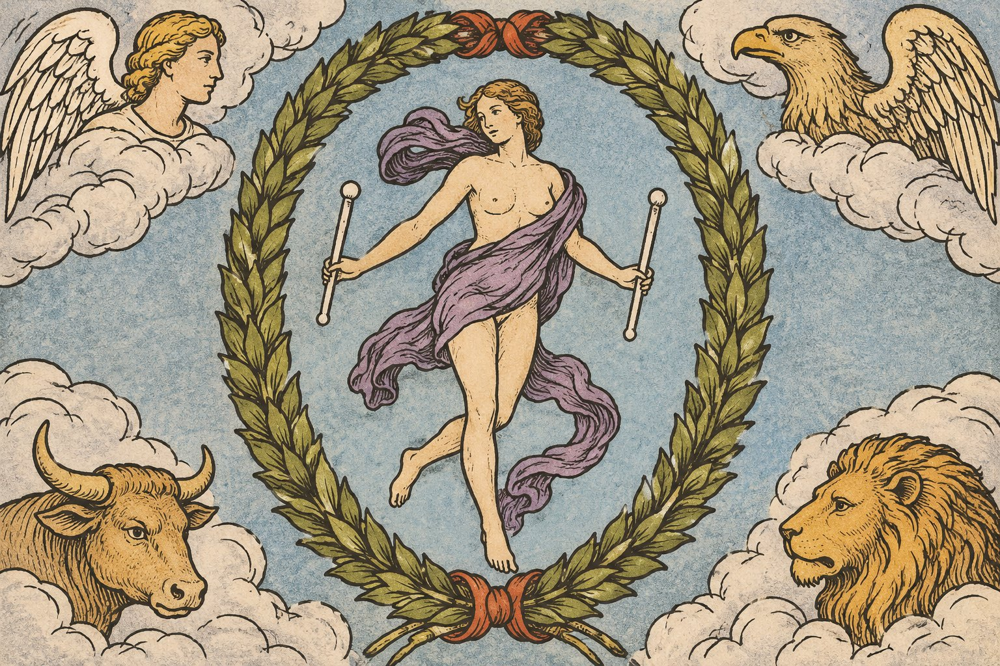
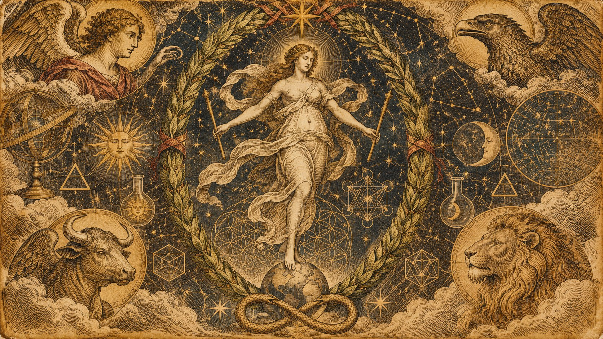
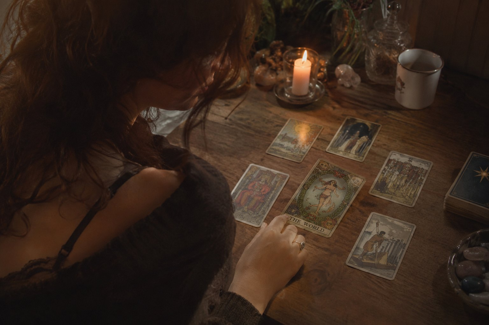
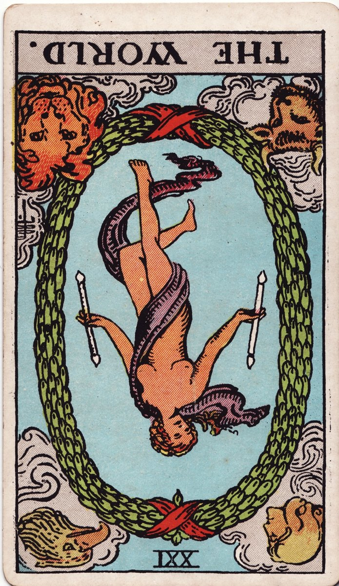

This time I have prepared an in-depth look at the final card of the Major Arcana – The World – through the lens of archetype, psychology and symbolism. I will show you how I read it: not simply as a “good card”, but as a key to the meaning of the whole road travelled.

The World is the final card of the Major Arcana. It marks the end of a symbolic journey – a process of gathering experience, overcoming obstacles, awakening and inner transformation. Its appearance signals the moment when the scattered pieces of what we have lived through begin to make sense and settle into a single, coherent picture.

This is the card of **the completed cycle, of integration achieved and of expanded consciousness**. It does not merely say that something has ended; it says you have reached a state in which you can grasp the full meaning of the road you have travelled.

## Completion as a form of awareness

Life often draws us into processes whose meaning eludes us while we are living them. Some events seem random, others contradictory, and still others confront us with circumstances we can neither control nor foresee.

While we are inside the process, we see only fragments. We lack the distance needed to recognise the threads that bind them together.

This is precisely where the symbolism of The World comes into play.

Once a cycle is complete, the perspective shifts. What once looked like an obstacle may prove to have been a necessary stage. A loss may reveal a new direction, and an apparent detour may turn out to be part of a far larger route.

Clarity does not always arrive when we ask our questions. Sometimes it dawns only once the experience has run its natural course.

The World invites us to look back without returning to the old – to recognise what we have learned, to integrate the experience and to clear the space the next stage requires.

## The symbolism of The World card

The classic image shows a dancing figure encircled by an oval wreath. In the four corners stand four symbolic creatures: a man or angel, an eagle, a bull and a lion.

Each of these elements carries a meaning of its own.

### The oval wreath

The wreath stands for the completed cycle, for eternity and the unbroken continuity of existence. It has no clear beginning or end and recalls the cyclical nature of life. Completion is not an absolute endpoint, but a passage to the next level of development.

### The dancing figure

The central figure embodies freedom attained and the reconciliation of opposites. She dances within the wreath, yet is not confined by it. This is an image of consciousness no longer at war with its experience – one that has learned to embrace it as part of its own wholeness.

### The four creatures and the fixed signs

The four creatures are linked to the four Evangelists of Christian iconography, and to the four fixed signs of the zodiac:

<ul class="creatures not-prose">
<li class="creature creature--air">

The Angel

♒&#xFE0E; Aquarius · air

intellect and consciousness

</li><li class="creature creature--water">

The Eagle

♏&#xFE0E; Scorpio · water

transformation and depth

</li><li class="creature creature--fire">

The Lion

♌&#xFE0E; Leo · fire

vitality and creative power

</li><li class="creature creature--earth">

The Bull

♉&#xFE0E; Taurus · earth

matter and stability

</li>
</ul>

Esoterically, these four images can be read as the four fundamental principles from which the manifest world is built. Their presence around the central figure speaks of balance between the different dimensions of existence.

## The end of one cycle and the beginning of another

One of the most striking features of The World is its place in the architecture of the Major Arcana.

It is **card XXI** and follows Judgement, arcanum XX. If Judgement symbolises awakening, the call to awareness and a reckoning with the past, The World represents the fruit of that process.

Here it is no longer merely a matter of recognising the need for change, but of integrating it.

The card's numerology is telling, too:

**2 + 1 = 3**

Three is traditionally associated with manifestation, the creative principle and synthesis. It can be seen as the outcome of an interplay between two principles that gives rise to a third – a new form or state.

The World can thus be read as the moment when accumulated experience has taken on a finished form and is ready to be expressed in a new reality.

## The meaning of The World in a tarot spread

Depending on the question and the surrounding cards, The World can carry several core meanings:

- **Personal life:** the completion of an important stage of personal growth; a clearer understanding of yourself, your desires and your place in the world.
- **Career:** the successful conclusion of a project, the fulfilment of a long-term goal or a result reached after sustained effort. It may also point to expansion, international contacts or new opportunities.
- **Relationships:** wholeness and clarity about a connection. Depending on the context, this may mean stabilising and moving on to the next stage – or the natural end of a relationship whose cycle has run its course (see also ["Pentacles in Love Readings About the Future"](/en/blog/pentacles-in-love-readings)).
- **The spiritual path:** the integration of accumulated knowledge and experience; seeing how the stages of your spiritual path connect, and arriving at a broader perspective.

## Reversed – when the cycle remains unfinished

Reversed, The World can signal a sense of incompleteness. You may be close to the finish line, yet unable to take the final step.

This can show up as:

- unfinished projects and postponed decisions;
- difficulty letting go of the past;
- recurring situations and patterns of behaviour;
- a feeling that something is missing, despite what you have achieved;
- fear of the next stage and the unknown it brings.

Sometimes an unfinished cycle stems not from a lack of opportunity, but from an unwillingness to accept that a chapter has already closed.

The reversed card can be an invitation to return to what we left undone, and to discern what still calls for our attention.

## The message of The World

The World is a card of perspective. It reminds us that we cannot see the whole picture while we are fixed on its separate fragments.

Sometimes we must pass through the entire process before we understand its purpose. Not every event offers an immediate explanation, and not every situation demands an immediate answer.

There are moments when the wisest course is to let things reach their natural conclusion.

When the circle closes, the horizon widens. We no longer see our experience solely through the limits of the present moment; we begin to recognise the connections, the sequence and the meaning.

Then clarity comes.

**You need not see the whole picture while you are still painting it. Sometimes you must first finish the journey to understand how far you have truly come.**

The card's message

Let the old cycle close. Integrate what you have learned and release what has already served its purpose. Completion is not the end of growth, but an invitation to continue from a new level of understanding.

## Frequently asked questions

Is The World a good card in tarot?

Yes – it is one of the most favourable cards in the deck. It speaks of a completed cycle, a result achieved and clarity about the road behind you.

What does The World mean in a love reading?

Wholeness and clarity in the relationship: either stabilising and stepping into a new stage, or the natural end of a bond whose cycle is complete. The question and the neighbouring cards decide which.

What does The World reversed mean?

An unfinished cycle: postponed decisions, recurring patterns and difficulty letting go of the past, even though the finish line is near.

## Afterword: how I read a card

The same card can carry different meanings depending on the question we put to it. Here is how The World shifts:

- **What is happening in my life?** – the completion of a cycle.
- **What does this person feel?** – a sense of wholeness, or of a chapter closing.
- **What lies ahead?** – a result reached, integration and a new perspective.
- **What is the hidden process?** – the completion of a recurring pattern.
- **What am I not seeing?** – the missing link between events that have already happened.
- **What is the spiritual task?** – integrating experience rather than endlessly chasing new ones.

That is why, in my system, every interpretation rests on three coordinates:

**Card × Prism × Context of the question**

The prism is the lens through which we read the symbol. This article combines several prisms, with the psychological and archetypal perspectives leading:

| Prism | How it shows |
| --- | --- |
| Archetypal | completion, wholeness, integration |
| Psychological | inner transformation and awareness |
| Spiritual | growth and the gaining of wisdom |
| Symbolic | the wreath, the central figure, the four creatures |
| Numerological | XXI → 2 + 1 = 3 |
| Astrological | the four fixed signs of the zodiac |
| Existential | the meaning of experience and accepting endings |
| Temporal | one stage ending and another beginning |

The more precisely you know which prism and which context you are reading through, the clearer the cards' answer becomes (more on precise questions in ["A Few Quick Tips for Effective Tarot Readings"](/en/blog/tips-for-effective-tarot-readings)). And to follow how a card's meaning evolves over time, keep a [tarot journal](/en/blog/how-to-keep-a-tarot-journal).

In the next article I will unfold the **synchromystic principle** of interpreting The World.

If you'd like us to look at your spread together, see [readings](/en/consult).
