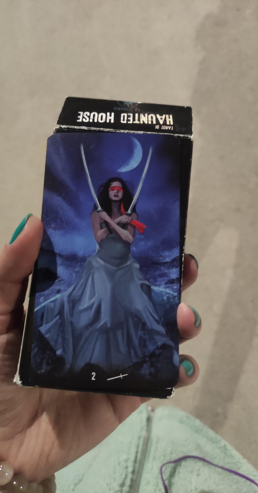
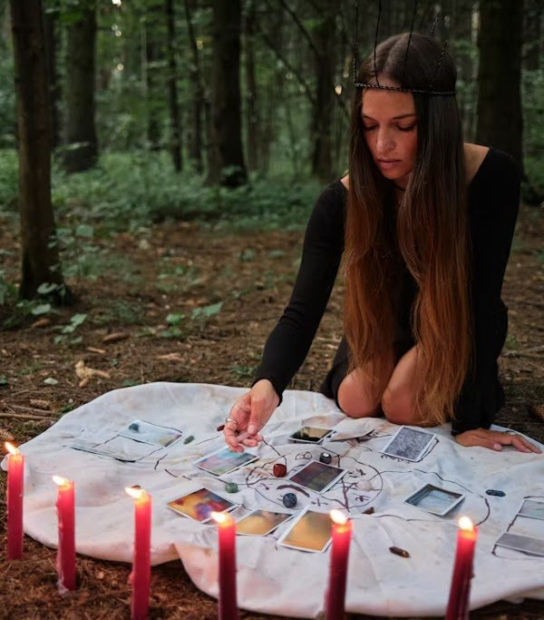
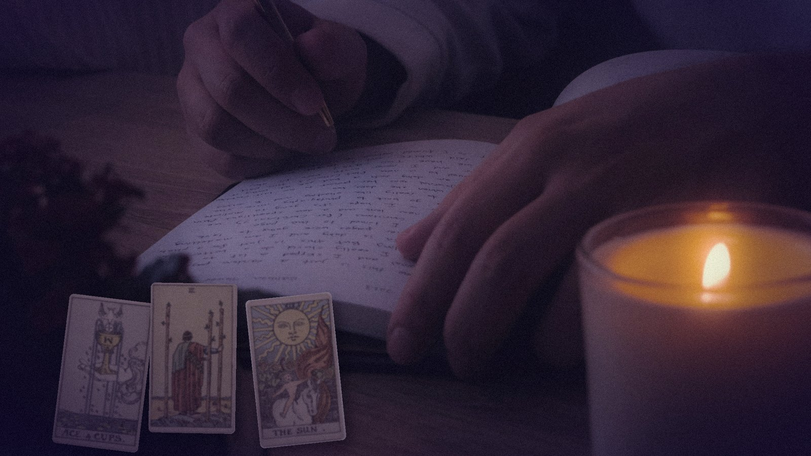
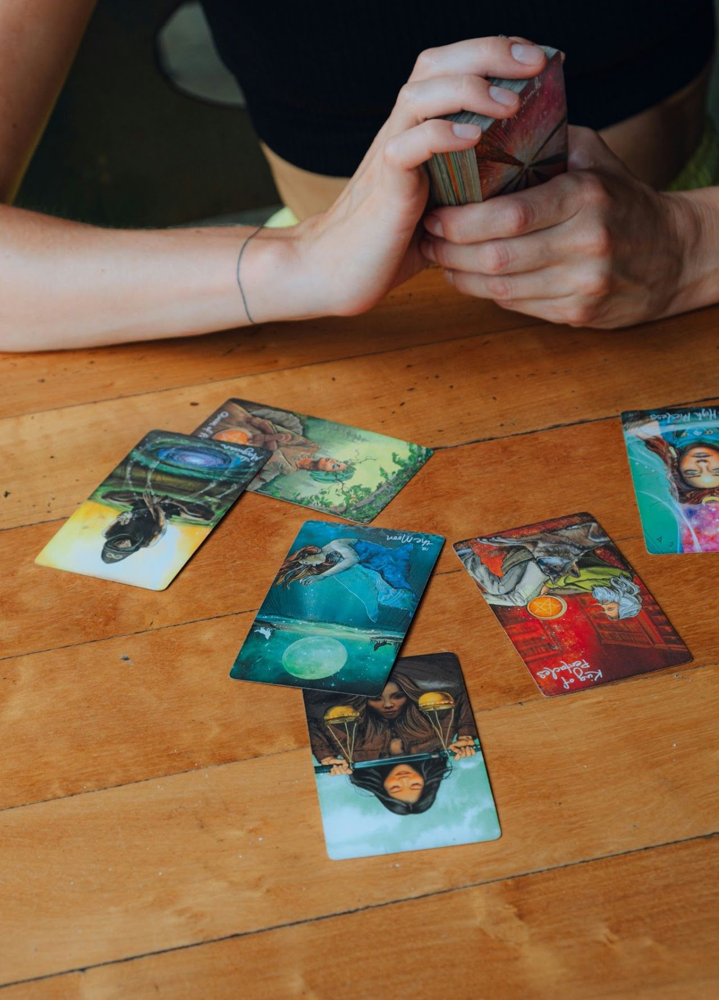
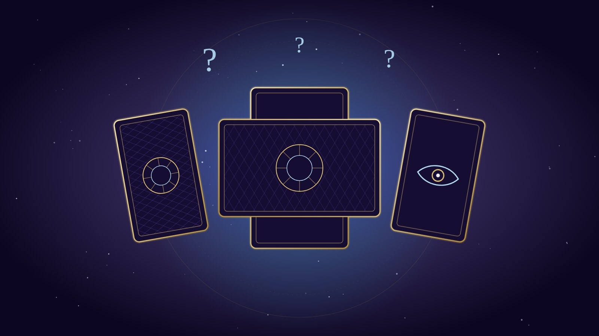

**How do you wring the truth out of Tarot? Why won't these cards talk??? 🙄**

Here are my "two cents" on the subject, plus a few simple but effective tricks for going deeper in the art of reading Tarot – and why not oracle cards too. Stick around to find out how to progress quickly with Tarot! Just staring at the pretty pictures won't cut it – tarot is a skill, and it takes some reading too :)

## Why the cards sometimes don't "talk"

If you've already tried reading Tarot, you've probably noticed that the cards don't always speak clearly and directly. Sometimes they're like a stubborn conversation partner who stays silent, drops hints or hides the truth behind half-sentences and metaphors. They also love playing tricks and little jokes. The truth is that we don't get the information ready-made, as when we open a book – we are actually having a conversation with Tarot, or rather with whatever makes contact through it. Yes, quite often that may be a demon, which is NOT necessarily a bad thing, but that's a story for another time.

**Absolutely any information channel or being can speak through tarot, though, so we need to know how to break the ice. We want information, and we have to know how to ask for it.**

Another truth is that the Matrix itself has a built-in mechanism that tries to block clairvoyance into the future – the program doesn't like anyone poking into its secrets and predicting its moves. [The archons](/en/blog/archons) don't like anyone interfering with their control of timelines. Yet it is not only our right but our duty – as conscious beings with a Higher Self – to govern our present, future, past and timelines.

I'll never tire of repeating that **the cards are only a tool for our Higher Self and intuitive mind**, helping us see more clearly the direction we're heading in. They are the picture frame we need so that our brain doesn't get lost in an ocean of undifferentiated information.

Every tarot reader has had moments when the cards simply refuse to give a straight answer. Do you know what I learned from those moments? That the problem isn't the tarot but the way I approach it. The cards always speak, and they always "come out" right. There are no bad or wrong cards.

**Tarot is like a mirror** – it reflects our state, our questions and our readiness to hear the truth. Sometimes, though, getting to the heart of the message takes a little cunning, patience and creativity. I've had moments of "fog", when the cards just won't say anything meaningful, and moments of illumination, when I finally get past their resistance and start a real conversation with them.

Today I'll share a few tricks that help me get through this "silent period" and pull out the truth even when the cards don't want to cooperate. **Tarot is not just a divination tool – it is our intuitive partner.** And as in any partnership, sometimes you have to find the right approach for communication to happen.

## 1. Create a ritual before the spread 🧙

For some of you it's a good idea to have a small ritual – tapping the cards, striking a match, a magic phrase, an invocation or ritual formula (a key) that activates the "energy" of the cards and sets them in motion. There are no limits here – anything that works **for you** and comes to you as an idea, inspiration or intuition will do the job.

**Remember:** the ritual shouldn't be complicated or tiring; it should help you reach a point of focus as quickly as possible. It should be short (a few seconds) and easy to remember – literally like the match that strikes the flame of inspiration.

*Example ritual:* tapping the cards while saying "I call upon the good spirits, bring me knowledge".

## 2. Trust your first impression 💫

When you draw a card, pay attention to the first feeling or thought that comes to you. Intuition often speaks through exactly these first impressions. Don't worry if you're unsure of the card's meaning – just write down what you feel, then look up more information in books or online to fine-tune your intuitive impressions.

**Remember:** Tarot is a tool for working with intuition, and however many traditional meanings the cards have, in the end it is your personal intuitive impression that decides whether a reading holds. Besides, many decks differ considerably from the original [Rider–Waite–Smith](https://en.wikipedia.org/wiki/Rider%E2%80%93Waite_Tarot) symbolism and show quite different, specific scenes (the Tarot of the Elves, for example), which can capture a situation precisely.

## 3. Keep a tarot journal 📒✍️

Writing down your spreads is extremely useful – I've said it more than once. It lets you follow how your practice evolves over time and notice repetitions and patterns. The journal also lets you quickly "spark" and find synchronicities, meanings and patterns in your readings that are unique to you. Priceless. You really have no idea how much we forget.

*What goes into the journal:*

- ✔️ the date and time of the reading;
- ✔️ the question or theme;
- ✔️ the cards drawn;
- ✔️ your interpretations and the meanings of the cards;
- ✔️ later: what action or decision you took based on the spread, how things turned out and any further insights.

When you're confused at the start of a reading and unsure how to interpret certain cards, you can always check your journal for recurring cards and combinations from earlier readings and see what role they played then. You can return to a reading when an insight comes, or keep coming back to build on it. You can also make yourself a tarot dictionary with the meaning of every card.

You'll find a detailed guide in the article ["How to Keep a Tarot Journal"](/en/blog/how-to-keep-a-tarot-journal).

## 4. Draw a significator card as your starting point

If you don't know where to start a reading, or often lose your way in it, set yourself a **significator card** that "holds" the theme of the spread.

The significator is like a compass in the world of Tarot – it points the way and helps you focus on the main energy or theme of the spread. It represents you, the person the spread is for, or the specific situation you're exploring, and gives context to all the other cards. For example, if you draw a card that symbolises strength and determination, it may hint that exactly these qualities will be key to the situation. In other words, the significator is the "main character" in the story the cards are telling. It not only makes interpretation easier, but also helps you connect more deeply with the energy of the spread, reminding you what (or who) you're actually looking for. Without it, you can sometimes feel lost in a chaos of symbols and messages.

**There are several ways to choose a significator:**

- **At random** – shuffle the cards and pick one. This is the card the deck sets as the theme of the reading. For example, if *The Empress* comes up, the theme will be feminine energy and abundance in your life.
- **As the answer to a specific question** – for example, "Who is the object of my true feelings?". If you draw the Page of Cups, you'll base the reading on that energy and its meanings.
- **Deliberately chosen significators** – there can be more than one card here. Say you're doing a reading about your love life: you pick one card for yourself (for example the Queen of Wands), one for the object of your desire (for example the Page of Cups) and a card for the problem you think you have – let's say The Tower.

The trick is to read the significator **in combination** with the cards you draw – that gives more accurate information.

- **The significator focuses the energy** and helps you concentrate on the person or theme, which makes the spread more accurate and meaningful.
- **It makes interpretation easier** – with a reference point, it's easier to see how the other cards relate to the querent or the situation.

**Important:** place the significator at the start, in the centre or at the top of the layout. This establishes a link between the querent and the situation being explored.

## 5. Ask very precise questions 🧐

When you ask Tarot questions, be as specific as possible. Instead of "What will happen in the future?", ask "What steps should I take to succeed in my career?" or "What will happen if I decide to travel to…?". You get the idea.

**Be specific**, and ask different questions several times to see all the possible angles, situations and timelines. **Precisely worded questions** lead to clearer, more useful answers – when you ask in more detail, Tarot gets a clearer idea of exactly what you want to know.

A clever trick for **timing** is to ask whether something will happen between certain dates. That way you can even "pin down" the tarot.

*Another example of asking questions:*

- ❌ "Where did I leave my umbrella?"
- ✅ "Is my umbrella in the living room?", "Is it at home?", "Is it somewhere bright?", "Is it under the table?" and so on.

## 6. Use the "cross-examination" technique 🤺

Cross-examination is a technique where you ask the same question in different ways, or look at the same situation from different angles.

For example, if you're asking about a love triangle, you can draw cards for what you feel, what your partner feels, what your shared energy is, whether a third person is involved and what that person feels towards you. If the cards are evasive, ask again: "If he is cheating on me, does it happen during the day?" and so on (for love readings, see also ["Pentacles in Love Readings About the Future"](/en/blog/pentacles-in-love-readings)).

This technique not only helps you "squeeze" the tarot (sometimes it really doesn't want to talk, for a number of reasons), but also helps you avoid biased interpretation. If you've drawn cards you read as a positive answer, and then a clarifying question brings flatly negative cards, you were obviously misled at first, or there are unknown factors you need to unravel.

You'll find more examples of cross-examination on [my YouTube channel](https://www.youtube.com/@astralarra) and on [Patreon](https://www.patreon.com/c/AstralARRA).

## Frequently asked questions

**What should I do when the cards "won't talk"?**
Do a short focusing ritual, ask a more specific question and use a significator card. If the answer is still foggy, ask the same question from another angle – with cross-examination.

**How many cards should I draw for one question?**
For a clear question, one to three cards are enough. More cards make sense for complex situations and spreads with fixed positions.

**Can I use these tricks with oracle cards too?**
Yes. The ritual, first impressions, the journal and precise questions work just as well with oracle decks.

## Conclusion

Tarot is a powerful tool for self-reflection and spiritual growth, but it takes practice, practice and more practice. **The ritual, trusting your first impression, keeping a journal and asking precise questions can greatly improve your skills, but they need persistent use.** You have to go to bed and wake up with the cards. Remember that Tarot isn't just fortune-telling about the future, but a way to connect with your Higher Self and, in a sense, to create your future.

So next time you pick up the cards, don't forget these tricks – they can take your understanding of Tarot to a new level ✨

If you'd like a personal reading, see [readings](/en/consult).
