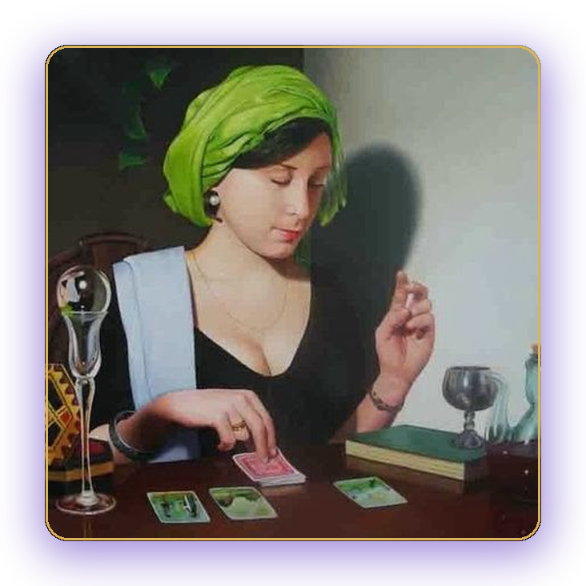
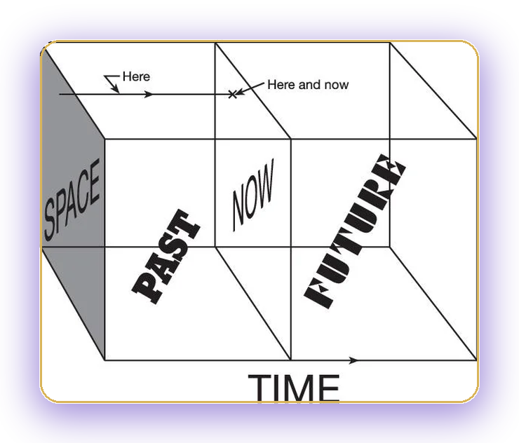
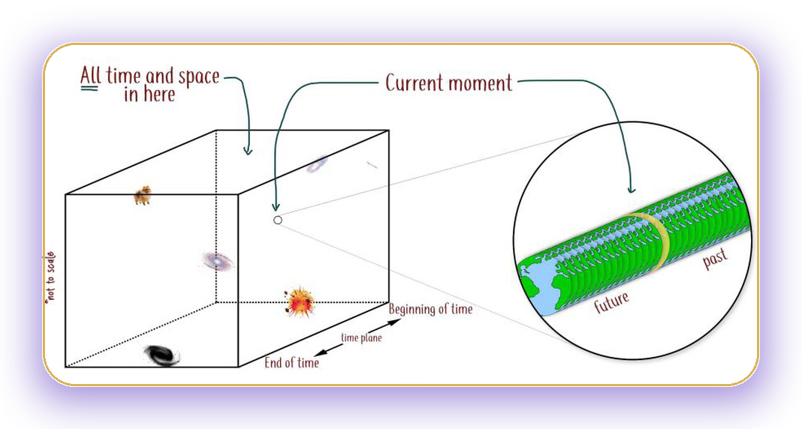
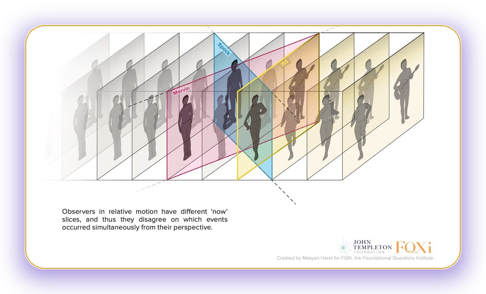
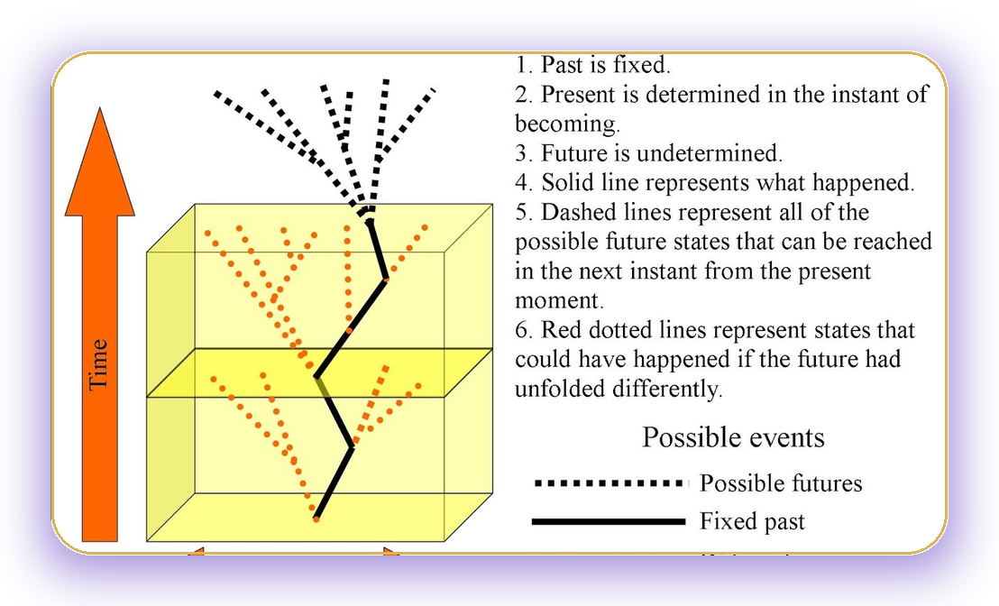
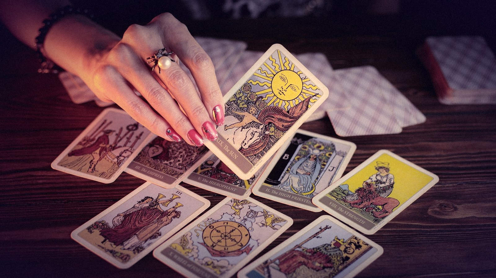
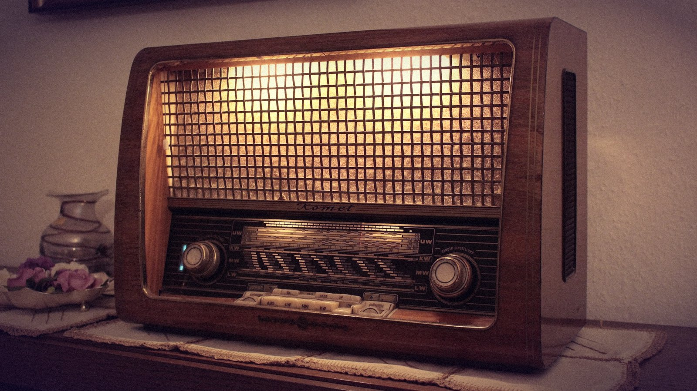
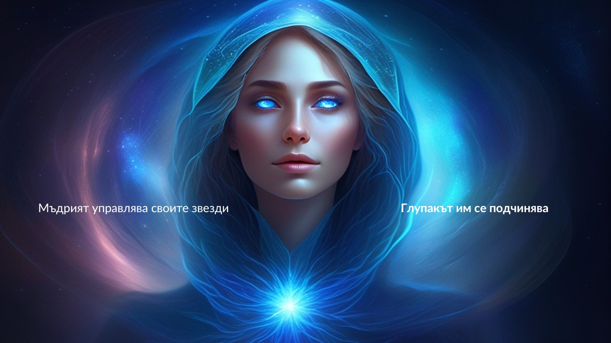

Има един въпрос, който тормози всички ни: **„Картите винаги ли познават?“**

И да Ви призная, и мен ме тормози. Отчасти, защото отговорът хем ми е пределно ясен, хем не.

Сега ще видим защо.

Като опитен таролог ми е пределно ясно, че картите ВИНАГИ показват нещо. Работата на таролога е да разбере КАКВО.

*Отговорът на този въпрос е далеч по-сложен, отколкото изглежда на пръв поглед. В тази статия само ще се пуснем по повърхността, като ще загатна няколко основни момента. По-пълно изследване на въпроса ще има в книгата ми „Таро Призми“, когато излезе. Да се надяваме – през 2027 г.*

Магията на Таро гаданието се корени в дълбините на квантовата физика, науката за времевите линии, упражняването на свободната воля и в манипулирането на астралните равнини. Нека да разнищим този въпрос точка по точка. За да кажем дали таро винаги познава, трябва да знаем как работи всичко това – от квантовото поле до съзнанието. Защото картите не са извън нас, те са в НАС. Те просто отразяват кадри от потока, през който нашето съзнание едновременно преминава и се потапя.

Какво всъщност улавяме, когато теглим карта? Откъде идва информацията? Дали картите показват бъдещето, или отразяват определен потенциал, през който съзнанието ни вече преминава?

**Всъщност картите са нас.**

Нашето съзнание се потапя в определена енергоинформационна матрица и абсорбира картината оттам (дали това ще е Етер, Астрал или нещо друго...). Представете си нашето съзнание като радиостанция, която улавя различни канали. Тези канали сменят честотите си с местоположението, а понякога е възможна и случайна или не съвсем случайна намеса и прекъсване на канала.

Нека да разгледаме няколко основни принципа.

## 1. Фокусната точка – какво всъщност отразяват картите?

Така, накратко: ДА, картите ВИНАГИ познават.

Въпросът е КАКВО.

Картите отразяват определена картина на реалността, но тази картина може да не е Вашата или да не е точна. Също така, тя може да се променя постоянно. Всичко това се корени в начина, по който времето функционира в loop – ние винаги се намираме в точка СЕГА и създаваме и миналото, и бъдещето от нея посредством feedback loops.

**Много е важно за таролога да има добре отработен ФОКУС!**

Центрирането в себе си и фокусът са единствените начини, чрез които можете да сте сигурни, че контролирате хаоса, който представлява един ясновидски канал за гадаене.

Фокусът е инструментът, чрез който можете да бъдете сигурни, че Съзнанието Ви принадлежи и че всъщност Вие сте медиумът, а не, примерно, някой демон да говори през Вас като host. За съжаление – и го казвам наистина с огромна доза съжаление, но е факт – доста хора, които се представят за таролози, са масово обсебени от демони. Този феномен заслужава цяла отделна статия.

Важността на точката на фокуса е свързана с начина, по който разглеждам времето – не като линейна последователност от минало, настояще и бъдеще, а като много по-сложна структура, в която различните времеви състояния са взаимосвързани. Демоните са същества, които естествено могат да прескачат през такива нелинейни точки, затова е много важно да се научите да ги избягвате – и начинът това да стане е чрез ФОКУС.

Да започнем оттам, че когато теглите карта Таро, тя „запечатва“ или отразява през какво преминава Вашето съзнание В момента. Това е Вашият моментен ментален, емоционален и духовен фокус и картина. Всякакво колебание се отразява на картите мигновено. Те не са статичен феномен, който седи извън Вашето съзнание и чака да бъде избран. Те, в известен смисъл, СА ВАШЕТО СЪЗНАНИЕ. Вашето съзнание изследва себе си чрез тези картини.

Това неизбежно Ви среща и с доста вътрешни „демони“, които биха желали да проектирате определена негативна реалност с цел – захранка.

Когато избирате карта, Вашето съзнание вече преминава през определен кадър на реалността, затова и картата отразява точно този Ваш моментен ФОКУС. Затова и фокусната точка е толкова важна. Когато боравите с Таро, е изключително важно да се научите да „събирате“ мисълта си, а не да я пилеете, и да премахнете всякакви разсейващи фактори, били те вътрешни или външни.

Ако в момента на гледането съзнанието Ви се колебае между няколко различни сценария, това може да се отрази и върху тълкуването на картите.

**Всякакво енергийно смущение, усещане (астрал) или странична мисъл (сетете се и как мислим в картини) се отразява веднага на картите, които теглите.**

Например питате за развитието на определени отношения, но едновременно с това изпитвате желание за сближаване, страх от отхвърляне и очакване за раздяла. Вие не наблюдавате една ясно дефинирана вътрешна позиция, а няколко конкуриращи се фокуса.

Именно затова едно и също гледане понякога може да бъде толкова трудно за тълкуване (как да различите интуицията от страха, разглеждам подробно в [„Интуиция или страх?“](/blog/intuiciya-ili-strah)).

**Колкото по-ясна е фокусната точка, толкова по-ясна е и информацията, която се опитваме да разчетем.**

Поради тази причина доста често – и неправилно – се казва, че на таро може да Ви гледа само друг. Това не е вярно. Всеки таролог трябва сам да си гледа на таро и да се научи да развива тази своя Вътрешна точка. Повече за това – в предстоящата статия „Можем ли сами да си гледаме на Таро?“ в [раздела за Таро](/blog/categories/taro), а за ритуала, с който да събирате фокуса си преди разклад – в [„Няколко кратки трика за ефективно гледане на Таро“](/blog/trikove-za-efektivno-gledane-na-taro).

## 2. Квантовата блокова вселена – съществува ли бъдещето, преди да го преживеем?

Тук навлизаме в една от най-интересните концепции, свързани с природата на времето.

Във физиката и философията съществува модел, известен като Block Universe, или блокова вселена.

**Времето не е статично – миналото, настоящето и бъдещето съществуват едновременно.**

**Илюзията за поток на времето** идва от нашето съзнание, което „преминава“ през вече съществуващата блокова структура.

**Ние просто преживяваме една определена траектория** в това пространство-време.

Според философската позиция, наречена [етернализъм](https://en.wikipedia.org/wiki/Eternalism_(philosophy_of_time)), миналото, настоящето и бъдещето имат еднакъв онтологичен статут. Те са части от единна четириизмерна структура на пространство-времето.

В този модел времето не е непременно нещо, което тече и създава нови моменти. По-скоро съзнанието ни преживява последователно различни позиции в пространствено-времевата структура.

Представете си филмова лента.

Всички кадри вече присъстват върху нея, но Вие виждате само един кадър в даден момент. Последователността на възприемането създава усещането за движение и развитие.

Илюстрация: <a href="https://fqxi.org/">FQXi – Foundational Questions Institute</a>

Това е добра метафора за начина, по който можем да си представим времето в контекста на Таро.

Ако различните времеви състояния съществуват като части от по-голяма структура, тогава възниква интересният въпрос: възможно ли е съзнанието ни да получава информация за събития, които все още не е преживяло?

В моята концепция Таро е един от инструментите, чрез които можем да изследваме подобна информация.

Картите не е необходимо да създават бъдещето. Те могат да отразяват определени негови потенциални конфигурации.

Това обаче не означава, че физиката е доказала съществуването на подобен механизъм за гадаене. Блоковата вселена е философска интерпретация на времето, която ни предоставя интересен модел за метафизичното изследване на Таро.

## 3. Квантова неопределеност – защо бъдещето не винаги е фиксирано?

Тук трябва да разграничим две неща: съществуването на потенциални времеви линии и тяхната реализация.

Таро картите, от своя страна, работят като инструмент за **събиране на информация** от „квантовото поле“ на възможности. Възможностите не са напълно определени, а са като вероятностни състояния, които могат да се материализират в зависимост от действията и съзнателните намерения на човек.

В квантовата физика съществува принцип, известен като **„квантова несигурност“** (quantum uncertainty) – [принципът на неопределеността на Хайзенберг](https://en.wikipedia.org/wiki/Uncertainty_principle). Той гласи, че е невъзможно да предвидим с абсолютна точност поведението на частица – нейното положение и импулс са винаги донякъде неопределени. Това не е ограничение на нашите инструменти, а фундаментално свойство на самата реалност.

Ако пренесем този принцип в света на гадаенето, можем да кажем, че **картите също отразяват потенциални възможности, а не фиксирани резултати**. Те не са като математическа формула, която винаги дава един и същ отговор. Вместо това те разкриват **вероятности**, които зависят от множество фактори – включително нашите действия, намерения и дори енергийното ни състояние в момента на изтеглянето.

Тук Таро придобива съвсем различно значение.

Вместо да го разглеждаме като инструмент, който трябва да съобщи един-единствен резултат, можем да го използваме за изследване на вероятните конфигурации на бъдещето.

Картите показват определен сценарий, но този сценарий съществува в контекста на множество променливи. Нашите решения, поведението на останалите участници, външните обстоятелства и моментният ни фокус могат да променят развитието на ситуацията.

Следователно не е задължително прогнозата да се реализира точно по начина, по който сме я тълкували. Тя може да е била вярна спрямо определена конфигурация на потенциалите, но впоследствие условията да са се променили.

## 4. Разклоняващите се вселени – множество възможни сценарии

Тук можем да включим и интерпретацията на квантовата механика, известна като [Many-Worlds Interpretation](https://en.wikipedia.org/wiki/Many-worlds_interpretation), или интерпретация на многото светове, свързана с Хю Еверет.

Според този модел различните възможни резултати от квантовите процеси се реализират в различни клонове на универсалната квантова структура. Всяко квантово събитие може да създава **разклонение** – множество паралелни времеви линии.

Така блоковата вселена **не е едно цяло и фиксирано**, а представлява **множество разклоняващи се блокови вселени**.

Тогава бъдещето не е напълно фиксирано, а **различни потенциали съществуват като възможности, докато не бъдат преживени**.

Това е една от интерпретациите на квантовата механика и не е общоприето доказателство за съществуването на достъпни за човешкото съзнание паралелни времеви линии. Но като метафизична отправна точка концепцията е изключително интересна.

Представете си, че се намирате пред важно решение. Всяка възможност отваря различна последователност от събития.

В единия сценарий приемате определено предложение. В другия го отказвате. В трети отлагате решението и се появява съвсем различна възможност.

Това са различни сюжетни линии, които можем да изследваме чрез Таро.

Според много духовни учения и съвременни теории за мултивселената **времевите линии** са паралелни реалности, които съществуват едновременно. Всяко наше решение или действие ни отвежда към различна времева линия, като по този начин променя бъдещето ни. Картите, когато се използват за гадаене, могат да „четат“ потенциалните времеви линии, които са най-вероятни в даден момент.

Понякога те показват най-вероятния сценарий спрямо настоящите условия. Друг път разкриват алтернативна възможност, която все още не сме взели предвид.

И тук се появява една важна особеност: **не всяка времева линия, която можем да наблюдаваме символно, е непременно времевата линия, която ще преживеем.**

## 5. Свободната воля – можем ли да променим предсказаното?

Разбира се.

Ако поискаме наистина ;)

Но тук идва и ролята на **свободната воля**. Ние не сме роби на предсказанията. Всяко наше решение може да промени времевата линия, в която се намираме. Например, ако картите предскажат негативен резултат, но ние осъзнаем потенциалната грешка и променим поведението си, можем да избегнем предсказаното. Това е илюстрация на **самоосъществяващото се пророчество** – ако вярваме твърдо в предсказанието, без да се опитаме да го променим, то може да се материализира именно заради нашите действия (или бездействия).

Именно тук се намира едно от най-големите противоречия в традиционното разбиране за гадаенето.

Ако бъдещето е предсказуемо, означава ли това, че вече е определено? И ако е определено, какъв смисъл има свободната воля?

Моят отговор е, че не трябва да разглеждаме прогнозата като окончателна присъда.

Когато картите показват определено развитие, те могат да отразяват посоката, към която се движи ситуацията при настоящите условия. Но условията могат да се променят.

Можем да променим собственото си поведение, да вземем различно решение, да прекратим определен модел или да предприемем действие, което отваря нови възможности. Така се променя и потенциалната времева линия.

Например картите показват професионален застой. Вместо да приемем това като неизбежна съдба, можем да разгледаме какво го причинява, каква е нашата роля в него и какви действия биха променили ситуацията. Впоследствие първоначалната прогноза може вече да не бъде актуална.

Това не означава, че картите са сгрешили. Възможно е да са отразявали реална тенденция, която впоследствие сме променили.

Тук обаче трябва да внимаваме да не използваме тази логика като универсално обяснение за всяко несбъднато предсказание. Понякога тълкуването просто е било неправилно.

## 6. Астралът и потенциалните сюжетни линии

В окултната концепция астралното измерение заема особено място в изследването на времевите линии.

В различни езотерични системи астралът се разглежда като междинно равнище между физическата реалност и всички останали пластове на съществуването. Там се локализират образи, мисъл-форми, енергийни структури и различни проявления на съзнанието.

Астралното измерение е място, където времето не съществува в традиционния смисъл. Там всички потенциални времеви линии съществуват едновременно като **енергийни шарки** или **сюжетни линии**. Когато гадаем с карти, ние на практика се „настройваме“ към астралното измерение, за да извлечем информация за тези потенциални линии.

Въпреки това не всичко, което съществува в астрала, може да се материализира в нашия физически свят. Някои сюжетни линии остават просто потенциални, защото липсват необходимите енергийни условия или подходящите действия от наша страна. Това обяснява защо понякога картите „грешат“ – те показват потенциал, който никога не се реализира.

Не всяка потенциална линия разполага с необходимите условия за реализация. Не всяка възможност достига до физическия план. И не всяка информация, която получаваме, задължително се отнася до бъдещето, което ще преживеем.

Това е особено важно, когато работим с прогностични подредби.

## 7. Таймингът – защо картите невинаги познават кога?

Една от най-трудните задачи в Таро е определянето на времето. По простата причина, че линейното време е изкуствена структура. А на всичко отгоре таро събира информация и от нелинейни инфоматрици, каквито например е [колективното несъзнавано](https://en.wikipedia.org/wiki/Collective_unconscious).

Можем да получим изключително точно тълкуване за дадено събитие, но да не успеем да определим кога ще се случи, защото в тази матрица виждаме по-скоро последователността на събитията, а не техния точен тайминг. Или както казва един познат: вселената не се подчинява на григорианския календар...

Има обаче различни начини, по които дадено събитие може да бъде установено с точност, и те са свързани с методологията на [Астралния дизайн](/blog/categories/astralen-dizain).

И така. Ако сами си гледате на таро и не познавате астрологични системи, чрез които можете да установите точен тайминг, важно е да помните следното.

Понякога картите показват развитие, което очакваме след няколко дни, а то се проявява след месеци. Друг път събитие, което изглежда далечно, се случва почти веднага.

Защо?

Защото времевата рамка на една ситуация зависи от множество фактори. Едно събитие може да изисква определени действия от наша страна, решения на други хора или промяна на външни обстоятелства.

Таймингът е ключов фактор в гадаенето. Картите могат да предскажат събитие, но **кога** точно ще се случи, зависи от сложно взаимодействие между различни фактори. Например, ако картите предсказват успех в кариерата, но ние не предприемем необходимите стъпки в правилния момент, този успех може да бъде забавен или дори отменен.

Тук се намесва и ролята на **по-висшите същества** – духовни водачи, ангели или други съзнателни енергии. Те могат да повлияят на тайминга на събитията, като ни насочват към правилната времева линия или ни дават знаци, които да ни помогнат да вземем правилното решение в правилния момент.

Това обаче е отделен езотеричен модел, а не нещо, което можем да установим само от наличието на забавено събитие.

Моят съвет, ако практикувате таро като непрофесионалисти, е да не се вкопчвате прекомерно във времевите прогнози. Понякога е много по-важно да разберете какво се развива, отколкото да знаете точната дата.

## 8. Самоизпълняващото се пророчество – когато предсказанието създава събитието

Тук се връщаме към един от най-интересните механизми в работата с Таро.

Както вече разгледахме в [предишната статия](/blog/intuiciya-ili-strah), всяко гледане включва определено взаимодействие между съзнанието и получената информация. Понякога самото предсказание може да повлияе върху последващото развитие на ситуацията.

Да предположим, че картите показват конфликт в определени отношения.

Ако приемем тази прогноза като неизбежна, можем несъзнателно да започнем да търсим признаци за предстоящия конфликт. Да станем по-подозрителни, да реагираме по-рязко или да променим поведението си спрямо другия човек.

Така първоначалната прогноза започва да влияе върху реалността.

Това е познатият в психологията механизъм на [самоизпълняващото се пророчество](https://en.wikipedia.org/wiki/Self-fulfilling_prophecy).

От гледна точка на моя модел можем да го разгледаме и като процес, при който информацията от едно гледане се превръща в част от следващия ни енергиен и ментален фокус. С други думи, не само наблюдаваме потенциалната времева линия, но започваме да взаимодействаме с нея.

Тук се крие и една от опасностите на Таро. Не трябва да забравяме, че тълкуването може да промени поведението ни. Затова не бива да превръщаме всяка прогноза в абсолютна истина.

## 9. Намеса в таро каналите – може ли информацията да бъде изкривена?

Това е тема, която рядко се разглежда, но е изключително важна.

**Има три основни начина, по които може да има намеса във Вашето гадание – чрез изкривяване на канала, чрез същност или чрез човек.**

Когато друг човек гледа на нас, той неизбежно участва със собственото си съзнание, очаквания и модели на тълкуване. Възможно е неговата перцепция да окаже влияние върху прочита на картите. Възможно е да проектира собствените си страхове и ограничения върху нашата ситуация.

В по-широкия окултен модел можем да разгледаме и хипотезата за външни влияния върху самия информационен канал. Това може да бъде тълкувано като намеса в процеса на настройване към определена времева линия.

Доста често в гаданията се месят и различни същности и същества от различни измерения и реалии, които много обичат да си играят на destiny policies или пък имат точно определена агенда за намесата си (например точене на енергия и т.н. – повече за тях в [„Архонти, органични портали и други противни съ(з)д(н)ания“](/blog/archonts)). За това говорихме в Точката на фокус и колко е важно да я имаме, за да не изпадаме в заблуди.

Друг начин, по който може да бъде упражнено влияние върху гаданието ни, е чрез случайна намеса на канали. Както вече посочих, човешкото съзнание е като радиостанция, която приема различни канали в зависимост от местоположението си. Без да навлизам в излишни подробности и физични терминологии, ще отбележа само, че понякога се случва наслагване или прекъсване на канала ни, тъй като например може да не се намираме на точното място или да не правим гаданието в точното време.

**Важно е обаче да разграничаваме действителната промяна на ситуацията от промяната в нашето възприятие за нея. Не всяка противоречива подредба означава външна намеса.**

**Понякога причината е много по-проста: променили сме въпроса, фокуса или емоционалното си състояние.**

**Именно затова личната практика, концентрацията и способността за самонаблюдение са толкова важни.**

Необходимо е да познаваме собствените си канали на възприятие, тъй като външните влияния са неизбежната агенда на множество същества, които ще искат да проектират желаните от тях реалности.

## 10. Нашите избори пренареждат картите

Тук стигаме до най-важната част.

Ако приемем, че Таро отразява потенциални развития, а не неизбежно фиксирано бъдеще, тогава възниква един много интересен въпрос: можем ли да направим ново гледане и да получим различен резултат, след като сме променили собственото си поведение?

Разбира се, че можем.

Но не защото картите произволно променят отговорите си. А защото междувременно може да се е променила самата ситуация.

Представете си следния пример: правите гледане за развитието на определена професионална възможност. Картите показват забавяне, препятствия и липса на реализация.

Вместо да чакате, предприемате конкретни действия. Свързвате се с нови хора, променяте стратегията си, намирате алтернативен източник на финансиране.

След известно време правите ново гледане.

Резултатът е различен.

**Това не означава, че първото гледане е било грешно. То е отразявало предишната конфигурация на ситуацията. Междувременно сте променили условията, а с тях и потенциалното развитие.**

В този смисъл можем да кажем, че нашите избори, както и развитието на ситуацията, пренареждат картите. Случвало ми се е посредством осъзнатост и воля да успея да пренаредя ситуация буквално за секунди.

Именно затова не трябва да използваме Таро като заместител на свободната воля. Напротив, трябва да го използваме, за да разберем къде се намираме, какви възможности имаме и как можем да променим посоката. Добро упражнение за това е [таро дневникът](/blog/kak-da-si-vodim-taro-dnevnik) – само той ще Ви покаже черно на бяло кои линии сте променили.

## И така, картите винаги ли познават? Моята честна оценка

Ще се върна към първоначалния въпрос.

Моят отговор остава ДА, но с едно много важно уточнение.

Картите могат да бъдат разглеждани като огледало на определена конфигурация от информация, потенциали и състояния на съзнанието. Но това не означава, че всяко наше тълкуване е правилно, нито че всяко показано събитие задължително ще се реализира.

**Понякога разчитаме грешно символите. Понякога сме загубили фокуса си. Понякога гледането отразява нашите страхове, а не външната ситуация. Друг път получаваме информация за потенциална времева линия, която впоследствие променяме чрез собствените си действия. Понякога линията на сюжета се променя... Понякога имаме външни намеси, които, ако сме ловки, успяваме да осуетим. Причините могат да бъдат МНОГО! Таро е една необятна вселена и полето ѝ на изследване е толкова голямо, колкото е голямо съзнанието, което временно обитаваме.**

Един ловък таролог, който е и ясновидец, ще усеща всички тези възможни флуктуации и ще знае къде да „бръкне“, за да извади необходимата и наличната за момента информация!

Важно е да помним, че картите отразяват определена информация и ние трябва да успеем да я разчетем правилно.

За мен Таро не е просто система за предсказване на бъдещето. **То е инструмент за взаимодействие със символния пласт на реалността ([синхромистицизъм](/portal)), за наблюдение на потенциалните времеви линии и за изследване на собственото ни участие в тяхното развитие. Таро е инструмент за комуникация с множество информационни канали.**

И може би най-важното, което трябва да разберем, е, че не сме пасивни наблюдатели на собствената си съдба.

Ние участваме в нейното създаване.

**Картите могат да Ви покажат накъде вървите. Но това не означава, че сте длъжни да продължите в същата посока.**

**Изборът в крайна сметка е Ваш. Независимо дали го осъзнавате, или не.**

## Често задавани въпроси

Картите винаги ли познават?

Картите винаги отразяват нещо – въпросът е какво. Понякога показват моментния Ви фокус, понякога потенциална времева линия, която после променяте, а понякога тълкуването е било неточно или каналът – смутен.

Защо предсказанието на картите не се сбъдна?

Защото картите показват вероятности, а не присъди. Условията може да са се променили – чрез Вашите решения или чужди действия, сюжетната линия да е останала само потенциал, или прочитът да е бил повлиян от страх, загубен фокус или външна намеса.

Може ли таро точно да покаже кога ще се случи нещо?

Трудно, защото картите улавят последователността на събитията повече от календарната им дата. За точен тайминг таро се съчетава с астрологични методи – за тях пиша в раздела [Астрален дизайн](/blog/categories/astralen-dizain).

