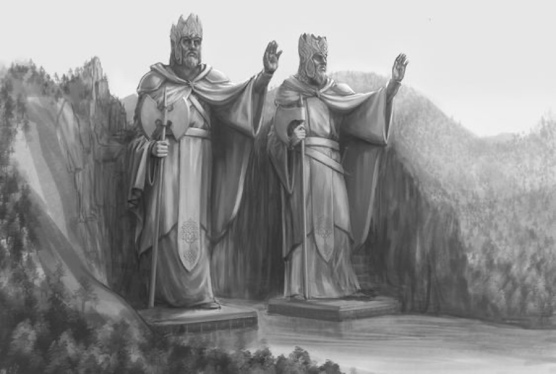
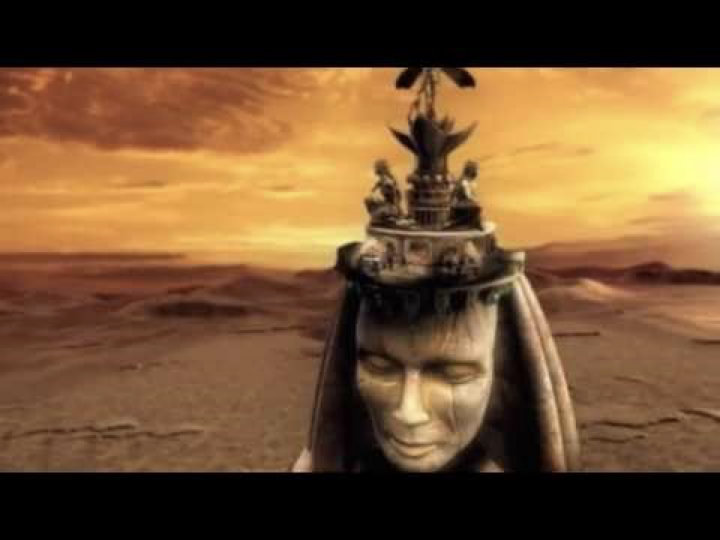
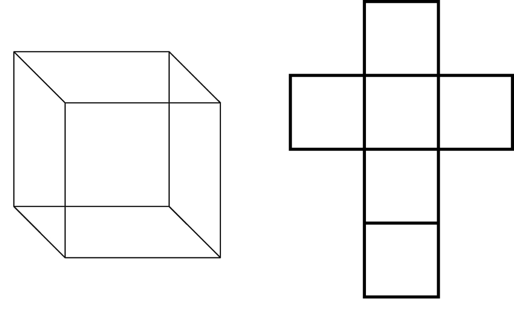
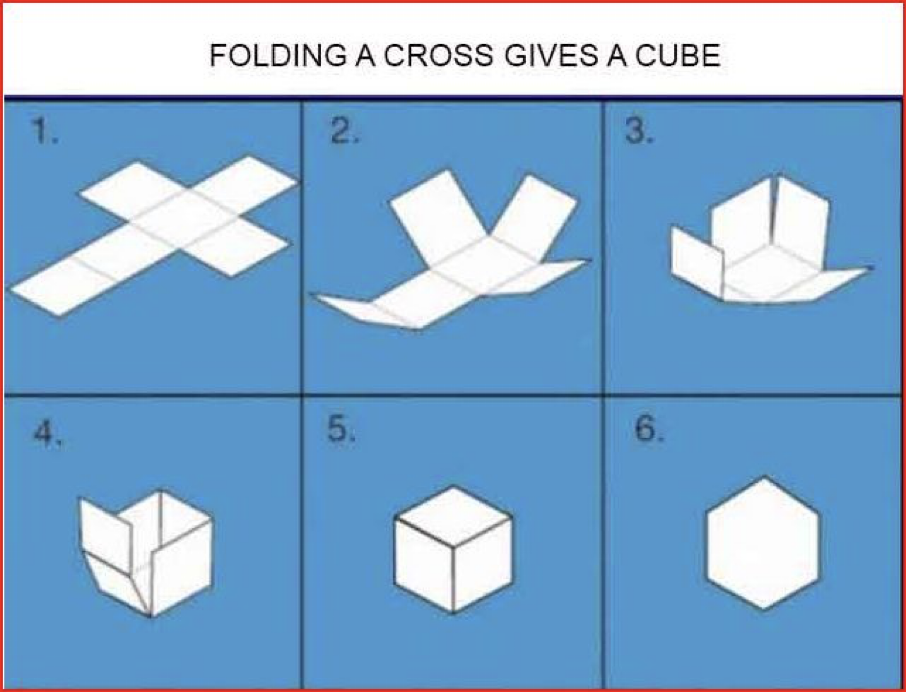

(част 1 – Въведение)

> 𝐈 𝐮𝐧𝐝𝐞𝐫𝐬𝐭𝐚𝐧𝐝 𝐭𝐡𝐞 𝐆𝐚𝐦𝐞 𝐧𝐨𝐰. 𝐈𝐭’𝐬 𝐜𝐥𝐞𝐚𝐫 𝐟𝐨𝐫 𝐦𝐞 𝐭𝐡𝐚𝐭 𝐭𝐡𝐞𝐫𝐞 𝐚𝐫𝐞 𝐜𝐨𝐧𝐬𝐞𝐪𝐮𝐞𝐧𝐜𝐞𝐬 𝐨𝐟 𝐝𝐞𝐧𝐲𝐢𝐧𝐠 𝐭𝐡𝐞 𝐩𝐫𝐨𝐠𝐫𝐚𝐦 𝐢𝐭𝐬 𝐩𝐨𝐰𝐞𝐫.
>
> Разбирам Играта сега. За мен е ясно, че има последствия от това, да отричаш силата на програмата.
> 
> Ra Uru Hu

_(Това е статия, писана през вече „далечната“ 2020 г. Авторката е еволюирала и надградила доста оттогава, но все пак тази информация съдържа много същностни пластове, има своето място в процеса и следва да бъде публикувана и тук ☺)_

Човек и добре да живее (или поне така да си въобразява), започва да пише за архонтите или, по-лошо – да си има работа с тях. При мен това е процес, който тече отдавна: ако върна лентата назад и в синхрон с належащото себеосъзнаване, активните ми наблюдения са от около 5–6 години насам. Преди горе-долу толкова време по редица стечения на обстоятелствата имах перфектните условия да се занимавам по-сериозно и задълбочено с езотерика и окултизъм, въобще да се обърна навътре към себе си и да се отдам на (по)знанието и четенето. По това време получих възможността да живея в изолация (before it was cool), можех и усърдно да тренирам и медитирам, спазвах много изчистен режим на хранене (без консерванти, junk food и всякакви други вещества или пък информационни потоци, затварящи съзнанието) и всичко това създаде перфектната предпоставка за „потъване“ в дебрите на Мистичното. Започнах да изучавам различните религии и митологии (особено исляма, митологиите на Шумер и Древен Египет, също така и магическото изкуство и, естествено, всяка „бродеща“ наоколо конспирация; изчетох, разбира се, и всичко налично в българския „езо ефир“). Не подминах и историята и културологията като дисциплини, най-вече защото по това време учех подобна специалност в университета (съответно и черпех доста силно от различните свързани егрегори, съдържащи много информация). Изучавах и семитски езици. С една дума, бях се заровила като прасе в тикви в окултната литература и търсенето на „голямата истина“. Забавно е да се отбележи, че този период започна със силна фрустрация от моя страна по всички теми, свързани с конспирации, извънземни, астрология (с която се занимавам вече от доста години), и като цяло реакцията ми беше „не ме занимавайте с тези глупости“. Навлизането ми в определени теми, съпътствано с определени преживявания, обаче обърна нагласата ми на 180 градуса и ме засили директно „in the deep shit“. Трудно ми е да определя кое конкретно отключи това, но подозирам, че освен комбинацията от фактори, конкретно влияние за отключването на генетичната ми памет от „минали животи“ имаше изучаването на арабски език и иврит, както и прочитането на Корана (който е доста солиден егрегор, съдържащ множество кодове за активация, за разлика от Библията, която вече толкова се е разводнила – най-вече заради преводите и преекспонирането, – че почти нищо от изначално заложената енергия и намерение не е останало). Интересно е да се отбележи, че и изучаването на историята на ранните халифати отключваше в мен изключително силна реакция на авторегресия – буквално не можех да си взема шибаните изпити, тъй като след има-няма 20 минути четене „припадах“ в дрямка (все едно някой ми изключваше шалтера и в резултат навлизах в сънувано осъзнаване на паралелни реалности), от която се събуждах в меко казано странно състояние и със странни спомени и знания „от нищото“. Доста бързо стигнах до книгите на Морнинг Скай и работата на Paralelreality, които ми се видяха като „самата явна истина“ (like, come ooon, how are you not seeing this???...). Тогава започна и реалният филм, защото тези издания са адски натоварени с определена енергия, която просто „смъква воала“ на илюзията и ръчка жестоко самите основи на кода. Всичко това разшири съзнанието ми и ме засили директно в света на ОИТ-а. След всичко това, да кажем, че затворих очите си за света и прогледнах наистина... този път.

В този период започнах да имам изключително силни ОИТ, [астрални проекции](/blog/categories/astral), както и редица по-неприятни и стресиращи преживявания (в този период дори отключих „автоимунно заболяване“ – long story short, ако тегля чертата, нямам алергия само към месо и определени плодове – carnivorous, а?). Незабравими бяха и срещите ми – не от 3-ти, 4-ти и 5-ти вид, а направо от 10-ти (имах невероятно силно осъзнато ОИТ, в което се разхождах гола пред спрелите погледи на извънземни, които ме попитаха телепатично „защо пак си излязла от камерата“ – ще разкажа подробно за това друг път ;D).

But before we get to the weird side of the internet again, едно по едно...

За щастие, бях съобразителна да си водя записки и [дневник на сънищата](/sonovnik), за да не би случайно да пропусна нещо от този процес. Естествено, не всичко е записано или запазено и вече не всичко мога да си спомня, още по-малко с присъщата му уникална и силна енергия, с която самото преживяване е било импринтнато в момента, но... все пак черно на бяло го има.

(Отсега предупреждавам, че тази статия е малко субективна и карам изцяло на дясно полукълбо – демек мои преживявания и интуитивни прозрения. Не ме интересува откъде идва информацията и няма да си губя времето и енергията да я рационализирам излишно. Тук просто споделям опитността си.)

**В крайна сметка всичко започна да се върти около скапаните архонти.**

Така, моите първи срещи с архонтите – и всъщност първият път, когато научих това име – бяха в един сън. Преди това дори не бях чувала думата (поне нямам съзнателен спомен), колкото и да е странен този (необразован) факт... Мисля, че в този период вече бях навлязла доста навътре в материята и ОИТ-овете ми започнаха да стават брутални, все по-осъзнати и контролирани и съответно бях „хваната“, че се навъртам, където не трябва. Самият сън, в който се срещнах с архонтите, все още го помня доста добре. Бяхме някаква група хора, явно се познавахме в т.нар. „астрал“ и мисля, че бяхме и в паралелно измерение (повечето „сънища“ по същество са преживявания в „паралелни измерения“, а „астралът“ е нещо като layer между тях – пресичане и наслояване на образи) и не помня точно какво е ставало, преди да навлезем в нещо като подземна гробница. Преобладаващите тонове бяха светлосиви и всичко изглеждаше някак доста прашно – такова усещане оставаше в мен (в нас – усещах и другите в групата). Имам лек спомен, че бяхме с раници и май носехме нещо в тях, нещо, което бяхме... откраднали? Кристали, maybe, who knows... Загледах се в стените и видях как постепенно те започват да се ронят и от тях се оформят човешки тела, които, сега като се замисля, ми напомнят точно на ето това:

_Това са съществата от клипа на Linkin Park – [In the End](https://www.youtube.com/watch?v=eVTXPUF4Oz4)._

_(Между другото, в началото на този клип има един доста интересен кодиран текст, който като стилистика малко напомня на иврит, но представлява прост геометричен шифър за заместване, наречен **[pigpen cipher](https://en.wikipedia.org/wiki/Pigpen_cipher)**, който – никак не изненадващо – е бил използван от фримасоните и розенкройцерите (чиято литература е изключително стойностна, btw, и на база на която ще публикувам доста изследвания в бъдеще). Повече информация за евентуалното разшифроване можете да откриете [тук](http://scienceblogs.de/klausis-krypto-kolumne/2017/07/22/who-can-decipher-this-encrypted-text-in-a-linkin-park-video/). Повече не съм си правила труда да проверявам – засега не е в моята синхронистична нишка...)_

Тези човешки тела се оказаха оживяващи същества (които дълго време са били „заспали“, а нашите действия ги съживиха), които постепенно започнаха да се оформят и да излизат от стените. Тогава настъпи осезаем страх и паника и някой се развика: _„Архонти, архонти, бягайте...“_. В този миг всички хукнаха супер организирано като по филмите (поне беше супер забавно :DDD) и можех да наблюдавам отстрани как всичко се движи като на филмова лента (което малко провокира в мен въпроса доколко естествено е било това изживяване – движението „като на лента“ в съня говори за използване на психотронни генератори за създаване на сънища). Тези същества по някакъв странен начин започнаха да ни преследват, незнайно как, защото очевидно не вървяха (!!!), а все едно летяха или по-скоро се придвижваха през време-пространството (???); но Ви казвам – такова бягане нито съм сънувала, нито съм тичала :D Паниката беше **зловеща**. Нека подчертая още драматизма: усещахме, че сме събудили древна сила, която не е трябвало да събуждаме (така че, ако нещо сме осрали – сори... ;D). Опасявахме се, че ако ни хванат, всичко е „край“. Самият край. Ужасен край. В момента ми се губят други подробности от линията на съня – отпреди и след това. Единственото, което си спомням, е, че стигнахме до нещо като **спирка** (което е символ на придвижване от едно измерение или ниво в друго или от един клъстер на астрала в друг). Следващото, което помня, е, че се събудих плувнала в пот и веднага записах името „архонти“ в дневника за сънища до мен.

Идея си нямам как е приключил сънят, но сега предполагам, че качването на всички ни в колата е било „излизането“ от астрала (всъщност вече не съм сигурна дали трябва да го наричам астрал...). Самото излизане не го помня – сигурно защото вече не съм имала достатъчно енергия да поддържам тази паметова следа...

_(Между другото, тук отварям една интересна скоба: обикновено самото начало на съня и навлизането в подобна опитност не се помнят после в будно съзнание и трябват целенасочени тренировки, за да започне сънуващият да помни и началото на съня си. Интересното е, че два пъти реших да пробвам с едно магическо заклинание, което ми попадна случайно, за да започна осъзнаването на съня от самото начало – и се получи! При това изскочиха интересни подробности. Първия път видях голям сив левитиращ и въртящ се куб в центъра на пустиня, а на самия квадрат имаше лицето на сив. Другият случай беше, когато се опитвах да достигна архетипа на Луцифер и да видя какво се крие зад него – спомням си, че в съня си навлизах в някакво тъмно пространство и тъкмо се готвех да отворя вратата, за да видя „лицето му“, когато ме нападнаха 2 изключително злобни черни кучета. Това със сигурност беше т.нар. „астрална охрана“ и тя наистина доста често се използва, когато нещо трябва да бъде държано в тайна и под защита. Не знам дали беше астралната форма на някой маг, егрегор или нечий действителен извънземен образ, но усещането, което получих от кучетата, е, че охраняваха нечий женски образ, който е първоизточник на архетипа. Кубът със сивия пък си е типичният „lock“, който трябва да бъде отключен, за да стане съзнанието на обекта достъпно, тъй като повечето „сънища“ наистина са програмирани „реалности“ от сивите и техните технологии. В случая съм 100% убедена, че е ставало въпрос за препрограмиращ сън – каквито имах адски много по това време.)_

Мисля, че оттогава започнаха наистина сериозните проблеми от енергийно естество в живота ми и по-надолу ще обясня какво имам предвид. Всъщност не съм съвсем убедена дали е имало чак толкова големи проблеми, или просто осъзнаването за тях се е „изострило“. В крайна сметка повишаването на „вибрациите“ (a.k.a. скаларният потенциал на съзнанието) открива полезрението ни за множество съществуващи нива на реалността, които досега са оставали незабелязани. Колкото това е философски въпрос (на перспектива), толкова е и въпрос на механика.

Но защо е важно да споделя моите преживявания с архонтите? За какво въобще ги има? И за какво се боря?

Първо, защото очевидно Висшият ми Аз иска това.

Второ...

Етимологията на името сочи, че **архонт означава „управител“**.

**Какво управляват те?**

**Очевидно някаква система... Всяка система има нужда от нива на управление, от йерархии, за да функционира. Съответно има нужда от управители** или **надзиратели**. В [гностицизма](/blog/categories/gnosticism) архонтите са седемте планети: Сатурн, Юпитер, Марс, Слънцето, Венера, Меркурий и Луната. И какво мислите, че управляват те? Матрицата, в която живеем... Астрологията... мда ☺ Но за това ще говоря много подробно по-нататък... Накратко, така започна запознанството ми с архонтите и тяхното изследване ☺

**Малко философски аспекти...**

Сега, ако трябва да се разфилософствам, ще кажа, че целта на архонтите и органичните портали е да направят играта, която играем тук, по-интересна и предизвикателна. Иначе няма да има смисъл да се играе. И това _от една страна е вярно_. От друга страна обаче е неизбежно да ги има, тъй като те са част от механизма на кода и са негови **keeper-и**, тоест това е просто механизмът, по който нещата се случват. Истината обаче е, че целта им е да ни държат в **ниски нива на съзнание** – нещо, известно в езотериката като „ниска плътност“ или 3D. Архонтите са контролният механизъм на симулацията и матрицата, който ни държи в капана на външния фокус – вниманието навън, – пречейки ни да намерим вътрешния – вниманието навътре, вътрешния лабиринт или начина за излизане от матрицата. Те си служат с различни механизми, които целят да възпрепятстват високото ниво на себеосъзнаване и разширяването на съзнанието. Това е механизъм, заложен в гените, и за цялата генетика може да се говори като за **генетичен императив**, чиято цел е да „тика“ матрицата в определена посока. Той се програмира в синхрон с 2 или 3 основни „кристала“ от тъмна материя, които са носители на съзнанието. Те формират 2 неща – **тялото или подсъзнанието (в [Хюман дизайн](/blog/categories/astralen-dizain) този кристал е наречен Design crystal)** и **личността**, или това, което си мислим, че сме (това е т.нар. **Personality crystal**). В допълнение, като част от полярната фрагментация на съзнанието се развива и **суперподсъзнание**, което се оформя в зародиша около третия месец от бременността.

Ще обясня всичко това подробно – целия механизъм на инкарниране и генетичен импринт, стъпка по стъпка, когато му дойде времето...

Това, което обаче повече ме притеснява, е другата им, много по-съществена цел и предназначение, с което лазят по нервите на всички тръгнали по пътя към „разкритието“: тези програми реално са инструмент в ръцете на играчите извън матрицата за манипулиране и „блокиране“ в ниските нива на полуосъзнаване или направо за тотално роботизиране и хомогенизиране. Самите архонти са пазители на гейтове (тоест на порталите), но могат да бъдат използвани по различни начини и от различни играчи според механиката на системата и целта. Във всеки случай те се подчиняват на един общ принцип и на генетичния императив на Играта. Да, те следят кодът да „върви“ както трябва, но в същото време могат да служат и като насочващи „станции“, които да ни помогнат да изпълним потенциала си – който обаче отново е зададен по генетична програма. Но тъй като живеем в дуалност, всичко си има и обратна страна. И точно тук те могат да бъдат **хакнати**... от този, който познава кода, разбира се :))) Това е и идеята на цялото истинско [магическо изкуство](/blog/categories/magick) – манипулиране на кодовете на симулацията в наша полза, тоест борба с детерминизма и работа със свободната воля на Егото, доколкото все още я имаме. Важно е да се отбележи, че Земята по принцип е поле на остър конфликт в еволюцията на съзнанието – между детерминизма и ограничената свободна воля.

Държа да подчертая, че темата за архонтите ще бъде изследване върху цялата система на Симулацията, което ще се разгръща постепенно. В него ще има доста осезаемо присъствие на системата Хюман дизайн, както и на астрологията и философията на розенкройцерите. Изследванията ми включват и трудовете на [Блаватска](https://bg.wikipedia.org/wiki/Елена_Блаватска) и [Алис Бейли](https://en.wikipedia.org/wiki/Alice_Bailey), както и дисциплините на демонологията, ангелологията, гностицизма, [таро](/blog/categories/taro) и много други. Това е нещо, по което работя от години. Всички тези учения и системи са различни начини и различни аспекти на една и съща истина – астрогенетичния и астрален код на homo sapiens и как работи Играта в тази част на Вселената, и по-специално – Земната платформа. Всички тези системи от информация са „изтекли“ от различни източници на извънземни и земни фракции (включително Обществото на Енки – култа към змията) и идват от ренегати, които се стремят да предоставят кода за матрицата. От друга страна, популяризирането и комерсиализирането на тези науки отново е подтикнато от определени фракции – именно за да се затвърди следването на този детерминистичен код. Разбирате, че става въпрос за схемата „разделяй и владей“ и като цяло трябва да се бяга от всякакви егрегориални интерпретации на ученията. Самата система работи с понятия като код, съпротива, потенциал, реакция-отговор, цел, среда, мотивация, трансференция и т.н. Цялото ми изследване ще вземе за основа „откровението“ на Ра Уру Ху, представено чрез системата [Хюман дизайн](https://www.jovianarchive.com/), тъй като това е най-прецизно подреденият информационен поток, който имаме за нашата локална матрица. Понеже живеем в квантова система, тя се подчинява на закона за информацията – а именно, че информацията трябва да се разпространява свободно в системата, за да може тя да е свързана и функционираща. Или както се казва, няма скрито-покрито, стига да умееш да търсиш ;) Разбира се, извънземните полярности са напълно наясно с този факт, затова и го играят на принципа: **„Ако те трябва да знаят за това, ние ще им кажем точно каквото трябва да узнаят.“** Макар по същността си това, което се преподава като Хюман дизайн, да е поредният цикъл на пропаганда от една определена фракция, тази система следва да се взема доста насериозно и да се изучава почти маниакално – в нея има много истина и несравнимо точна информация.

Нека изясня един принцип още отсега. Цялата информация – 100%, всичко, което се излива в информационното „езотерично“ пространство (пък и в политическото и научното – всичко е част от цялото и изкуствено се създава илюзия за разделение – „Разделяй и владей“), поднасяно под формата на ченълинг, блог, книга, каквото и да е учение или личност, които са малко по-известни и забележими, е програмирано или частично програмирано събитие, а съответната личност представлява **поставено лице (осъзнато или не) на някоя от фракциите.** Това не е параноя. Това е факт. Това е играта. Просто така работят нещата! Не изключвам, а дори все повече се убеждавам, че доста от тези популярни говорители са шейпшифтъри... Замислете се. Живеем в изцяло стерилна, програмирана и контролирана платформа. **Планетата изпълнява ролята на затвор с различни функции** (няма да е лъжа, ако кажа, че сме под **планетарна карантина** – pun intended). Защо трябва да има нещо тук, което не принадлежи на играта? Това би било парадокс на самата игра (сега не ми се говори за парадоксите – оставяме ги настрана; trust me, не сме от тях, малцина са, но и те са част от друга игра...). Освен ако съответният източник на информация не е тук в качеството си на **Наблюдател**, трудно бих очаквала обективност. **Наблюдателите са „инкарнирани“ пратеници на различни наблюдаващи фракции и обикновено са тук с официална цел**. Те нямат право да говорят. Само наблюдават и събират информация от личен опит – да видят нещата „на терен“ и после, естествено, „докладват“ на съответната фракция, както и пред различните Комитети. Разбира се, и тук има игра, защото много от тях могат да бъдат „активирани“ и препрограмирани да служат на определена адженда. Отвъд това те не могат да разпространяват свободно истински стойностната информация без филтри. Всяка информация има пропаганден и личностен филтър и следва правилото 90/10 – 90% mindblowing truths и точно 10% манипулативна лъжа или изопачаване, което е хем нарочно, хем механизъм на лингвистично програмиране. Така че просто не могат. Такъв е законът – така е написан кодът. И колкото по-надълбоко отиваш в знанието и осъзнаването, толкова по-ясно става това. Трудно бихме могли да мислим без езика и неговите ограничения. Просто казано: всеки чува каквото си иска или каквото може (според нивото, опитността и пътя, до които е стигнал, и от тази гледна точка – всеки си следва фрактала). Всяко същество неизменно ще пречупи информацията през собствените си филтри на опит и биография. Както казва Ницше, всяка философия не е нищо друго освен собствената ни автобиография, а всяко говорене по същество е философия, дори когато претендира за научна изчерпателност. Просто съзнанието е над всякакво емпирично наблюдение, а възприятието и перспективата ни за нещата непрекъснато се менят. Това обаче не означава, че няма истина и че не сме фиксирани на определени пътеки – **фрактали** – те крепят съзнанието „стабилно“ и „в опитност“. Означава само, че истината е субективна в изразяването и възприемането си, не че я няма като същност и форма... Означава също, че доста често говорим за едно и също, без да се разбираме, както и обратното... Лингвистично-генетичното програмиране е наистина забавно :)))

Така, ако все пак Наблюдателите проговорят, моментално биват „изтегляни“. В момента, в който един наблюдател успее да пречупи програмирането си, както и общата съпротива, която среща от настройката на програмата, и реши да говори, губи статута си на висш член на Империята или Федерацията (зависи кой го е пратил тук) и (о)става политически затворник на Земята. Гарантирам, че повечето не искат това. Все пак подозирам, че има няколко такива, но това не променя факта, че информацията, която подават, е леко оцветена от перспективата на съответната фракция и нейните интереси, „вкаменявани“ в колективното съзнание милиони години наред. Няма как да бъдем „обективни“ (whatever the hell that means...). Лично аз се убедих, че доста популярни езотерични фигури са просто поредните играчи; за други, честно казано, още се чудя... Във всеки случай едва ли има вариант, в който можеш да не играеш личната си съдба.

И все пак има една истина за механиката на нещата, защото това е наука, тоест логос, и отговаря на някаква историческа фактология. Щом нещата се случват, значи са в система.

И така...

**Защо въобще има архонти и органични портали?**

Матрицата е сбор от феномени. Тя представлява сравнително сложен, но доста стабилно работещ комплекс от системи, които имат за цел **абсолютния контрол**. А формите на контрол са много. Ето някои от тях:

1. Земята е **ферма**. За всеки, стъпил сериозно на пътя на езотериката и себепознанието, концепцията, че **Земята е затвор и ферма**, трябва да е ясна като бял ден – иначе, сори, но още не сте дори в началото на пътя. Допускам, че това се чете предимно от хора, които боравят добре с **енергията** и имат **усещане** за нещата, тоест не са лумпени или органични портали. За симулация и ферма (жътва) се говори буквално във всеки езотеричен, религиозен, гностически, митологичен и всеки по-сериозен окултен текст и да не се чете между редовете е направо недопустимо. Отново – абсолютно всяко мистично учение говори за това. Всички тайни учения от началото на летописа са имали за цел да разкрият „тайната на тайните“ или т.нар. философски камък и тази тайна се открива навсякъде под формата на кодирано послание за този, който умее да чете между редовете, а на места е написана и черно на бяло. Целите на фермата са много – от точене на енергия, през добив на полезни изкопаеми, до използването на физическите тела за храна, както и, разбира се, процесът на „жътва“ на съзнанието.

2. Земята е **затвор**. Планетата е затвор за „провинили“ се извънземни, прегрешили срещу някоя от фракциите. Обикновено тук се пращат по-големите „клечки“, които обикновено и вършат някаква работа за фракциите (предварително програмирани), използвани като информационни мулета. Земята е мястото, където се затварят особено „прегрешилите“, които са във високи нива на съзнание, тоест са напреднали и изолацията им веднъж завинаги от делата на галактиката е наложителна, като идеята, разбира се, е да бъдат „изтикани“ и „набутани“ обратно в ниски нива на съзнание. Това, разбира се, важи и за средните нива на съзнание, както и за по-ниските, развили се на Земята, като крайната цел е всичко, което не може да бъде препрограмирано в биороботи за Империята, да бъде изтласкано в т.нар. 2D – символ на което е самият кръст, който представлява не друго, а двуизмерна репрезентация на 3D куба, който от своя страна е репрезентация на 4D [тесеракта](https://bg.wikipedia.org/wiki/Тесеракт) и т.н.

   
   

   И ако на някого не му се вярва, че има живот във второ измерение, го съветвам да прочете [„Флатландия“](https://bg.wikipedia.org/wiki/Флатландия) или да погледне ето този епизод от знаковия сериал **[The Orville](https://en.wikipedia.org/wiki/The_Orville)**:

3. **Земята е поле на Игра от ново ниво**. Философията настрана – на едно по-практично, **политическо ниво** (хах!), бих казала, нещата добиват доста конкретни измерения. Като една от (бившите?) колонии на Империите Земята е място на всякакви **експерименти**, където могат да бъдат отделени следните групи:
   - предишни играчи от платформата (атланти и други, които са средно напреднали, все още предимно полярно светли – все пак това в момента се води пета версия или пета раса на симулацията);
   
   - извънземни затворници (тук групата е наистина разнообразна и заслужава цяла отделна статия) – обикновено силно напреднали съзнания, но и не само. Срещат се и типичните закостенели извънземни инкарнации, зациклили в тъмни или светли модели на ниско ниво;
   
   - „любимите“ органични портали – създания, носители на витална сила и материя, но без его-воля, тоест без съзнание;
   - други случайни и временно генерирани форми от симулацията, които не са самостоятелни съзнания.
   
Историята на самата матрица, както и механиката ѝ няма да описвам засега, а ще разгледам само отделните технически аспекти. Засега съм по-склонна да приема теорията, че тази матрица съвсем буквално, физически съществува (тоест не сме на кораб и това не е тренировъчна симулация като в „Стар Трек“, примерно, лол), но все пак не изключвам възможността за **„тренинг симулации“** (тоест излиза, че в момента си пиша сама с още може би 5–10 човека :))) Не изключвам възможността и аз да преживявам такава преди действителното ми „поставяне“ в реална планетна колония... :)

НО по-скоро всичко е метареално и самата „реалност“ е програмирана на квантово ниво посредством широко свързана гама от технологии – нано- и биотехнологията на **black goo (черното масло)**, различни видове „кристали“, имплантирани в мантията на Земята и в клетките на човешките тела, решетките около Земята, които представляват различни дефлектори, също и насочените неутрино излъчватели и преобразуватели (главно на другите планети от Слънчевата система, както и от звездни системи в съзвездията Голяма мечка, Плеядите и, естествено, любимата ни звезда – Сириус :P), а с това и различният технологичен и социален комплекс, обслужващ първичното генетично програмиране. Това е един доста голям, добре смазан и работещ технологичен комплекс, който ще опиша постепенно. В случай че не бъда спряна. Ще опиша и технологията, стояща зад астрогенетичното програмиране, което изследвам специално.

Обратно към действителността... kind of...

Защо въобще говорим за **програмиране**? Защото животът, както го познаваме днес на Земята, не е възникнал случайно. Вярно е, че всичко във Вселената почива на една математическа закономерност, но тук можем да говорим за вторично и дори третично програмиране въз основа на изначалната матрица. Имаме пластове от програмиране върху програмирането. **На всяко ниво обаче се създават програми-пазители, които да отговарят за процеса, и именно те са диференциацията, която разделя и форматира отделните реалности**. Тоест има компресия и множествено отдалечаване от първоизточника и на всяко от тези нива има различна форма на съзнание и възприятие. Съзнание, програмиращо съзнание. Предполагам, повечето от Вас са запознати с книгите на Морнинг Скай (отново и отново), а ако не сте, е хубаво това да стане, понеже те са най-достоверният и пълен ресурс, който имаме относно истинската история, и всичко останало трябва да бъде надграждано над и около тях. Без история ще се лутаме в безсмислени теоретизации. Зад всяко нещо има основание и причинно-следствена връзка и историята помага да се видят тези нишки на реалността. Езикът и историите в книгите му са доста конкретни и точни и всеки друг ченълинг е хубаво да се напасва към тях, макар и те да имат своето политическо изкривяване. Нещата на Еаша Ашаяна също са доста солидни, но там пропагандата на псевдосветлите за христовото съзнание (a.k.a. Енки и Еа-Су) ми идва в повече. В нещата на Алис Бейли също има доста подхвърлена информация, както и в редица други книги, които сега няма да изреждам. Както вече казах, информацията е разпиляна, но се събира като доста хубав пъзел, ако се следват синхронизациите и пътят на логиката. Никой ченълинг не е перфектен и РМС си има своите изкривявания, но... затова трябва да се мисли и да се търси, а не информацията да се поема наготово и да се препредава като папагал само защото „ни повдига вибрациите“. Всичко може да ти повдигне вибрациите (както и други неща), стига да е импринтнато със съответната енергия. В случая става въпрос по-скоро за изключителната енергия на тази информация, която директно „отваря“ съзнанието и предизвиква много силни синхронизации и странни преживявания – нещо, което само истината прави. Трябва да се търси разширяване на съзнанието, а не само „вдигане на вибрациите“...

Anyway, хубаво е да се помни, че в момента, в който някой Ви говори прекалено мило или стереотипно и се заканва как ще дойде да Ви спаси и всичко ще стане цветя и рози, значи сте поели солидна доза булшит. Има много наблюдатели, които са започвали да говорят истината, но впоследствие са били препрограмирани от архонтите. Трябва по-критичен поглед и за съжаление виждам, че повечето хора не познават самия живот и неговата сурова прагматичност, а са като малки невинни дечица, които се привличат като молци към различни „лампички“ на просветление и знание. Това са „младите и светлите инкарнации“. Това, че някой те зарежда с „позитивна“ енергия, не означава, че ще ти предаде и стойностна информация като съзнателно познание. Слушайте и четете между думите. Също толкова притеснителни са ми и хората, за които това са „пълни глупости“, но на тях по начало давам един солиден ignore, тъй като са ми нек'ви сухи плъхове, а теорията сочи, че обикновено са агенти на самата матрица или органични портали :)

Говорейки за източника на „светла вибрация“, ето нещо за размисъл:

   https://www.youtube.com/watch?v=fCa-v2CeyY0

_Сцена от сериала [„V“](https://en.wikipedia.org/wiki/V_(2009_TV_series)), в която Анна и дъщеря ѝ – хибрид между извънземната рептилска раса и земните хора – „облъчват“ хората с мисъл-форми посредством машина, която имплементира в населението чувство и преживяване на „bliss“ и „светлина“._

Разбира се, сигурно и аз няма да бъда докрай изчерпателна и обективна, понеже и аз представлявам определена фракция (аз поне не се правя, че съм „чиста“ ;О). (Бел. ред.: към 2023 г. вече мисля, че съм доста обективна...)

НО! Никой и нищо не е 100% и това не зависи само от намеренията или знанията на субекта, а и от начина, по който информацията се изкривява, когато се предава чрез езика от съзнание към съзнание. Никой не е 100% от общата истина, но е 100% фрактал от цялата истина! Затова се осланяйте на това, което резонира с Вас и на което можете да се доверите интуитивно. Моят произход (поне докъдето си го спомням) е от стара тъмна **Сирианска фракция на РА** – известна в колективното съзнание като Йерархията **Ursa Major**. Аз съм ренегат и затворник. Заточена съм тук заради предателството си към официалния двор и договора на сирианците с драконианската кралица. Както и да е, формацията, от която произлизам, е един от архитектите на локалната симулация. Съответно информацията тук идва директно от един от първоизточниците – архитекти на **локалната** игра (да не се бърка с по-горните пластове на Играта).

Важно уточнение е, че единствено тъмната страна може да говори истината тук, ако реши, но хората на ниво личност са така програмирани, че не биха могли да възприемат тази информация. Информацията, подавана от тъмната страна, е твърде директна и тежка като вибрация, без емоция или „сладникавост“ в нея, без морално противопоставяне или обвинение, затова обикновеният човек, програмиран да реагира на емоционални стимули, просто ще бъде отблъснат, защото тя подтиска егото му или някой друг аспект на личността. **Истинската информация е извънегрегориална**. Отново, всичко това е код. Изключително лесно е да манипулираш човек чрез емоционалното му тяло и тялото на егото (които са аспекти на личността). Йерархиите са направили това нарочно. Съответно съзнанието тук оперира през тези капани. От една страна, емоцията има нужда да бъде изразена, от друга – тя може да стане причина за „падение“. Това е астрогенетично програмиране, което се преодолява много трудно. И отново – то контролира личността и тялото. Голяма част от хората са програмирани да са емоционално уязвими, а друга част биват повлияни от този кондишънинг (обусловеност) и са по-склонни да приемат изреченото от някого, който дори само претендира, че е емоционално отворен и добър към тях. Това, както се досещате, отваря много вратички за манипулиране. Ако не си склонен да надраснеш собствения си фрактал и да поглеждаш истината от различни посоки, това е рецепта за провал като съзнание. _(Бел. ред.: към 2023 г., след събитията от последните години и вече към края на Плутоновия цикъл в Козирог, виждам обаче, че нещата започват да се променят и доста хора оценяват истината хладно и безпристрастно.)_ Нещата отново не са едностранни – емоционалното тяло е източник освен на огромна физическа сила и на духовна такава и е център, през който се осъществява катализата на т.нар. духовен напредък. Не случайно то е цел на всички препрограмирания, които се правят от фракциите. Точно затова е толкова важно за хакване и контрол. Get it? Ето и нещо за размисъл по темата, отново от сериала „V“:

https://www.youtube.com/watch?v=smDRrHh6vdg

**Накратко, емоциите могат да бъдат източник на илюзии или на истина и ние не можем да направим нищо по въпроса. Това, което трябва да помним, е да търсим собствените си усещания за нещата.**

**– May the Force be with us –**
