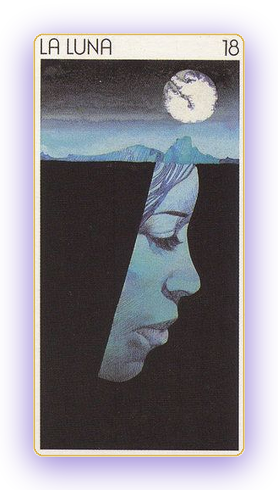
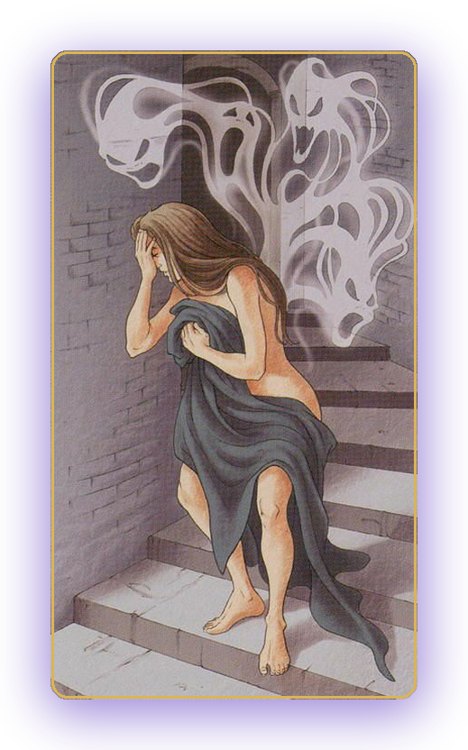
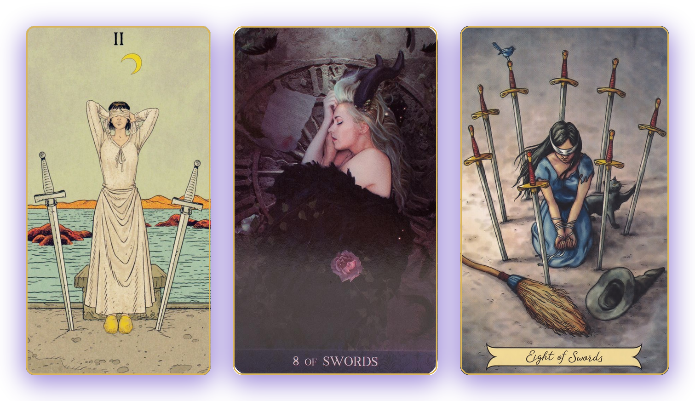
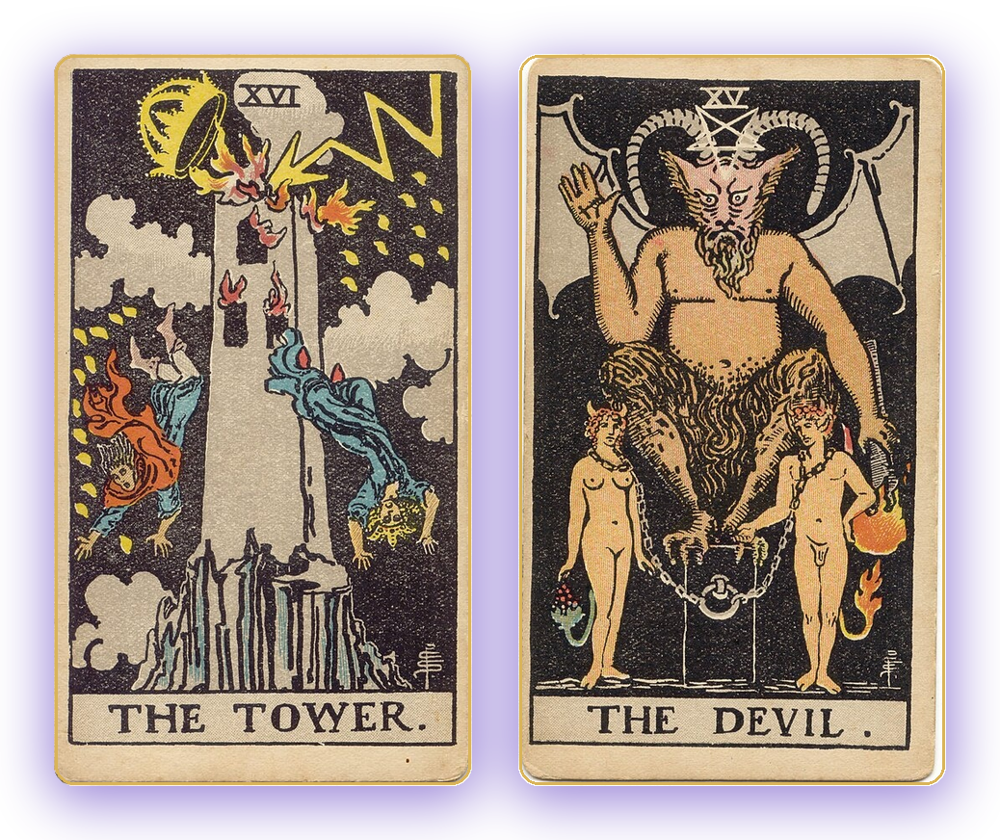
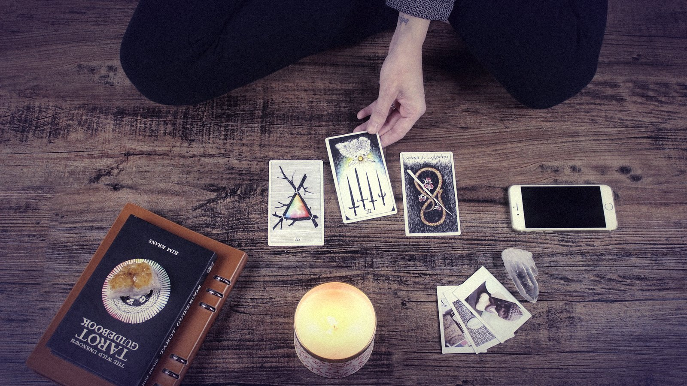
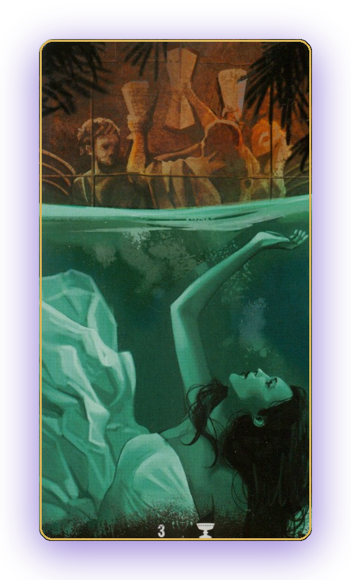

Това е въпрос, който ми задавате често – и който аз самата си задавам почти при всяко гледане. Затова днес искам да поговорим за една от най-тънките граници в работата с Таро: границата между интуицията и страха.

Едно от най-големите предизвикателства в Таро е да се научим да различаваме интуитивното възприятие от собствените си психологически проекции. На пръв поглед това изглежда лесно: интуицията ни подсказва едно, страхът – друго. На практика обаче границата между тях често е доста размита.

Особено когато задаваме въпрос със силен емоционален заряд, съзнанието ни вече участва в тълкуването, преди дори да сме обърнали първата карта. Имаме очаквания, желания, подозрения, предварително изградени сценарии. Понякога дори не осъзнаваме колко силно сме привързани към определен отговор.

Тогава възниква един съществен въпрос: **когато усещаме нещо, откъде знаем, че то идва от интуицията ни, а не от страха, който се опитваме да потвърдим?**

## Интуицията не е същото като емоционалната реакция

Често използваме думата „интуиция“, за да опишем всяко силно вътрешно усещане. Но интензивността на едно преживяване не е доказателство за неговата достоверност.

Можем да изпитваме изключително силно предчувствие, което всъщност е резултат от тревожност, несигурност или натрупани очаквания. Можем също така да имаме тихо, почти незабележимо усещане, което впоследствие се оказва много по-съществено за разбирането на ситуацията.

В психологически план интуицията може да бъде разглеждана като форма на [бързо разпознаване на закономерности](https://en.wikipedia.org/wiki/Recognition-primed_decision) – мозъкът обработва информация, без процесът непременно да достига до съзнателното ни внимание. Това обяснява защо понякога знаем, че нещо не е наред, без веднага да можем да посочим конкретната причина.

В езотеричната традиция обаче интуицията има и по-дълбоко значение. Тя се разглежда като способност да възприемаме информация отвъд обичайния линеен анализ – чрез символи, архетипи, вътрешно познание и непосредствено разпознаване.

Лично аз смятам, че е важно да не смесваме тези две перспективи, но и да не ги противопоставяме непременно. Психологическото обяснение ни помага да разберем механизмите на възприятието, докато езотеричният модел предлага различен начин да осмислим преживяването.

И в двата случая обаче остава необходимостта да проверяваме собствените си възприятия.

## Страхът има нужда от потвърждение, интуицията – от наблюдение

Една от най-полезните разлики между интуицията и страха е начинът, по който те взаимодействат с информацията.

Страхът обикновено [търси потвърждение](https://en.wikipedia.org/wiki/Confirmation_bias) на вече съществуваща хипотеза. Ако се страхуваме, че някой ще ни изостави, можем да започнем да тълкуваме всяко негово действие като доказателство за предстоящо отдалечаване. Ако се страхуваме от провал, дори неутралните обстоятелства могат да изглеждат като предупреждения.

Страхът има склонност да стеснява възможностите. Той избира един сценарий, концентрира вниманието ни върху него и постепенно започва да филтрира цялата постъпваща информация през своята перспектива.

Интуитивното възприятие, поне в идеалния си вид, не изисква непременно потвърждение. То допуска наблюдение, изчакване и корекция. Не е необходимо веднага да превръщаме едно усещане в заключение или да предприемаме действие въз основа на него.

Това не означава, че интуицията винаги е спокойна, нито че страхът винаги е шумен. Понякога реалната опасност предизвиква силна реакция, а понякога тревожността се проявява като тихо и настойчиво съмнение.

Затова не бих използвала единствено емоционалното състояние като критерий. По-важно е да наблюдаваме какво прави дадено усещане с нашето възприятие.

**Дава ли ни възможност да виждаме повече – или ни кара да виждаме само онова, от което се страхуваме?**

## Проекцията – когато виждаме собственото си съдържание в картите

В психологията [проекцията](https://en.wikipedia.org/wiki/Psychological_projection) е механизъм, при който приписваме на външния свят съдържание, което произлиза от собствената ни психика. Това може да бъде желание, страх, подозрение, потиснато чувство или неприета част от личността ни.

В работата с Таро този механизъм е особено интересен, защото картите са символна система с множество възможни значения. Изображенията им могат да активират различни асоциации в зависимост от личния опит, емоционалното състояние и вътрешните конфликти на човека.

Например картата „Кулата“ може да бъде възприета като разрушение, освобождение, внезапно осъзнаване или прекъсване на остарял модел. Ако човек вече се страхува, че ще загуби работата си, той може автоматично да избере най-заплашителното тълкуване. А всъщност „Кулата“ би могла да означава пробив и прозрение, което ще го накара сам да разруши стария си ритъм и да напусне работата – или пък просто да промени визията си за нещата. Склонността към фатализъм и негативизъм в Таро, за съжаление, е доста честа.

Тълкуването може да бъде повлияно от внушение, което вече присъства в съзнанието на питащия.

Тук се появява и един интересен парадокс: понякога картите действително ни показват нещо важно, но ние не успяваме да го разпознаем, защото собствените ни страхове определят начина, по който го четем.

Затова смятам, че работата с Таро изисква не само познаване на символиката, но и сериозна степен на **самонаблюдение и самоусъвършенстване**. Необходимо е да познаваме собствените си психологически механизми, за да можем да различаваме информацията, която възприемаме, от значенията, които сами добавяме към нея.

## Архетипите и подсъзнанието – защо картите предизвикват толкова силни реакции?

Таро може да бъде разглеждано като система от архетипни образи, които представят универсални човешки преживявания: загуба, трансформация, власт, зависимост, избор, съзряване, освобождение и завършване на цикъл.

В аналитичната психология на Карл Густав Юнг архетипите са фундаментални структури на [колективното несъзнавано](https://en.wikipedia.org/wiki/Collective_unconscious). Те не са просто готови символи, а модели, чрез които психиката организира и изразява определени преживявания.

От тази перспектива Таро може да се използва като своеобразна проективна система. Картите предоставят символен материал, чрез който съзнанието може да разпознае и изведе на повърхността съдържание, което иначе остава трудно достъпно.

Тук обаче има една важна подробност.

Когато изтеглим карта, която силно ни въздейства, това не означава автоматично, че тя предсказва определено събитие. Възможно е да е активирала вътрешен конфликт, спомен или страх, който има нужда да бъде осъзнат.

Например „Дяволът“ може да насочи вниманието ни към зависимост, привързаност или загуба на лична автономия. Но преди да заключим, че някой външен човек ни манипулира, е добре да проверим дали картата не описва собственото ни отношение към ситуацията.

**Понякога най-важната информация в едно гледане не е какво ще направи другият човек, а какво се случва вътре в нас.**

## Синхроничността и въпросът за вътрешното познание

В езотеричния контекст интуицията често се свързва със [синхроничността](https://en.wikipedia.org/wiki/Synchronicity).

Когато задаваме въпрос и изтеглим определени карти, можем да възприемем комбинацията като символно отражение на ситуацията, която изследваме. В рамките на [синхромистичния модел](/portal) това може да се разглежда като взаимодействие между вътрешното състояние на наблюдателя и символния език на Матрицата.

Но тук трябва да направим едно разграничение.

Не всяко съвпадение е послание. Не всяка карта, която изглежда изключително точна, е доказателство за външна намеса или предварително зададен сценарий.

Синхроничността придобива значение чрез контекста, повторяемостта и връзката с конкретното преживяване. Именно затова е важно да наблюдаваме събитията във времето, вместо да изграждаме цялостна теория около един отделен знак (ако ви е интересно как изглежда това на практика, вижте моите [„Преживявания в синхроничности“](/portal/synchronistic_experiences_pt_1)).

Тук изключително голяма роля играят интуицията на наблюдателя и неговата изградена система за разпознаване на модели: кога знакът ни води към интуитивно послание от Висшия ни Аз и кога е просто проекция на собственото ни подсъзнание.

Възможно е дадена карта да ни насочи към нещо, което вече сме усещали, но не сме успели да формулираме. Възможно е и собствените ни очаквания да ни накарат да открием връзка, която реално не съществува.

Способността да различаваме тези две възможности е част от развитието на интуитивното възприятие.

## Как да разпознаем собствените си проекции при гледане на Таро?

Има няколко практически подхода, които могат да помогнат за по-обективно тълкуване.

### 1. Наблюдавайте първоначалната си реакция

Когато обърнете карта, запишете първата асоциация, която възниква. Не я редактирайте и не се опитвайте веднага да я обясните. След това разгледайте традиционната символика и останалите възможни значения.

Така ще можете да проследите разликата между спонтанното си възприятие и съзнателното тълкуване.

### 2. Запитайте се какво искате да видите

Преди всяко гледане е полезно да установите собствената си емоционална позиция. Надявате ли се на определен отговор? Страхувате ли се от конкретна карта? Искате ли картите да потвърдят нещо, което вече сте решили?

Това не обезсилва гледането. Напротив – помага ви да разберете през какъв филтър възприемате информацията.

### 3. Потърсете алтернативно тълкуване

Ако картата ви изглежда категорично негативна, опитайте да разгледате и другите ѝ възможни значения. Не за да си внушите по-приятен сценарий, а за да избегнете автоматичното заключение. Една и съща карта променя смисъла си според въпроса и призмата, през която я четем – показала съм го подробно в статията за [картата „Светът“](/blog/taro-karta-svetat).

### 4. Не задавайте един и същ въпрос многократно

Повтарянето на едно гледане, докато получите желания отговор, обикновено увеличава объркването. То може да засили тревожността и да създаде привидна последователност между тълкувания, които всъщност са резултат от различни моментни състояния.

Има разлика между това да повтаряте въпроса и да го задавате от различни ъгли – второто е техниката на „кръстосания разпит“, която описвам в [„Няколко кратки трика за ефективно гледане на Таро“](/blog/trikove-za-efektivno-gledane-na-taro).

### 5. Проверявайте тълкуванията във времето

[Воденето на таро дневник](/blog/kak-da-si-vodim-taro-dnevnik) е един от най-добрите начини да развиваме по-надеждна преценка. Записвайте въпроса, картите, първоначалното си усещане и последващото развитие на ситуацията.

Това ви позволява да установите кои ваши интуитивни прочити се оказват полезни и кои по-често отразяват страхове или предварителни очаквания.

## Интуицията и Висшият Аз

В езотеричната перспектива интуицията често се разглежда като канал за възприемане на информация от по-високо ниво на съзнанието, което обикновено наричаме Висш Аз.

Този модел предполага, че човешкото съзнание не се изчерпва с рационалното мислене и обичайните механизми на възприятие. Висшият Аз е по-широка перспектива, от която индивидуалната личност може да получава насоки за собственото си развитие и избори.

Но има един проблем: **не всяко вътрешно усещане е послание от Висшия Аз.**

Ако приемаме всяка мисъл, импулс или предчувствие за духовна информация, рискуваме да превърнем собствените си желания и страхове в абсолютни истини.

Според мен истинската работа с интуицията изисква точно обратното – да развиваме способността си да поставяме под въпрос собствените си възприятия, без непременно да ги отхвърляме.

В този смисъл Таро може да бъде полезен инструмент за изграждане на връзка с по-дълбоките пластове на съзнанието. Не защото всяка карта предоставя готов отговор от Висшия Аз, а защото символният език ни позволява да изследваме съдържание, което често остава извън непосредственото ни внимание. Затова и в [таро картата за деня](/karta-za-deniya) всяко послание завършва с въпрос за размисъл, а не с присъда.

## Най-важното умение е да не се идентифицираме с всяко свое усещане

За мен развитието на интуицията не означава да започнем да вярваме на всяко вътрешно предчувствие. Означава да опознаем собственото си съзнание достатъчно добре, за да можем да разпознаваме различните източници на информация.

Страхът може да бъде полезен сигнал, когато ни предупреждава за реален риск. Желанието може да ни показва какво е важно за нас. Проекцията може да разкрие съдържание, което не сме осъзнали.

Но страхът може и да бъде внушаван от [негативни същности](/blog/archonts) или да е израз на собственото ни подсъзнание и неговия страх от новото, а желанието може да се окаже нездрава обсесия. **Дуалността е част от Играта, а преценката е най-важното умение за правилно развита духовност.**

Преценката и интуицията са форми на обработка на информацията и на възприятие, които могат да се развиват чрез опит, наблюдение и осъзнаване на собствените ни ментални модели.

В крайна сметка Таро не е само практика за разчитане на символи. То е и практика за разчитане на самите нас.

Колкото по-добре познаваме собствените си страхове, желания и несъзнавани модели, толкова по-малка е вероятността да ги объркаме с информацията, която търсим.

**Защото едно от най-големите предизвикателства в работата с Таро не е да разберем какво ни казват картите, а доколко сме способни да ги чуем, без да оставяме собствените си страхове да говорят вместо тях.**

## Често задавани въпроси

Как да разбера дали едно усещане е интуиция или страх?

Наблюдавайте какво прави то с възприятието ви. Страхът стеснява – избира един сценарий и търси доказателства за него. Интуицията разширява – допуска наблюдение, изчакване и корекция, без да настоява за незабавно заключение.

Добре ли е да гледам Таро за себе си в момент на силна тревога?

Може, но с повече внимание. Преди да изтеглите карта, назовете какво се надявате и от какво се страхувате да видите. Запишете първите си впечатления и се върнете към гледането, когато емоцията утихне.

Защо не трябва да задавам един и същ въпрос многократно?

Защото повторенията обикновено отразяват моментното ви състояние, а не нова информация, и засилват объркването. Ако имате нужда от яснота, задайте въпроса от друг ъгъл или изчакайте развитието на ситуацията.

Ако искате да погледнем заедно Вашия разклад, вижте [консултациите](/consult).
