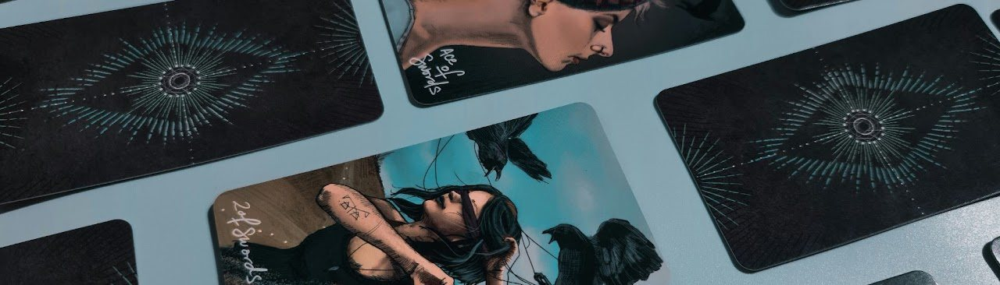
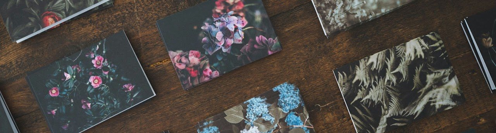

Таро картите не са просто инструмент за гадаене – те са мощен метод за саморефлексия, личностно развитие и връзка с Висшия Аз чрез интуицията. Един от най-ефективните начини да задълбочите разбирането си за картите и да проследите развитието на духовната си практика е **воденето на таро дневник**.

Ако сте **сериозни** в изучаването на Таро, дневникът е едно от най-ценните неща, които можете да направите за себе си. Той е Вашият личен интуитивен партньор, който Ви помага да разберете по-добре картите, себе си и енергиите, с които работите.

Аз започнах да водя дневник преди години, почти случайно, и той се превърна в един от най-силните инструменти в практиката ми. В тази статия ще Ви разкажа защо е важно да имате таро дневник и как стъпка по стъпка да го направите наистина полезен и вдъхновяващ – така че да Ви помага да растете както в практиката, така и в личния живот.

## Какво е таро дневник?

Таро дневникът е тетрадка, файл или приложение, в което записвате всеки свой разклад: датата, въпроса, изтеглените карти, тълкуванието си и – по-късно – какво всъщност се е случило. С времето той се превръща във Ваш личен **таро речник**, архив на гаданията и хроника на собствения Ви път.

## Защо да водите таро дневник: 5 ползи

Преди да стигнем до „как“, е важно да разберем „защо“.

1. **По-дълбоко разбиране на картите**

   Това е изключително ефективен начин за учене. Когато записвате тълкуванията и наблюденията си, изграждате по-дълбока връзка със символиката и значенията на всяка карта. Дневникът се превръща във Ваш личен таро речник и енциклопедия и показва как картите работят **за Вас** и към какви синхронизации и значения Ви водят.

2. **Проследяване на личния растеж – и памет**

   Дневникът Ви позволява да видите как се развивате с времето – и в практиката си, и в личния живот. Ще Ви напомня за стари гадания и недовършена работа. Много начинаещи смятат, че тарото е само за мимолетни гадания. Нищо подобно. Точно тук можете да правите shadow work (работа със Сянката) и да следите напредъка си през годините – как пластовете от значения на картите и дори самите цветове се менят след всеки скок на съзнанието и как това води до определени причинно-следствени връзки. Ще Ви напомня и за важни гадания, които сте забравили. Това наистина ще е WOW момент за Вас.

3. **Развиване на интуицията**

   Когато редовно записвате усещанията и впечатленията си от картите, тренирате интуицията си и я правите по-остра. Ако сте се съмнявали в някое тълкувание, можете да се върнете към него месеци по-късно, да проверите дали усещането Ви е било точно и да изградите повече увереност в собствените си способности.

4. **Анализ на повтарящите се карти**

   Често определени карти или архетипи се появяват многократно. Дневникът Ви помага да забележите тези модели и да ги тълкувате в контекста на живота си. Така голямата картина се навързва много по-успешно, вместо да разчитате на паметта си – защото, повярвайте ми, забравя се адски много :) Аз лично слагам цветни листчета на страниците и с различен цвят отбелязвам отделните теми и повтарящите се карти. Определено ти светва, когато видиш, че имаш 70% зелени листчета :))) Толкова много пъти тройка чаши? Вселената се опитва да ми каже нещо ;)

5. **Проверка дали гаданията Ви наистина работят**

   За мен това е най-полезното, което прави таро дневникът. Няма по-силно чувство на просветление от това да видиш как са се развили нещата година по-късно – и че картите всъщност са познали много точно, но тогавашното ти виждане и тълкувание са били по-ограничени и дори не си могъл да си представиш някои събития. Точно така започва да се трупа истински опит и се научават новите, истинските значения на картите. За съжаление, така осъзнах и до каква степен съдбата ни е фиксирана от отдавна взети решения... Да обърнеш Колелото на съдбата наистина е трудно. Затова воденето на таро дневник е наложително от самото начало на Вашето таро пътешествие.

## Как да водите таро дневник стъпка по стъпка

1. **Изберете подходящ носител**

   Целият смисъл на таро дневника е да издържи във времето – години, че и десетилетия. Няма значение дали предпочитате класически ръкописен дневник, цифров документ или приложение за бележки. Важното е да Ви е удобно и да Ви вдъхновява. Аз лично обичам ръкописните дневници, защото писането ме кара да се фокусирам по-добре и активира определени части от мозъка. Харесва ми и занаятчийският момент – в него има особена магия. Ако сте по-изобретателни, можете да си направите и гримоар към тарото.

2. **Запишете датата и въпроса**

   Всеки запис трябва да включва датата и въпроса (или темата) на разклада. Добра идея е да записвате и текущите астрологични транзити за деня, които може да влияят на тълкуванието. Датата е от ключово значение – моля Ви, не я забравяйте. Случва се дори на мен :)

3. **Опишете картите и първите си впечатления**

   Запишете кои карти са излезли и какво е било първото Ви впечатление. Не се притеснявайте да сте субективни – това е Вашето лично пространство. Не е страшно и ако не запишете нищо в деня на гаданието: можете да се върнете към него, когато се почувствате готови и вдъхновени. Случвало ми се е да анализирам подредба месеци наред и чак след около година да стигна до окончателния отговор. Винаги има какво ново да се види.

4. **Добавете своите тълкувания**

   Опишете как разбирате картите в контекста на въпроса. Включете емоциите, които изпитвате, асоциациите, които Ви хрумват, своите синхронизации и мистични значения.

5. **Отбележете връзките между картите**

   Обърнете внимание как картите си взаимодействат. Има ли обща тема? Има ли противоречия? Следете числата, цветовете, фигурите и записвайте астрологичните и и-дзин съответствията на картите. Тези наблюдения са ключови за по-дълбокото разбиране.

6. **Връщайте се и преглеждайте дневника**

   **Най-важното от всичко – затова имате дневник.** Редовно преглеждайте старите си записки. Така ще видите как сте се развили, как картите са предсказали определени събития и как тълкуванията Ви са се променили с времето.

## Хартиен или електронен таро дневник?

И двата варианта имат предимства:

- **Хартиеният дневник** засилва фокуса и интуицията, а писането на ръка само по себе си е ритуал.
- **Електронният дневник** е изключително удобен: носите го навсякъде, можете да използвате бележки и хаштагове, за да следите синхронизациите и повтарящите се карти, да търсите по дата, а снимката на разклада се качва директно. Спестява време и улеснява прегледа на съдържанието.

Ако имате възможност, принтирайте електронния дневник и го превърнете и във физически. Ако сте сериозни изследователи, ще комбинирате и двата подхода.

## Какво да записвате след всеки разклад

Ето кратък шаблон, който можете да копирате в дневника си:

- ✔️ дата и час на гаданието (и транзитите за деня);
- ✔️ въпросът или темата;
- ✔️ изтеглените карти и позицията им в разклада;
- ✔️ първото Ви впечатление;
- ✔️ Вашето тълкувание;
- ✔️ **по-късно:** какво решение сте взели и как са се развили нещата, плюс нови прозрения.

## Оригинални идеи за вашия таро дневник 💡

1. **Добавете визуални елементи**

   Ако обичате да рисувате или да правите колажи, скицирайте картите, добавяйте цветове или залепяйте снимки, които Ви напомнят за посланията им.

2. **Създайте си таро речник**

   Отделете по няколко страници за всяка карта и записвайте личните си тълкувания, емоции и асоциации. Аз записвам и интересни и оригинални значения от книжките към различните колоди и когато нещата се натрупат, картината става много по-цветна и многопластова. Добра идея е да вземете по-голяма тетрадка и да я разделите на две части – едната да е изцяло речник със значения и асоциации.

3. **Отбелязвайте енергийните си състояния**

   Запишете как се чувствате преди и след разклада, дали сте били във високи или ниски вибрации и какво сте правили. Много хитър трик е да обедините таро дневника със [съновника](/sonovnik) си: теглете карта за деня и за нощта и записвайте сънищата и преживяванията си.

4. **Създайте раздел „прогнози и реалност“**

   Ако правите разклади за бъдещето, сравнявайте прогнозите с това, което всъщност се е случило. Това е страхотен начин да се учите от грешките си. Без него наистина няма как да научите таро както трябва.

Още практически съвети ще намерите в статията [„Няколко кратки трика за ефективно гледане на Таро“](/blog/trikove-za-efektivno-gledane-na-taro).

## Често задавани въпроси

**Колко често да пиша в таро дневника?**
След всеки разклад, дори да е само една карта за деня. Редовността е по-важна от обема.

**Трябва ли да записвам и гаданията за други хора?**
Да, но само с тяхно разрешение и без лични данни. Тези записи бързо изграждат опит и показват как работят картите при различни хора.

**Мога ли да започна дневник, ако съм начинаещ?**
Точно тогава е най-добре. Колкото по-рано започнете, толкова по-ценен ще бъде архивът Ви след година.

## Няколко последни думи...

Воденето на таро дневник не е просто практика – това е **метафизичен процес** на изследване и **създаване на реалността**. Той ще Ви помогне да проследите пътя си, да развиете интуицията си и да изградите уникална връзка с картите. Може дори да Ви помогне да манифестирате желаното – тайната за това ще Ви издам друг път ;) Не се страхувайте да експериментирате и да направите дневника си наистина свой – той е отражение на Вашия личен духовен и/или вещерски път.

В крайна сметка той ще се превърне и във **Ваша автобиография**.

Така че вземете тетрадката, грабнете тестето и започнете да записвате още днес! Кой знае – може би след няколко месеца ще се върнете към първите си записки и ще се изумите колко далеч сте стигнали :)

Ако искате да погледнем заедно вашия разклад, вижте [консултациите](/consult).
