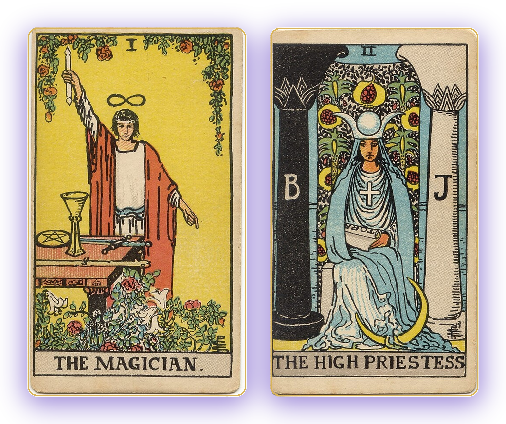
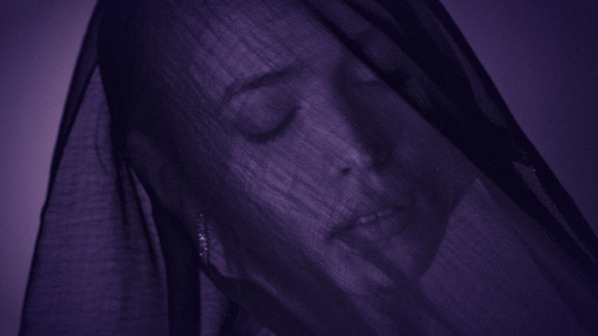
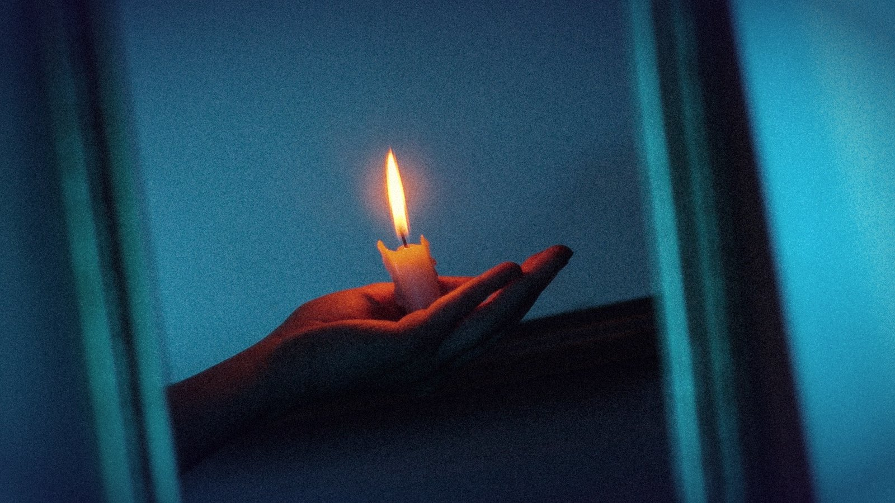
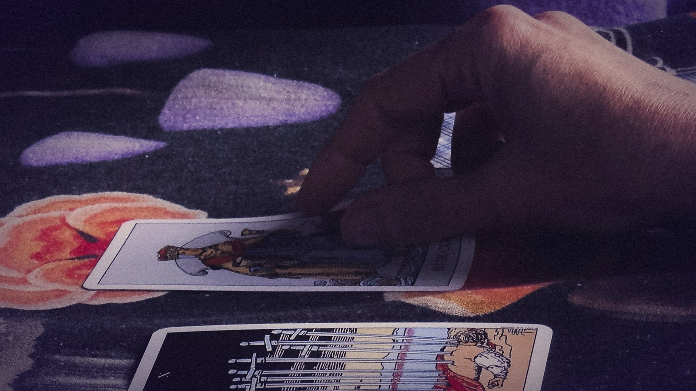

Това е въпрос, по който имам много ясна позиция – и днес искам да я споделя с вас.

Един от най-често задаваните въпроси при изучаването на Таро е доколко трябва да се доверяваме на интуицията си. Достатъчно ли е да познаваме значенията на картите, или трябва да развием способност да усещаме тяхното послание отвъд традиционните тълкувания?

Отговорът е ясен – интуицията е един от най-важните компоненти в работата с Таро. Всъщност именно тя е това, което постепенно превръща механичното разчитане на символи в действително взаимодействие с архетипния език на системата.

Книгите могат да ни научат какво символизира Императрицата, какви са астрологичните съответствия на Магьосника или как се тълкува Седмица мечове. Но те не могат да ни дадат готов отговор за начина, по който тези символи взаимодействат в конкретната ситуация, нито за връзките, които можем да открием между тях. Най-малкото всяка една карта – да не говорим за множеството възможни комбинации от карти – съдържа хиляди възможни варианти на тълкувание. Навлизаме в хаоса на информационното море.

И това е пространството, в което започва да работи интуицията.

За мен Таро не е система, която трябва да бъде научена наизуст. То е система, с която трябва да се изгради определен тип взаимодействие. А за това е необходимо да развием способността си да възприемаме информацията не само чрез интелекта, но и чрез по-фините механизми на съзнанието.

## 1. Интуицията като начин на възприемане на символна информация

Първо трябва да разграничим интуицията от обикновеното предположение.

Често използваме думата „интуиция“, за да обозначим всяко спонтанно усещане, което възниква в съзнанието ни. Но не всяко такова усещане е интуитивно познание. Понякога то е резултат от страх, желание, предварително убеждение или несъзнавана асоциация (подробно разглеждам разликата в [„Интуиция или страх?“](/blog/intuiciya-ili-strah)).

В контекста на Таро бих разглеждала интуицията като способност да възприемаме връзки и значения, които не са непосредствено очевидни на съзнателно, логическо ниво.

Например можем да изтеглим три карти, чиито традиционни значения изглеждат несвързани. Но когато ги разгледаме заедно, определена комбинация може спонтанно да предизвика конкретна асоциация, образ или разбиране за ситуацията.

Понякога тази асоциация се оказва по-близо до същността на въпроса, отколкото механичното прилагане на значенията от учебника.

Това не означава, че трябва да пренебрегваме традиционната символика. Напротив. Колкото по-добре познаваме системата, толкова повече материал има интуицията, с който да работи.

**Интуицията и познаването на символите не са противоположности. Те се допълват.**

## 2. Интуицията и архетипният език на Таро

Една от причините Таро да допуска толкова много нива на тълкуване е неговата [архетипна](https://en.wikipedia.org/wiki/Jungian_archetypes) структура.

Големите аркани например представят универсални принципи и модели на човешкото преживяване – създаване, познание, власт, трансформация, разрушаване, жертва, преход и завършване.

Тези символи не се изчерпват с едно конкретно значение.

В зависимост от контекста Магьосникът може да представя съзидателната воля, способността за материализация, манипулацията на ресурсите или взаимодействието между различните равнища на реалността.

Жрицата може да бъде свързана с интуитивното познание, скритата информация, вътрешното наблюдение или достъпа до съдържания, които все още не са достигнали до съзнателно проявление.

Когато започнем да работим по-задълбочено с архетипите, постепенно преставаме да възприемаме картите като отделни изображения. Започваме да разпознаваме принципите, които стоят зад тях. (Как една карта сменя смисъла си според призмата, през която я четем, показвам подробно в статията за [картата „Светът“](/blog/taro-karta-svetat).)

Именно тук интуицията придобива особено значение.

Тя ни позволява да преминаваме от буквалния образ към неговото символно съдържание и да откриваме различните му проявления в конкретния контекст.

## 3. Интуицията като връзка между съзнателното и несъзнаваното

От психологическа гледна точка интуитивното възприятие може да бъде разгледано като процес, при който мозъкът обработва информация и [разпознава закономерности](https://en.wikipedia.org/wiki/Recognition-primed_decision), без те непременно да достигат до съзнанието ни като последователни логически заключения.

В юнгианската психология интуицията е една от [четирите основни психологически функции](https://en.wikipedia.org/wiki/Psychological_Types) наред с мисленето, чувстването и усещането.

Юнг я разглежда като функция, чрез която възприемаме възможности, отношения и потенциални развития, които не са непосредствено достъпни за сетивното възприятие.

Това е интересна отправна точка за работата с Таро.

Когато наблюдаваме определена комбинация от карти, е възможно да активираме асоциативни процеси, които свързват символите с вече натрупани знания, преживявания и несъзнавани съдържания.

Понякога получаваме цялостно разбиране за комбинацията, преди да можем да обясним логически защо сме стигнали до него.

Това е едно от проявленията на интуитивното познание.

В езотеричен контекст можем да разгледаме този процес и като взаимодействие между съзнателния ум и по-дълбоките пластове на психиката.

Картите предоставят символния материал, а интуицията участва в неговото разпознаване и свързване.

## 4. Интуицията и синхронистичният принцип

За мен тук се намира една от най-интересните страни на Таро.

Ако разглеждаме системата през призмата на [синхромистицизма](/portal), интуицията не е просто способност да разчитаме изображения. Тя е и способност да забелязваме връзките между символите и събитията, които се проявяват в нашата реалност.

При едно гледане можем да получим определена карта, която впоследствие започва да се появява под различни форми в ежедневието ни.

Това може да бъде повтарящ се образ, тема в разговор, сън, случайна среща или събитие, което носи сходна архетипна структура.

Важното е не просто да забележим съвпадението, а да можем да го поставим в контекст.

Каква е връзката между първоначалното гледане и последващото събитие? Какво общо има символът с процеса, който наблюдаваме? Дали става дума за реална закономерност, за [селективно внимание](https://en.wikipedia.org/wiki/Frequency_illusion) или за асоциация, която сме изградили впоследствие?

Това са въпроси, които трябва да си задаваме.

В концепцията за [синхроничността](https://en.wikipedia.org/wiki/Synchronicity) на Карл Густав Юнг се разглеждат именно смислените съвпадения между вътрешни психични състояния и външни събития, които не могат лесно да бъдат обяснени чрез обикновена причинно-следствена връзка.

Таро предоставя интересна символна среда за наблюдение на подобни явления. (Как изглежда това в живия живот, можете да видите в моите [„Преживявания в синхроничности“](/portal/synchronistic_experiences_pt_1).)

В този смисъл интуицията е способността да разпознаваме смисловите връзки, без предварително да разполагаме с цялата информация.

## 5. Кога интуицията се превръща в проекция?

Тук трябва да бъдем особено внимателни.

Както вече разгледахме в [„Интуиция или страх?“](/blog/intuiciya-ili-strah), когато работим с Таро, неизбежно проектираме част от моментното си състояние върху картите.

Това означава, че не всяко спонтанно усещане трябва да бъде приемано като интуитивно послание.

Понякога страхът се маскира като предчувствие. Желанието се представя като вътрешна сигурност. Предварително изграденото убеждение започва да изглежда като получена отвън информация.

Например, ако очакваме негативно развитие на дадена ситуация, можем да възприемем първата неприятна асоциация като интуитивно предупреждение.

Но е възможно тя просто да отразява собственото ни емоционално състояние.

Затова е важно да развиваме способност за разграничаване между:

- **Интуитивно възприятие** – спонтанно разпознаване на връзка или значение.
- **Психологическа [проекция](https://en.wikipedia.org/wiki/Psychological_projection)** – пренасяне на собствените ни страхове, желания и убеждения върху символите.
- **Интелектуална интерпретация** – съзнателно прилагане на знанията за значенията и съответствията на картите.
- **Предварително очакване** – търсене на потвърждение на вече формирано предположение.

Тези процеси могат да протичат едновременно. Затова добрата практика изисква не просто да се доверяваме на първото си усещане, а да се научим да го изследваме.

## 6. Можем ли да развием интуицията си чрез Таро?

Определено можем да развием по-добра способност за интуитивно разчитане на символите.

Но това не става чрез безкрайно теглене на карти или механично запаметяване на значения.

Необходимо е да изградим индивидуален процес на наблюдение.

Ето няколко практики, които намирам за особено полезни:

### Работа с една карта дневно

Изтеглете една карта и запишете първоначалното си впечатление, без да проверявате значението ѝ. Обърнете внимание на образите, цветовете, фигурите и детайлите. Какво ви привлича? Какво ви отблъсква? Каква е първата асоциация?

В края на деня се върнете към картата и наблюдавайте дали сте открили връзки с преживяното. Можете да започнете още днес с [таро картата за деня](/karta-za-deniya).

### Интуитивно разчитане преди справка

При всяко гледане първо направете собствена интерпретация. Едва след това проверете традиционните значения. Така ще можете да разграничите личните си асоциации от символния фундамент на системата (повече за силата на първото впечатление – в [„Няколко кратки трика за ефективно гледане на Таро“](/blog/trikove-za-efektivno-gledane-na-taro)).

### Работа с комбинации

Не се ограничавайте до индивидуалните карти. Изтеглете две или три и опитайте да разчетете общата им история. Интересувайте се от динамиката между тях, а не само от отделните значения.

### Дневник на синхроничностите

Записвайте картите, които сте изтеглили, и последващите съвпадения, които сте забелязали. Не търсете насилствено връзки. С времето ще можете да проследите кои асоциации се оказват смислени и кои са резултат от [прекомерно търсене на закономерности](https://en.wikipedia.org/wiki/Apophenia). Как да подредите такъв дневник, описвам в [„Как да си водим таро дневник“](/blog/kak-da-si-vodim-taro-dnevnik).

### Наблюдение на собственото състояние

Преди всяко гледане обръщайте внимание на емоционалното си състояние. Дали сте спокойни, тревожни, разсеяни или силно фокусирани върху конкретен резултат? Това е важно, защото моментният импринт на съзнанието влияе върху начина, по който възприемате картите (за фокусната точка пиша подробно в [„А сега, де? Картите винаги ли познават?“](/blog/a-sega-de-kartite-vinagi-li-poznavat)).

## 7. Интуицията и Висшият Аз

От езотерична гледна точка можем да разгледаме интуицията и като възможен механизъм за достъп до по-дълбоки нива на съзнанието.

В различните окултни традиции интуитивното познание се свързва с вътрешното виждане, духовното различаване и способността да възприемаме информация отвъд ограниченията на обикновеното рационално мислене.

В някои системи това се асоциира с Висшия Аз, в други – с духовното сърце, [будхиалното](https://en.wikipedia.org/wiki/Buddhi) ниво или определени аспекти на висшето съзнание.

В контекста на Таро можем да разгледаме тази възможност като взаимодействие между символния език на картите и по-дълбоките пластове на собственото ни съзнание.

Не бих приела автоматично всяко интуитивно усещане за послание от Висшия Аз. Важно е да запазим способността си за различаване.

Но смятам, че именно чрез системна работа със символите можем да развием по-фина чувствителност към собствените си вътрешни процеси.

Това е особено важно при самостоятелното гледане, защото постепенно изграждаме собствен език за взаимодействие със системата.

## Заключение: интуицията е мостът между символа и неговото значение

Можем да научим всички 78 карти, да изучим техните астрологични, кабалистични и нумерологични съответствия и да запомним стотици комбинации.

Но това все още не означава, че умеем да работим с Таро.

Истинското майсторство идва, когато започнем да разпознаваме символите като част от една цялостна система и развием способността да възприемаме техните значения в конкретния контекст.

Интуицията е важна именно защото ни позволява да преминем отвъд механичното знание. Тя свързва отделните символи, активира асоциативните процеси и ни помага да откриваме отношения, които не са непосредствено видими.

Но тя трябва да бъде развивана заедно със самонаблюдението и способността за критична интерпретация.

За мен Таро е не просто система, която разчитаме, а език, с който постепенно се научаваме да взаимодействаме.

И колкото по-добре познаваме собственото си съзнание, толкова по-добре можем да разбираме и символите, чрез които изследваме реалността.

**Защото интуицията не замества знанието за Таро. Тя е това, което му позволява да оживее.**

## Често задавани въпроси

Може ли да се гледа на Таро само с интуиция, без да се знаят значенията?

Може да се започне така, но интуицията работи най-добре върху солидна основа. Колкото по-добре познавате символиката, толкова повече материал има интуицията, с който да изгражда връзки.

Как да разбера дали едно впечатление е интуиция или проекция?

Запитайте се какво сте очаквали, преди да изтеглите картата. Ако впечатлението само потвърждава страх или желание, вероятно е проекция. Записвайте впечатленията си и ги проверявайте във времето.

Как да развия интуицията си с Таро?

С една карта дневно, със собствено тълкуване преди справка с книгата, с работа с комбинации от карти, с дневник на синхроничностите и с наблюдение на собственото си състояние преди всяко гледане.

