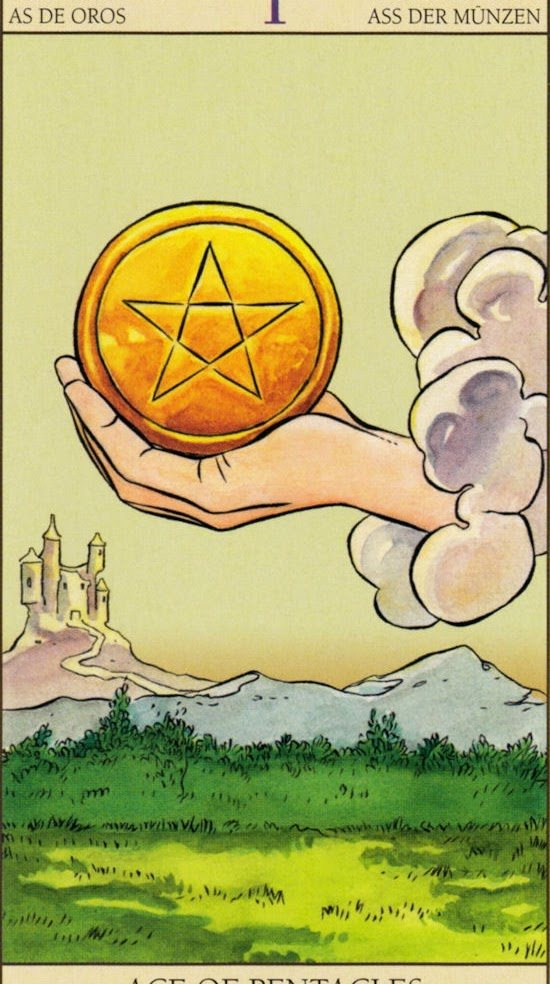
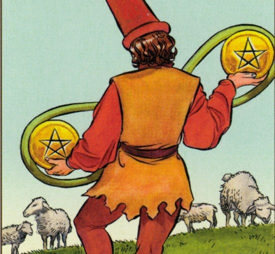
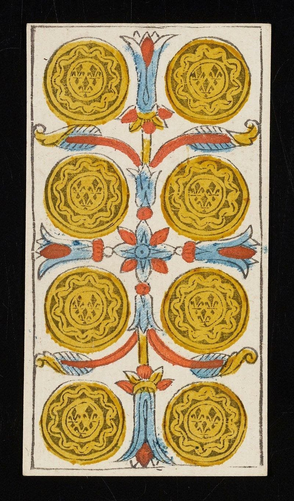

Ще представя опита си с таро картите в любовните въпроси в малко по-различна светлина – с известна доза отрезвяваща критика, която прекрасно приляга на слънчевата ми козирожка природа. Когато питаме картите за любов, особено за потенциална или тепърва започваща връзка, често търсим конкретен и прагматичен отговор, а не отнесена в облаците приказка. **Пентаклите** са идеалното поле за този отрезвяващ поглед.

## Какво означават Пентаклите в любовно гадание?

Пентаклите (монетите, денарите) са земната масть в Таро. В любовно гадание те не говорят толкова за емоциите и преживяванията, а за **заземяването** на връзката: има ли бъдеще съюзът, надежден ли е партньорът, подсигурена ли е материалната основа, стабилни ли сме за сериозна връзка. Затова много пентакли в разклада обикновено сочат към по-сериозни отношения – и към по-трезвите въпроси около тях.

Поредицата от Асо до Крал може да се чете и като процес, през който минава една евентуална връзка – от първата възможност до зрялото партньорство. Ето значението на всяка карта.

## Значението на картите Пентакли в любовта

### Асо пентакли – възможност

Асо пентакли ясно показва **възможност**. Поканата е отправена или ще бъде отправена – порталът на възможностите е отворен. НО! Някой може да Ви държи като опция и да чака да се възползва от нея, защото смята, че сте много изгодна партия. В най-позитивния вариант му е паднал късметът от небето и не може да изпусне този шанс. Човекът е доволен от жребия, но не знае какво да прави с него. Често картата показва, че мъжът осъзнава, че ще трябва да подходи по-традиционно и да предложи някаква материална „примамка“ – ще Ви предложи нещо, ще направи жест. Другите карти ще подскажат дали това наистина ще стане, или само ще го премисля.

Асо пентакли не е лоша карта, но като всяко асо е по-скоро идея, отколкото действие. Потенциалът е налице и възможността не е за изпускане, но как ще се развият нещата, зависи от останалите карти. Това е нещо, което отдавна сте чакали, но ще са нужни и други фактори, за да се действа в тази посока.

### Двойка пентакли – колебание

Като всяка двойка, тук човекът просто не знае какво да мисли – претегля и преценява. Има двойна игра... не се знае в какво (другите карти ще покажат). Не се надявайте много – най-вероятно претегля между Вас и друга опция. Ако това не е случаят, значи се чуди какъв избор има от чисто практическа гледна точка и чака Вашата реакция, отговор или подсказка, за да предприеме нещо или да започне комуникация. Бездействие, колебание. Може да означава и нужда от повече комуникация и обмен, от физически контакт, за да се предприеме действие. Игра на думи, прагматични разговори, капризи. Може да използва банален претекст, за да Ви потърси.

### Тройка пентакли – разговор

Има нужда от разговор и обсъждане, от изясняване на ценностите и позициите във връзката. Двойката не работи или идеите, дошли с асото, имат нужда от избистряне. Ключовата дума е **комуникация** – комуникирайте! Като предсказание – възможно е да се свърже с Вас, за да изясните нещо, да иска да придвижи нещата. Възможни са разговори, включително за развитието на връзката (както, между другото, показва и картата Умереност). Начало на начинание, но всичко е още флуидно и в процес на преговори. Срещи. Може дори да Ви заведе на кратко пътуване или да Ви покаже пред приятелите си. Може и трети човек да се меси... Дано не е майка му… но може да е и приятел или бивша/настояща. И както винаги при тройките – внимавайте, не сте сами.

### Четворка пентакли – стабилност и застой

Нещата вече са се укрепили в реалността – и са в стагнация. Човекът не иска или не може да се помръдне от създалата се ситуация и няма да прави повече от абсолютно необходимото. Ако не действа, значи не вижда практична полза от това или е твърде затворен в чувствата си. Ключовата дума е **амбиция** – накъде го води тя и има ли я въобще? Нужен е драйв.

Хубавата новина е, че един от гейтовете в [Хюман дизайн](/blog/categories/astralen-dizain), съответстващ на тази карта, се нарича „Омъжената мома“ и отговаря точно за намирането на солиден партньор, с когото да изградим нещо. Това може да е Вашият провайдър... ако реши. Ако не предприема нищо, значи се чуди дали сте keeper-ът за него и дали отговаряте на амбициите му за дом и стабилност.

Негативният аспект показва емоционална недостъпност и блокажи: човекът не иска да чувства, обградил се е със стени и се предпазва с бездействие. Очаквайте студенина. В позитивен смисъл иска да запази статуквото, защото за него сте много ценна – пази Ви като съкровище. Но ако стане скръндза – оставете го, спестява тези пари, за да впечатли друга ;)

### Петица пентакли – трудности и липса на грижа

Една от гадните карти в Таро. Не помня случай, в който да ми се е паднала и да е показала нещо добро. Може би защото наистина рядко намираме човек, с когото ще бъдем „в нещастие, скръб и бедност, докато смъртта ни раздели“. Нещата може да не спрат дотук, но стават трудни. Спорове за пари, за ресурси, за уговорки. „Ама ти каза, че ще направиш едно, а то стана друго…“ Имало е нужда от сигурност, която не е била подсигурена, и сега някой от партньорите се чувства зле. В най-лошия случай – разбито сърце: „С теб съм, докато се налага…“

Позитивното тълкувание е *трудности в началото* – това е буквалното име на 3-ти гейт в Хюман дизайн, един от съответстващите на картата. Другите карти на същия гейт са Жрецът, Четворка жезли и Крал пентакли и темата им е обща: семейство и брак. Мъжът си задава въпроса: „Мога ли да бъда провайдърът на бъдещото ни семейство? Достатъчен ли съм за тази жена? Мога ли да ѝ дам дом, сигурност, бъдеще?“ Връзката има нужда от грижа, която в момента липсва. В по-прости обстоятелства човекът просто не усеща грижа и внимание. Липса на любовна комуникация. Или просто няма пари сега да Ви звънне… оставете.

### Шестица пентакли – щедрост

След размислите на петицата следва позитивна стъпка напред. Някой е решил да инвестира във Вас. Ура! Щедър партньор, който иска да впечатли и да се представи като заможен и значим. Очаква обаче да го оцените – и леко да го превъзнесете. Очаквайте жест, подарък, сигнал – и да, ще Ви се обади.

### Седмица пентакли – преоценка

Оценихте ли жеста? Време е за преоценка на ситуацията: да продължаваме ли, или не? „Каквото посях, това пожънах. Как се стигна дотук?“ Фигурата в класическото таро Rider–Waite–Smith седи и се чуди какво е объркал и какво е можел да направи по-добре – или, по-рядко, се радва на постигнатото. Доста често нещата прекъсват на този етап и картата по принцип сочи **краткотрайни връзки**. В позитивен смисъл семената са посяти и чакаме да видим какво ще поникне – нужна е визия за връзката. В негативен – подозрения, недоверие, усещане, че някой ни е подвел. Ситуацията зацикля, докато урокът не бъде научен и цикълът не продължи към осмицата – безкрайността.

### Осмица пентакли – работа по връзката

Вече сме преценили нещата и сме взели решение – или работим по връзката, или си гледаме работата. Може да е връзка, по която има нужда от мнооого работа, или нещата да са в начален етап. Човекът е взискателен и Ви гледа под лупа. В негативен вариант – празни амбиции, суета; има изобилие от опции и затова не Ви търси.

Гледайте и сбора на числата: 3 + 5 = 8 – ако не комуникирате през тройката, ще Ви чака петицата… и цикълът се завърта. 4 + 4 = 8 – двойна стабилност или двойни прегради. Във всеки случай става въпрос за доста предпазлив човек. Ако картата излиза, но човекът не Ви търси, значи е зает с работата си – това е решил.

Класическото тълкувание е годеж, но да не прибързваме :))) Осмицата е безкрайност – и наистина дълъг цикъл: или ще работите по връзката, или по уроците от нейния провал. Затова в дългосрочни въпроси може да означава годеж – решение за дългосрочен проект в живота. Картата ни подсказва да извлечем поука и да развием нови умения.

### Деветка пентакли – самодостатъчната жена

Задоволената жена. Венера в Дева. Жената, чиито капризи са задоволени – „това е жената, за която искам да се грижа и на която да дам всичко“. Или самодостатъчната жена: „Тази жена си има всичко, аз за какво съм ѝ?“ В по-прозаично тълкувание той очаква Вие да направите следващата стъпка и да бъдете по-инициативна. Аурата Ви на успяла жена го плаши, може да Ви смята за меркантилна (значи е беден ;D) или да чувства, че сте извън лигата му. Може и да реши да Ви остави на мира, защото смята, че нямате нужда от него. Ако нещата са се провалили в предишните цикли, картата показва, че трябва да развиете самодостатъчност. В позитивен смисъл – иска да Ви обгради с разкош. Деветката е мостът към завършека – десетката.

### Десетка пентакли – домът

Домът. Завършекът. Щастието. Човекът, когото виждам като свой спътник... или просто съквартирант :))) В по-прозаичен смисъл някой ще Ви дойде на гости или ще Ви покани у дома си, или ще имате ситуация, свързана с жилище. Да, може да Ви покани да гледате Netflix (макар че това е по-скоро десетка чаши – десетката пентакли е по-сериозна карта). Десетката е логичният изход на нещата. Ако този човек не Ви търси и картата се падне, значи сте си уредили сметките, моралните дилеми и семейните ценности и всичко е ясно – край на един цикъл с налични резултати.

### Паж пентакли – младият, който се колебае

Младият дух, който вече ясно вижда възможността и ѝ се радва – „как се уредих“. В по-прозаичен смисъл това е мъжът, който смята, че сте му вързана опция, и седи и се чуди дали да Ви звънне. Хванал Ви е на кукичка. В негативен аспект – незрялост, прекалено приятелско или момчешко отношение, нерешителност: има възможност, но не се възползва. В сериозна връзка може да показва раждане на момче. При други обстоятелства – жест, предложение, нещо, което партньорът прави за пръв път. Но това е млад играч, който най-много да надиграе себе си...

### Рицар пентакли – класическият ухажор

Тук вече момчето е решително и по-зряло – методичен и последователен млад мъж. Настоятелен, точен, уверен. Очаквайте постъпките да следват думите му. Малко бавен е, но това е за добро, ако сте търпелива. Ще Ви ухажва стабилно и традиционно – възможна е покана за ресторант.

В негативен аспект: каквото си е наумил, това ще е. Липса на гъвкавост, материален инат – ще Ви зареже, без да му мигне окото, защото има цели да гони. Бягайте от негативния аспект на тази карта, един от най-гадните е. Когато веднъж ми се падна като карта за деня, един бивш ме заряза с оправданието, че нямал пари да се виждаме (абсолютно тъпо оправдание – просто беше стипца и егоист), при това с едно неграмотно написано съобщение, без дори да изчака отговора ми. Ето това е Рицар пентакли в негатив. Най-забавното е, че цял ден очаквах да ме покани на вечеря (положителното проявление на картата).

### Дама пентакли – жената за семейство

Вие сте дамата на дома му. Една от най-позитивните карти – рядко съм срещала негатив в нея, освен в обърната позиция или когато показва липсата на тази енергия в ситуацията. Ако се падне, човекът наистина Ви харесва и вижда потенциал с Вас, защото сте „сериозна“. Вижда Ви като спокойна, уравновесена и земно красива жена, понякога малко инат – типичната за него жена за семейство: сигурна, надеждна, порядъчна, с добри нрави и грижлив характер. Има нужда повече от Вашата женственост. Може да означава и просто, че ще се срещате доста вкъщи.

Обърнатата позиция показва, че Ви смята за „лека“ жена или че на Вас не може да се разчита – днес Ви има, утре не, – или че имате разбирания и морал, които не му допадат.

### Крал пентакли – зрелият мъж и провайдърът

Ето го и завършекът на цялата пентаклена одисея! В моите гадания това често е човек, твърде зает с бизнеса и проектите си, на когото сега въобще не му е до Вас. Кралят винаги е тежкар и си седи на мястото, а при пентаклите – още повече. Буквално е извърнал глава. Вие сте на второ място. Чака Вие да го потърсите. Той вече е заявил какво предлага. Ако гледате за нов мъж в живота си, това е човек, който в момента се интересува да прави пари, а жените са нещо странично. В картата има и съмнение. Може да мине време, преди да Ви потърси – а може и никога да не го направи.

В позитивен аспект това е картата на хармоничната, стабилна и сериозна връзка – зрелият мъж, който се грижи за семейството и за Вас. Не е нужно да му казвате от какво имате нужда – той вече знае и полага усилия да сте щастлива. Крал пентакли е свързан с енергията на Лъва – ще стане неговата воля, както той реши. Има нужда от Вашето уважение, за да Ви дари с пентаклите и вниманието си. Ако каже „да“, ще мине през всичко с Вас. Ако тази карта Ви се падне за някого, запитайте се дали той може да бъде Вашият Крал пентакли. За него мъжките дела са на първо място и ако сте жената на живота му, ще направи стъпка... ако не – well… има и други мъже.

🌚

> **Езотерична забележка:** ако забелязвате, **всяка поредица от малките аркани завършва с Крал**. Таро е **поредица (секвенция), която показва началото, развитието и завършека на един или много процеси** – какъвто е и любовният процес, доста по-предвидим, отколкото на някои им се иска. Таро е и **магически архетипен инструмент**, създаден главно от няколко магически школи, които служат на Сириус... Това е и причината Кралят да е накрая (забележете и че има 3 мъжки дворцови карти и една женска), което отговаря на извечния въпрос кой „избира“ или „дава връзката“ – според тези школи това очевидно е Кралят, при това Кралят пентакли, демек зрелият, финансово осигурен мъж. Ако проучите в дълбочина, ще забележите доста интересни red pill линии в картите. Но за това – друг път.

## Въпросите, които да си зададете, когато излизат Пентакли 💜

- Дали това наистина е моят надежден партньор?
- Последователен ли е този човек в думите и действията си спрямо мен?
- Мога ли да разчитам на него?
- Материално и финансово адекватен ли е (спрямо мен) този мъж?
- Раздава ли се за мен?
- Поставя ли ме като приоритет, независимо от обстоятелствата?
- Аз ли съм единствената (истинска) опция за него?
- Може ли партньорът ми да ми осигури материалната, финансовата и емоционалната сигурност и подкрепа, от които имам нужда?
- Имаме ли общи ценности и визия за съюза?
- От една и съща социална класа ли сме? Ако не – как ще ни се отрази това?
- Стабилен и надежден ли е този съюз, или има реални индикации, че може да стане такъв?
- Сериозна връзка и сериозно намерение ли е това?
- Знам ли си стойността?
- Сигурност, просперитет, доверие, компетентност, надеждност, защита, хармония, уют, морален компас – тук ли са?

## Често задавани въпроси

**Добра карта ли е Асо пентакли в любовно гадание?**
Да – показва реална възможност и покана. Но като всяко асо е идея, а не действие; как ще се развие, зависи от картите около него.

**Коя карта Пентакли е най-неблагоприятна за любов?**
Петица пентакли (трудности, липса на грижа) и Рицар пентакли в негативен аспект (студенина и материален инат).

**Какво означават много Пентакли в един разклад?**
Че акцентът е върху стабилността и бъдещето на връзката – материалната основа, надеждността и сериозните намерения, – а не толкова върху емоциите.

## В крайна сметка

Не забравяйте, че таро картите винаги се четат в контекст и при много прецизно зададени въпроси (вижте [„Няколко кратки трика за ефективно гледане на Таро“](/blog/trikove-za-efektivno-gledane-na-taro)). Уверете се, че интуицията и опитът Ви работят по-силно от собствените Ви желания и проекции да видите картите по определен начин. Защото пентаклите наистина умеят да приземяват.

Ако искате да погледнем заедно Вашия любовен разклад, вижте [консултациите](/consult).
