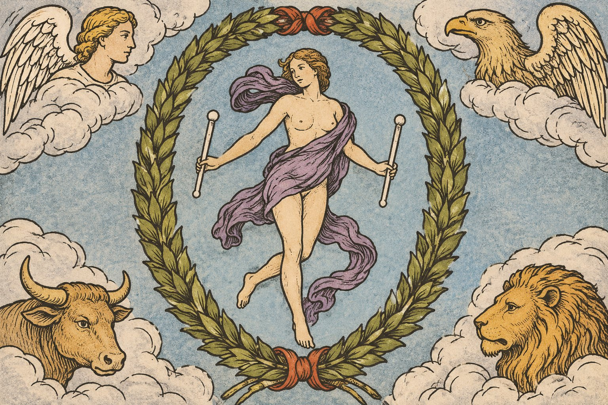
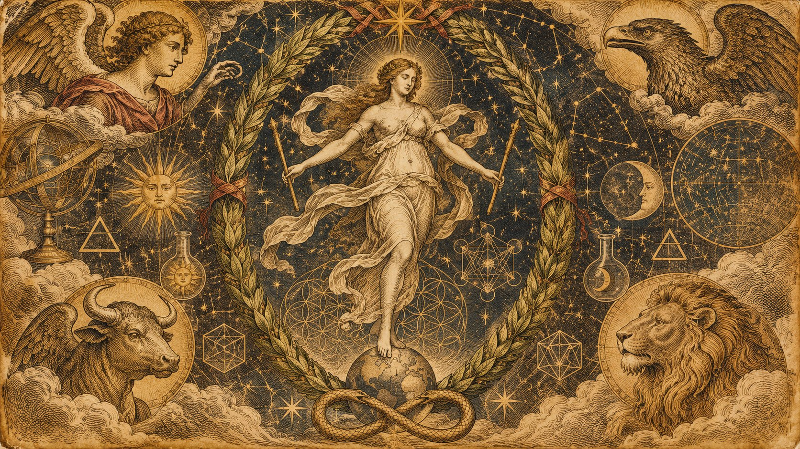
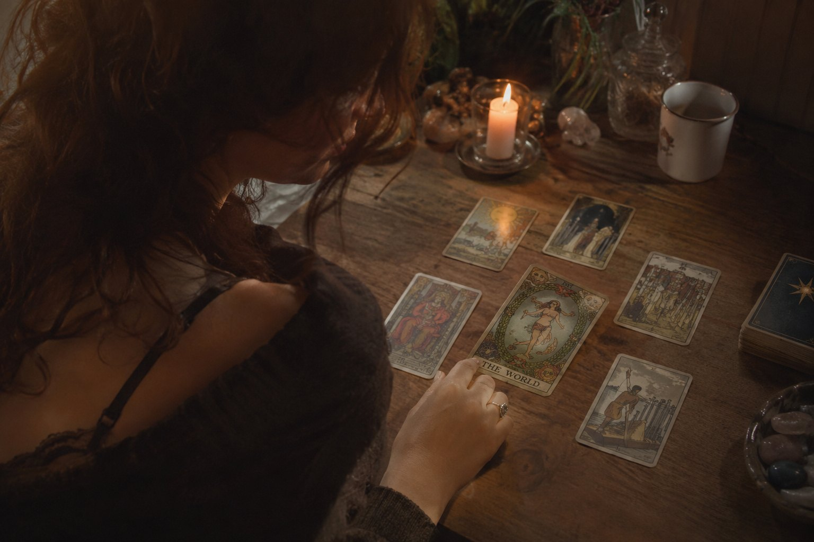
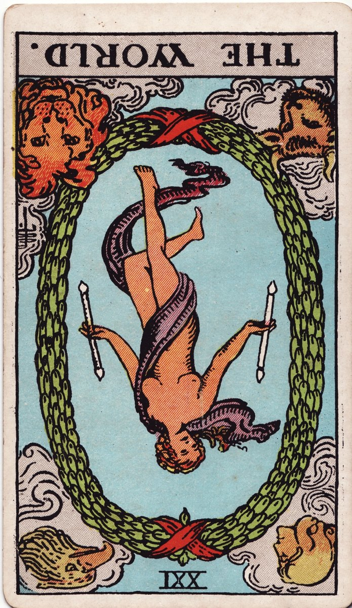

Днес съм ви подготвила задълбочен преглед на последната карта от Големите аркани – „Светът“ – през призмата на архетипите, психологията и символиката. Ще ви покажа как я чета аз: не просто като „добра карта“, а като ключ към смисъла на целия изминат път.

Картата „Светът“ е последната от Големите аркани в Таро. Тя представлява завършека на едно символично пътуване – процес на натрупване на опит, преодоляване на препятствия, осъзнаване и вътрешна трансформация. Появата ѝ бележи момент, в който отделните елементи от преживяното започват да придобиват смисъл и се подреждат в една цялостна картина.

Това е картата на **завършения цикъл, постигнатата интеграция и разширеното съзнание**. Тя не просто показва, че нещо е приключило, а че вече сте достигнали състояние, в което можете да разберете цялостното значение на изминатия път.

## Завършването като форма на осъзнаване

В живота често се оказваме въвлечени в процеси, чието значение не можем да разберем, докато ги преживяваме. Някои събития изглеждат случайни, други – противоречиви, а трети ни поставят пред обстоятелства, които не можем да контролираме или предвидим.

Докато сме в самия процес, виждаме само отделни фрагменти. Липсва ни необходимата дистанция, за да разпознаем връзките между тях.

Именно тук се проявява символиката на „Светът“.

Когато един цикъл бъде завършен, перспективата се променя. Това, което преди е изглеждало като препятствие, може да се окаже необходим етап. Загубата може да разкрие нова посока, а едно привидно отклонение – да се окаже част от по-голям маршрут.

Яснотата не винаги идва в момента, в който задаваме въпросите. Понякога тя се появява едва когато преживяването е достигнало своя естествен завършек.

„Светът“ ни приканва да погледнем назад, без да се връщаме към старото. Да разпознаем наученото, да интегрираме опита и да освободим необходимото пространство за следващия етап.

## Символиката на картата „Светът“

В класическото изображение на картата се наблюдава танцуваща фигура, обградена от овален венец. В четирите ъгъла присъстват четири символични същества: човек или ангел, орел, бик и лъв.

Всеки от тези елементи носи собствено значение.

### Овалният венец

Венецът представлява завършения цикъл, вечността и непрекъснатостта на съществуването. Той няма ясно изразено начало или край и напомня за цикличния характер на живота. Завършването не е абсолютна крайна точка, а преход към следващо ниво на развитие.

### Танцуващата фигура

Централната фигура символизира постигнатата свобода и интеграцията на противоположностите. Тя танцува в пространството на венеца, без да бъде ограничена от него. Това е образ на съзнанието, което вече не е в конфликт с преживяното, а е намерило начин да го приеме като част от собствената си цялост.

### Четирите същества и фиксираните знаци

Четирите същества са свързани с четирите евангелисти в християнската иконографска традиция, както и с четирите фиксирани зодиакални знака:

<ul class="creatures not-prose">
<li class="creature creature--air">

Ангелът

♒&#xFE0E; Водолей · въздух

интелект и съзнание

</li><li class="creature creature--water">

Орелът

♏&#xFE0E; Скорпион · вода

трансформация и дълбочина

</li><li class="creature creature--fire">

Лъвът

♌&#xFE0E; Лъв · огън

жизненост и творческа сила

</li><li class="creature creature--earth">

Бикът

♉&#xFE0E; Телец · земя

материя и устойчивост

</li>
</ul>

В езотеричен план тези четири образа могат да бъдат разглеждани като символ на четирите основни принципа, които изграждат проявения свят. Тяхното присъствие около централната фигура подсказва равновесие между различните аспекти на съществуването.

## Краят на един цикъл и началото на друг

Една от най-интересните особености на „Светът“ е мястото ѝ в структурата на Големите аркани.

Тя е **XXI карта** и идва след „Страшния съд“ – XX аркан. Ако „Страшният съд“ символизира пробуждането, призива към осъзнаване и преоценката на миналото, то „Светът“ представя резултата от този процес.

Тук вече не става въпрос само за осъзнаване на необходимостта от промяна, а за нейното интегриране.

Интересен е и числовият аспект на картата:

**2 + 1 = 3**

Числото три традиционно се свързва с проявлението, творческото начало и синтеза. То може да бъде разглеждано като резултат от взаимодействието между два принципа, които създават трети – нова форма или състояние.

Така „Светът“ може да бъде тълкуван като момент, в който натрупаният опит вече е придобил завършена форма и може да бъде изразен в нова реалност.

## Значението на „Светът“ в таро разклад

В зависимост от въпроса и съседните карти „Светът“ може да носи няколко основни значения:

- **В личен план:** завършване на важен етап от личното развитие. Постигане на по-добро разбиране за себе си, собствените желания и мястото си в света.
- **В професионален план:** успешно приключване на проект, реализация на дългосрочна цел или достигане до резултат след продължителни усилия. Възможно е да обозначава и разширяване на дейността, международни контакти или нови възможности.
- **В отношенията:** постигане на цялост и яснота относно дадена връзка. В зависимост от контекста това може да означава стабилизиране и преминаване към следващ етап, но също и естествено приключване на отношения, чийто цикъл е изчерпан (вижте и [„Пентаклите в любовно гадание за бъдеще“](/blog/pentaklite-v-lyubovno-gadanie)).
- **В духовен план:** интеграция на натрупаните знания и преживявания. Осъзнаване на връзките между отделните етапи от духовния път и достигане до по-широка перспектива.

## Обърната позиция – когато цикълът остава незавършен

В обърната позиция „Светът“ може да показва усещане за незавършеност. Човек може да е близо до финала, но да не успява да направи последната крачка.

Това може да се прояви като:

- незавършени проекти и отложени решения;
- трудност при освобождаването от миналото;
- повтарящи се ситуации и модели на поведение;
- усещане, че нещо липсва, въпреки постигнатите резултати;
- страх от следващия етап и неизвестността, която той носи.

Понякога незавършеният цикъл не се дължи на липса на възможности, а на нежелание да приемем, че определен етап вече е приключил.

Обърнатата карта може да бъде покана да се върнем към онова, което сме оставили недовършено, и да определим какво все още изисква нашето внимание.

## Посланието на „Светът“

„Светът“ е карта на перспективата. Тя ни напомня, че не можем да разберем цялостната картина, докато сме фокусирани единствено върху отделните ѝ елементи.

Понякога е необходимо да преминем през целия процес, преди да разберем неговото предназначение. Не всяко събитие има незабавно обяснение и не всяка ситуация изисква незабавно решение.

Има моменти, в които най-правилното действие е да позволим на нещата да достигнат своя естествен завършек.

Когато цикълът бъде затворен, перспективата се разширява. Вече не гледаме на преживяното единствено през ограниченията на настоящия момент, а можем да разпознаем връзките, последователността и смисъла.

Тогава идва яснотата.

**Не е необходимо да виждате цялата картина, докато все още я създавате. Понякога трябва първо да завършите пътя, за да разберете какво всъщност сте изминали.**

Послание на картата

Позволете на стария цикъл да приключи. Интегрирайте наученото и не задържайте онова, което вече е изпълнило своята роля. Завършеността не е край на развитието, а възможност да продължите от ново ниво на разбиране.

## Често задавани въпроси

Добра карта ли е „Светът“ в Таро?

Да – това е една от най-благоприятните карти. Тя показва завършен цикъл, постигнат резултат и яснота за изминатия път.

Какво означава „Светът“ в любовно гадание?

Цялост и яснота във връзката: стабилизиране и преминаване към нов етап или естествено приключване на отношения, чийто цикъл е изчерпан. Решават въпросът и съседните карти.

Какво означава обърнатата карта „Светът“?

Незавършен цикъл: отложени решения, повтарящи се модели и трудност да се освободим от миналото, въпреки че финалът е близо.

## Послеслов: как чета една карта

Една и съща карта може да има различно значение в зависимост от въпроса, който ѝ задаваме. Ето как се променя „Светът“:

- **Какво се случва в живота ми?** – завършване на цикъл.
- **Какво изпитва даден човек?** – усещане за цялост или приключване на определен етап.
- **Какво предстои?** – достигане на резултат, интеграция и нова перспектива.
- **Какъв е скритият процес?** – завършване на повтарящ се модел.
- **Какво не виждам?** – липсващата връзка между вече настъпили събития.
- **Каква е духовната задача?** – интегриране на опита вместо непрекъснато търсене на нови преживявания.

Затова в моята система всяко тълкуване има три основни координати:

**Карта × Призма × Контекст на въпроса**

Призмата е гледната точка, през която разчитаме символа. Тази статия съчетава няколко призми, но с доминираща психологическа и архетипна перспектива:

| Призма | Как се проявява |
| --- | --- |
| Архетипна | завършване, цялост, интеграция |
| Психологическа | вътрешна трансформация и осъзнаване |
| Духовна | израстване и придобиване на мъдрост |
| Символна | венецът, централната фигура, четирите същества |
| Нумерологична | XXI → 2 + 1 = 3 |
| Астрологична | четирите фиксирани зодиакални знака |
| Екзистенциална | смисълът на преживяното и приемането на края |
| Времева | завършване на един етап и начало на друг |

Колкото по-точно знаете през коя призма и в какъв контекст гледате, толкова по-ясен става отговорът на картите (повече за точните въпроси ще намерите в [„Няколко кратки трика за ефективно гледане на Таро“](/blog/trikove-za-efektivno-gledane-na-taro)). А за да проследите как се променя значението на една карта във времето, водете си [таро дневник](/blog/kak-da-si-vodim-taro-dnevnik).

В следващата статия ще разясня и **синхромистичния принцип** на тълкуване на „Светът“.

Ако искате да погледнем заедно Вашия разклад, вижте [консултациите](/consult).
