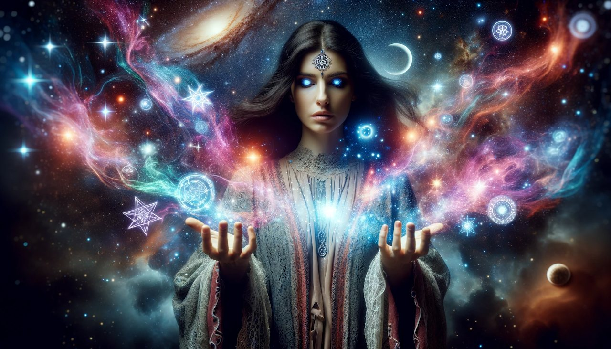

### Какво представляват телесматичните обекти?

Телесматичните обекти са магически предмети, създадени чрез ритуал или процес, чиято цел е да ги зареди със специфични енергии или духовни сили. Думата идва от гръцкото *telesma*, което означава "посвещение" или "завършване". Тези предмети служат като съдове или ***проводници за определени намерения, духове или сили*** и се използват в различните форми на магия и езотерични традиции като херметизъм, кабала и алхимия.

### Характеристики на телесматичните обекти

- **Целенасочено създаване**

   Телесматичните обекти се изработват умишлено с цел да канализират или насочват енергия към конкретна цел – защита, изцеление, благоденствие или духовно израстване.

- **Наситени със символика**

   Обикновено съдържат символи, сигили или надписи, свързани с намерението – астрологични знаци, планетарни влияния, свещена геометрия и др.

- **Избор на материал**

   Материалът се избира според неговите енергийни качества – злато за слънчева енергия и сила, сребро за интуиция, кристали за лечение и трансформация и т.н.

- **Ритуално зареждане с енергия и наричане**

   Чрез ритуал, медитация или съсредоточено намерение, обектът се зарежда с желаната сила. Това може да включва визуализации, заклинания или използване на природни и астрологични енергии, както и наричане.

- **Практическо приложение**

   Телесматичните предмети се носят като амулети, поставят се на олтари или се използват активно по време на ритуали. Те излъчват натрупаната енергия в пространството или директно влияят върху притежателя си.

### Примери за телесматични обекти

- **Амулети и талисмани** – За защита, любов, изобилие, успех.
- **Сигили и символи** – Активирани чрез ритуал за конкретно желание.
- **Магически инструменти** – Жезли, ножове (атамета), чаши, ако са заредени ритуално.
- **Кристали и камъни** – Програмирани с енергия за целенасочено въздействие.

### Как се създава телесматичен обект - стъпка по стъпка:

1. **Избор на предмет и материал**

   Съобразенте се с целта – например червен конец за защита или розов кварц за любов.

2. **Изписване на символика**

   Сигили, имена на сили, планетарни символи или лични кодове.

3. **Ритуално освещаване**

   Присъствие на четирите елемента и евентуално призоваване на астрални или божествени сили.

4. **Зареждане с намерение**

   Чрез визуализация, дишане, ритуал, светлина (слънце/луна) или астрологично събитие.

5. **Използване и грижа**

   Предметът се носи, съхранява на специално място или се използва в ритуали. Изисква периодично презареждане или пречистване.

## Knot Magic – Магията на възлите: Създаване и Развръзване на съдбата

### Какво е Knot Magic (Възлова магия)?

Особен раздел на Телесматичната магия е т.нар. Възлова магия /Knot magic.

Knot Magic (възлова магия) е форма на фолклорна магия, при която се използват **възли**, за да се **свърже, задържи или освободи енергия** по определена тема - любов, защита, успех, благословение и др. Това е изключително древна техника, присъстваща в традициите на келтите, скандинавците, вещерските практики и суфистката магия. Днес, вещиците от всички парадигми я използват в своята практика.

### Как се прави възлова магия (knot magic)?

1. **Избор на конец или шнур**

   – Помнете, че цветът символизира намерението и енергията на желанието.Червен – страст, силаЗелен – пари, изцелениеЧерен – защита, прекратяванеБял – чистота, ново начало и т.н.

2. **Задаване на намерение**

   Мислено или с думи се заявява какво ще бъде “завързано” във всеки възел. Това се прави, докато изготвяте възела. Произнасяйте "завръзването" при заплитането на всеки един възел.

3. **Заклинание - ритуал при всяко връзване**

   С всяко завързване се казва фраза или се визуализира целта.

Давам пример:  
 “Възел първи - волята ми се въдворява в света  
 Възел втори - съдбата се нареджа по моя воля…” и т.н. Сващате идеята.

1. **Зареждане с енергия**

   Крайната връзка се фиксира посредство енергията на самия наричащ. Именно това прави талисманът силен и работещ в полза на нарицателя си. Талисманът може да се носи или да се постави или запечата в кутия, като и тук си има доста особености...които няма да разкривам.

2. **Развързване (по желание)**

   Когато целта е постигната, или за да се освободи енергията (при определени изискващи обстоятелства) - възлите се развързват с намерение за освобождаване. Тук също се следва определена ритуалистика...

### ❗️Внимание! Кnot magic може да създава негативни цикли (loops) - 888

Понякога възлова магия може **несъзнателно да доведе до негативен “енергиен цикъл” или повторяемост на едни и същи събития** - бедност, токсични връзки, страхове, провали.

Това става, когато:

- Намерението е било неясно или изпълнено със страх;
- Възелът е направен от друг човек с вредоносна цел;
- Енергията се е “заключила” и не намира освобождение.

Също така е напълно възможно някой нарочно да ви е направил такава магия за "връзване на късмета".

Много е важно да се помни, че възловата магия е нещо много сериозно, поради това няма да издавам тук тайните й...Истината е, че ако не сте наистина Вещи, можете сериозно да се прецакате. Помнете, че повечето вредоносни магии се правят от "хора", които са обсебени и проводници на инкарнирани архонти, демони или дори астрални същности и стари духове.

Не просто Вярата, а сливането с Висшата божествена Сила, следването на Висшия Аз и връзката с Източника, могат да ви предпазт от всичко.

**Признаци на негативна/черна възлова магия:**

- Повтарящи се житейски ситуации като в капан;
- Чувство на застой, безизходица, “енергийна мъгла”;
- Чувството, че не живеете вашия живот и сякаш нещо ви се е изплъзнало (destiny swapping)
- Необясними провали, емоционално изтощение.

### 🔓 Как се разваля негативна възлова магия?

Ритуалът за развалянето не е никак сложен, но изисква добре насочена сила и умения, както и последователност, за да работи!

Някои от стъките включват:

- **Астрална диагностика и лечение**

   + таро гадание– откриване на чуждите влияния и вмешателства;

- Ритуал за **развръзване** в подходящ ден (напр. намаляваща Луна);

- **Пречистване с вода, огън и благовония** (градински чай, пелин, смирна);

- **Изработване на телесматичен обект**

   за защита, пренасочване и прекъсване на повтарящите се схеми;

- **Медитация и връзка с Божественото**

И най-важното е да разберем, че страхът работи в НАША полза, а не срещу нас.

## 🔮 Лична консултация и астрална диагностика

Магията е тайно изкуство за Посветени и ми е забранено да предавам всичките й тайни.

Това, което мога да направя е да Ви открехна вратата за информацията ...и да действам като Жрица - посредник между света на Посветените и Светския свят. Ако желаете да разберете повече за Възловата магия, можете да се свържете с мен и ако усетя, че сте Избран, можем да извършим консултации, в които да Ви обясня как работи магията, как да я правите безопасно. За по-широк кръг хора, предлагам астрална диагностика + таро гадание, за да проверим дали имате направена възлова магия или автомагия, а също така ще Ви дам и насоки за разваляне и предоляване на loop-a (циклежа/негативната повторяемост).

Предлагам **индивидуални консултации**, в които ще направим:

- ✨ **Астрална диагностика** – има ли направена възлова магия или друго негативно въздействие, намеса на демонични структури или енергиен капан; + **Таро Гадание**
- 🧿 **План и напътствия** как да се създаде телесматичен обект специално за Вас, съобразен с астрологичния дизайн и резултатите от астралната диагностика
- 💠 **Индивидуален ритуален план**, включващ нужните символи, материали и точен процес.

ВАЖНО! Аз самата не извършвам никакви ритуали! Аз просто правя консултацията и изработвам план-ритуала на действие. Това е!

📩 **Свържете се с мен** за лична астрална консултация или поръчка на персонален телесматичен обект.
