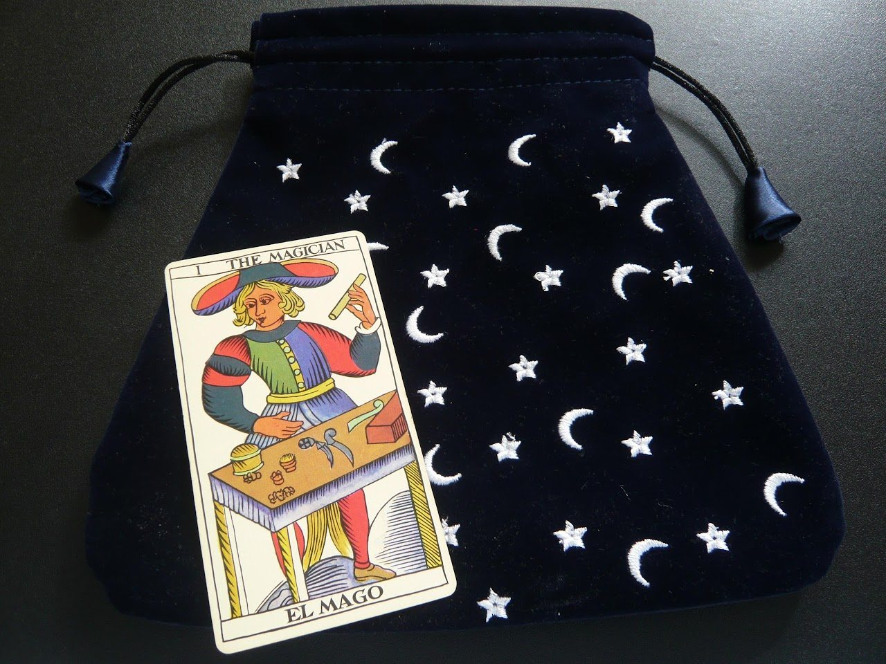
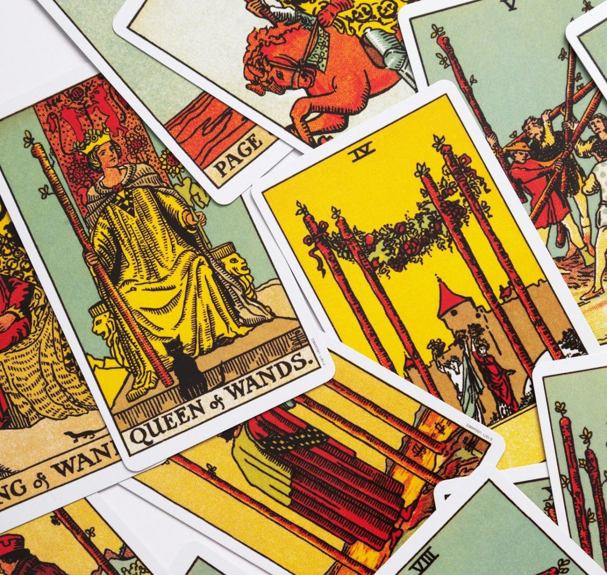

**Как да изтръгнем истината от Таро?**

**Защо тези карти не говорят??? 🙄**

Ще Ви предожа моите “2 цента" по темата + няколко прости, но ефективни трика за по-дълбоко усъвършенстване на изкуството на гадаене с карти Таро, а защо не и с Оракул!

*Останете, за да разберете как да напреднете бързо с Таро!*

Няма да стане само със зяпането на хубавите картинки, тарологията си е умение, трябва и четене :)

Ако вече сте се опитвали да гадаете с Таро, сигурно сте забелязали, че картите не винаги са склонни да говорят ясно и прямо. Понякога те са като упорит събеседник, който мълчи, загатва или крие истината зад недомлъвки и метафори. Често обича и да си прави номерца и шегички. Истината е, че не получаваме информация ей така наготово, както когато отваряме книга, а всъщност разговаряме с Таро или по-скоро с нещото, което контактува през него. Да, доста често това може да е демон, което НЕ Е непременно зле, но за това - друг път.

**През таро, обаче могат да говорят асолютно всякакви информационни канали и същества, затова трябва да умеем да разчупваме “леда”. Ние искаме информация и трябва да знаем как да си я поискаме.**

Друга истина е, че в самата Матрица е заложен механизъм, който се стреми да пречи на ясновидството в бъдещето - програмата не обича да се бърника в тайните й и да се предвиждат стъките й. Архонтите не обичат някой да се бърка в контрола на времевите им линии. Това обаче си е не само нашо право, но и нашо задължение - като осъзнати същества с Висш Аз - да управляваме настоящето, бъдещето, миналото и времевите си линии.

Няма да се уморя да повтарям, че **картите са само инструмент за нашия Висш Аз и Интуитивен ум**, за да ясновидим по-добре посоката, по която вървим. Те са нужната картинна рамка, която държи мозъка ни да не се изгуби в океана от недиферинцирана информация.

Всеки таролог е имал моменти, в които картите просто са отказвали да дадат директен отговор. Знаете ли какво научих от тези моменти? Че проблемът не е в таро, а в начина, по който подхождам. Картите винаги говорят и винаги “излизат”. Няма лоши или грешни карти.

**Тарото е като огледало** - отразява нашето състояние, нашите въпроси и нашата готовност да чуем истината. Но понякога, за да стигнем до сърцето на посланието, трябва да използваме малко хитрина, търпение и креативност. Имала съм моменти на “мъгла”, когато картите просто не са искали да говорят смислено, имала съм моменти на просветление, когато най-накрая успявах да премина през тяхната съпротива и да започна да разговарям с тях.

И днес ще Ви споделя няколко трика, които ми помагат да надвия този "мълчалив период" и да извадя истината, дори когато картите не искат да сътрудничат.

**Тарото не е просто инструмент за гадаене - то е нашият интуитивен партньор**. И както във всяко партньорство понякога трябва да намерите правилния подход, за да имате нужната комуникация. Ако сте готови да се потопите в света на Тарото с малко повече търпение и хитрост, ето как да започнете.

## Създайте си ритуал преди разклад 🧙

Не лоша идея за някои от Вас ще бъде да си имате малък ритуал, като например почукване по картите, запалване на кибритена клечка, магическа фраза/инвокация или ритуална формула/ключ, с която да активирате “енергията” на картите и да ги преведете в действие. Тук няма ограничения и всичко, което работи ЗА ВАС и Ви идва като идея/вдъновение/интуиция ще Ви върши работа.

ПОМНЕТЕ! Ритуалът не трябва да е сложен и да Ви изморява, а да Ви помага да навлезете в Точка на Фокус възможно най-бързо. Той трява да е бърз (в рамките на секунди) и да се помни и прави лесно - той е буквално като клечката кибрит, която трябва да драсне пламъка на вдъновението Ви.

Примерен ритуал: почукване по картите "извиквам добрите духове, донесете ми знание".

**Доверете се на първото си Впечатление 💫**

Когато изтеглите карта, обърнете внимание на първото усещане или мисъл, която ви идва. Често интуицията ни говори чрез тези първи впечатления. Не се притеснявайте, ако не сте сигурни в значението на картата - просто запишете какво усещате и след това потърсете допълнителна информация в книги или онлайн ресурси, с които да напаснете интуитивните си впечатления.

ПОМНЕТЕ! Таро е инструмент за работа с интуицията и независимо колко различни и традицонни значения ще имат картите, в крайна сметка личното интуитивно впечатление е това, което определя валидността на гаданието. Освен това, доста колоди се различват значително от оригиналната Таро Уейт символика и носят картини с доста по-различни и пунктуални сцени (Tarot of Elves, например), които могат доста точно да предадат ситуацията.

**Направете си Таро дневник 📒✍️**

Записването на разкладите е изключително полезно, както не веднъж съм повтаряла. Това Ви позволява да проследявате как се развива Вашата практика с времето и да забележите повторения или модели. Позволява Ви и бързо да “запалвате” и да намирате синхронизации, значения и модели във Вашите гадания, характерни само за Вас. Безценно. Наистина, идея си нямате колко много неща забравяме, дневникът е наистина добра идея.

*В дневника се записват:*

✔️Датата и часа на гаданието

✔️Въпроса/темата

✔️Изтеглените карти

✔️Вашите интерпретации и значения на картите

✔️По-късно допълнение: Какво действие или решение сте взели въз основа на разклада и как са се развили нещата + допълнителни прозрения

Когато сте объркани в началото на гадание и се чудите как да тълкувате дадени карти, винаги можете да погледнете в дневника си за повтарящи се карти и комбинации от предишните Ви гадания и каква роля са имали те тогава.

Също така, можете да се върнете към гаданието, когато усетите прозрение или да се връщате към него постоянно, за да надграждате.

Можете да си направите и нещо като Таро речник със значенията на всяка карта.

**ИЗТЕГЛЕТЕ КАРТА СИГНИФИКАТОР КАТО ОТПРАВНА ТОЧКА**

Ако не знаете откъде да започнете гаданието си или често се лутате в посоката му, задайте си карта сигнификатор, която да ‘’държи’’ темата на расклада.

Картата сигнификатор служи като отправна точка, която помага да се фокусира енергията и интерпретацията на гаданието.

Картата сигнификатор е като компас в света на Тарото – тя Ви насочва и помага да се фокусирате върху основната енергия или тема на разклада. Тя представлява Вас, човека, за когото се прави разкладът, или конкретна ситуация, която изследвате. Сигнификаторът служи като отправна точка, която дава контекст на всички останали карти в разклада. Например, ако изтеглите карта, която символизира сила и решителност, това може да ви подскаже, че именно тези качества ще бъдат ключови за вашата ситуация. С други думи, сигнификаторът е като "главен герой" в историята, която картите разказват. Той не само улеснява интерпретацията, но и помага да се свържете по-дълбоко с енергията на разклада, като ви напомня какво (или кого) всъщност търсите. Без тази карта понякога може да се чувствате изгубени в хаоса от символи и послания, докато с нея имате ясна отправна точка, от която да изградите своята интерпретация.

**Тази карта може да бъде избрана по няколко начина:**

- случаен принцип - разбъркайте картите и изберете една - това е картата, която таро колодата определя като тема за настоящето гадание. Например, ако се падне *Императрицата* - темата на гаданието ще бъде женската енергия и изобилие в живота Ви.
- отговор на конкретен въпрос - например: “Кой е обектът на моите истински чувства” и да кажем, че изтеглите Паж чаши - ще базирате гаданието на тази енергия и значения.
- нарочни сигнификатори - тук може да са повече от една карта. Например, правите гадание за себе си и любовния си живот - избирате една карта за себе си (напр. Кралица жезли) и една за обекта/обектите на желанията Ви (напр. Паж Чаши) + карта на проблема, който мислите, че имате, да кажем Кулата.

Трикът е, че ще гледате сигнификатора в **комбинация** с картите в тегленето и това ще Ви дава по-точна информация за нещата.

**Сигнификаторът фокусира енергията** и помага да се съсредоточите върху човека или темата, което прави разклада по-точен и смислен.

Той и **улеснява интерпретацията**. Когато имате отправна точка, можете по-лесно да разберете как останалите карти се отнасят към питащия или ситуацията.

Важно! Поставете сигнификатора в началото/центъра/върха на подредбата. Това помага да се установи връзка между питащия и ситуацията, която се разглежда.

**Задавайте много точни въпроси** 🧐

Когато задавате въпроси на Таро, бъдете максимално конкретни. Вместо "Какво ще се случи в бъдеще?", попитайте "Какви стъпки трябва да предприема, за да постигна успех в кариерата си?" или “Какво ще се случи на ….., след като….. и …… с еди кой си”, например. Или “Какво ще се случи, ако реша да пътувам до еди къде си”. Схващате идеята.

**Бъдете максимално конкретни** и задавайте различни въпроси по няколко пъти, за да видите всички възможни гледни точки, ситуации и времеви линии.

**Точно формулираните въпроси** водят до по-ясни и полезни отговори. Когато задавате точни въроси с повече подробности Таро добива по-ясна представа какво точно питате.

Хитър трик за **тайминг** е да питате ще се случи ли дадено нещо между дадени дати. Така може и да усеете да "хванете на тясно" таро.

*Друг примерен начин за задаване въпроси:*

❌ "Къде съм си оставила чадъра?"

✅ "Чадърът ми в дневната ли е?", "Вкъщи ли е", "На светло място ли", "Под масата ли е" и т.н.

Схващате идеята. 💡

**Използвайте техниката "кръстосан разпит"🤺**

Кръстосаният разпит е техника, при която задавате един и същ въпрос по различни начини или гледате една и съща ситуация от различни гледни точки.

Например, ако питате за любовен триъгълник, можете да изтеглите карти за това какво чувствате Вие, какво чувства партньорът Ви и каква е общата Ви енергия, има ли намесен трети човек, какво чвства този човек към Вас и т.н. Ако картите са уклончиви, питайте пак: "Ако той ми изневерява, това през деня ли се случва" и т.н.

Тази техника Ви помага освен да "изтискате" тарото (понякога наистина не иска да говори по ред причини), също така и да избегнете пристрастното тъкувание. Ако сте изтеглили карти, които мислите че Ви дават положителен отговор, но после изтеглите категорично отрицателни карти на уточняващ подробен въпрос, то очевидно сте се подвели първончално или има някакви други неизвестни фактори, които трябва да разгадаете.

Повече примери за метода на кръстосания разпит можете да видите в YouTube канала ми и в Patreon.

### Заключение

Тарото е мощен инструмент за себерефлексия и духовно израстване, но изисква практика, практика и пак практика. **Създаването на ритуал, доверието в първото впечатление, воденето на дневник и задаването на точни въпроси са стъпки, които могат значително да подобрят Вашите умения, но изискват упорито приложение**. **Трябва да лягате и ставате с картите**. Запомнете, че Тарото е не просто ''баене'' за бъдещето, а и начин да се свържете с Вашия Висш Аз и в известен смисъл да създадете Вашето бъдеще.

Така че, следващия път, когато вземете тарото в ръцете си, не забравяйте тези трикове - те могат да Ви отведат на ново ниво в разбирането на Тарото.✨
