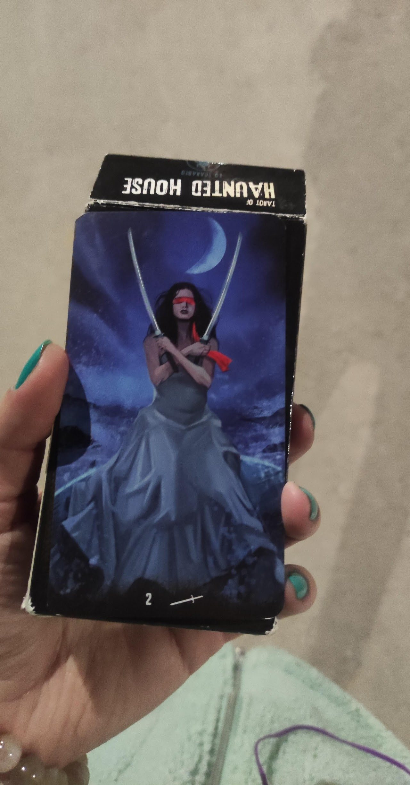
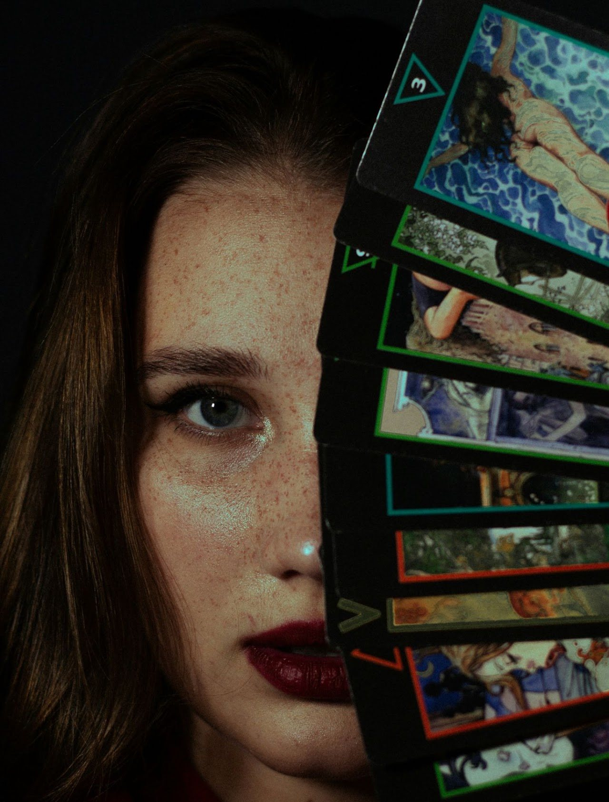
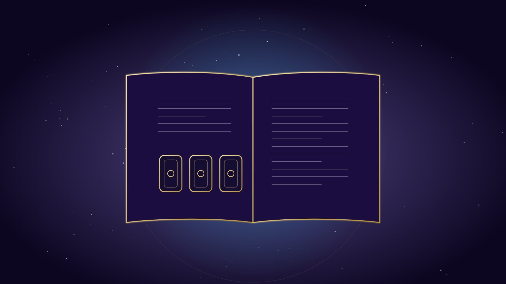
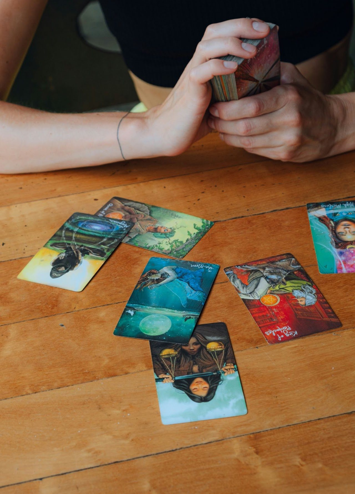
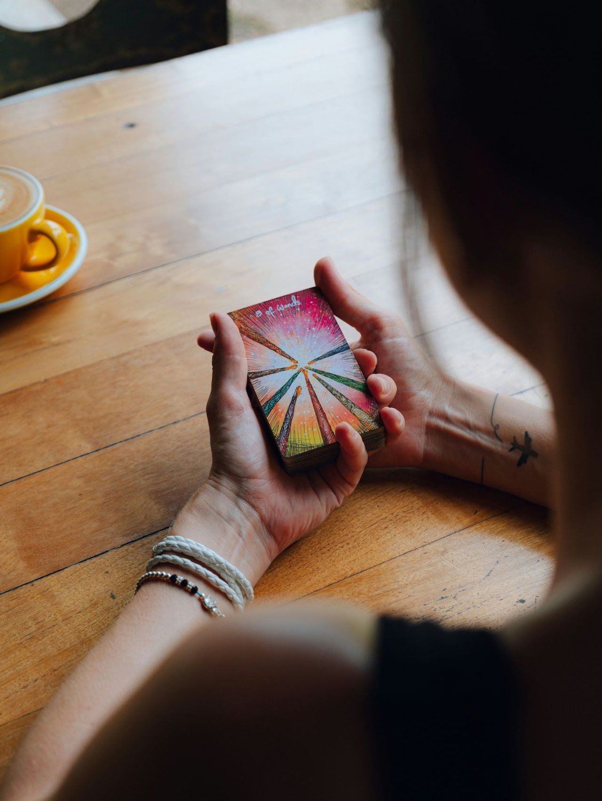
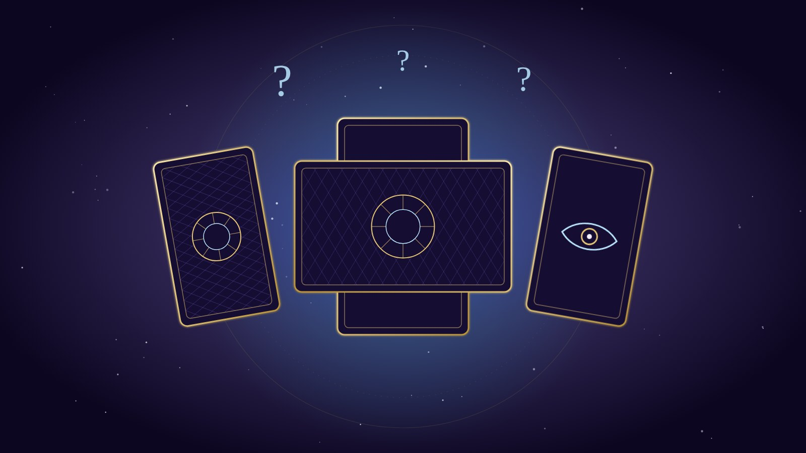

**Как да изтръгнем истината от Таро? Защо тези карти не говорят??? 🙄**

Ще Ви предложа моите „2 цента“ по темата и няколко прости, но ефективни трика за по-дълбоко усъвършенстване в изкуството на гадаенето с карти Таро – а защо не и с оракул. Останете, за да разберете как да напреднете бързо с Таро! Само със зяпане на хубавите картинки няма да стане – тарологията е умение и изисква и четене :)

## Защо понякога картите не „говорят“

Ако вече сте опитвали да гадаете с Таро, сигурно сте забелязали, че картите не винаги говорят ясно и прямо. Понякога те са като упорит събеседник, който мълчи, загатва или крие истината зад недомлъвки и метафори. Често обичат и да си правят номерца и шегички. Истината е, че не получаваме информацията наготово, както когато отваряме книга – всъщност разговаряме с Таро, или по-скоро с това, което контактува през него. Да, доста често това може да е демон, което НЕ Е непременно зле, но за това – друг път.

**През таро обаче могат да говорят абсолютно всякакви информационни канали и същества, затова трябва да умеем да разчупваме „леда“. Искаме информация и трябва да знаем как да си я поискаме.**

Друга истина е, че в самата Матрица е заложен механизъм, който се стреми да пречи на ясновидството в бъдещето – програмата не обича някой да се бърка в тайните ѝ и да предвижда стъпките ѝ. [Архонтите](/blog/archonts) не обичат някой да се меси в контрола на времевите им линии. Това обаче е не само наше право, но и наше задължение – като осъзнати същества с Висш Аз да управляваме настоящето, бъдещето, миналото и времевите си линии.

Няма да се уморя да повтарям, че **картите са само инструмент за нашия Висш Аз и интуитивен ум**, за да ясновидим по-добре посоката, по която вървим. Те са нужната картинна рамка, която не позволява на мозъка ни да се изгуби в океана от недиференцирана информация.

Всеки таролог е имал моменти, в които картите просто отказват да дадат директен отговор. Знаете ли какво научих от тези моменти? Че проблемът не е в тарото, а в начина, по който подхождам. Картите винаги говорят и винаги „излизат“. Няма лоши или грешни карти.

**Тарото е като огледало** – отразява нашето състояние, въпросите ни и готовността ни да чуем истината. Понякога обаче, за да стигнем до сърцето на посланието, трябва малко хитрост, търпение и креативност. Имала съм моменти на „мъгла“, когато картите просто не искат да говорят смислено, и моменти на просветление, когато най-накрая успявам да премина през съпротивата им и да започна да разговарям с тях.

Днес ще Ви споделя няколко трика, които ми помагат да преодолея този „мълчалив период“ и да извадя истината дори когато картите не искат да сътрудничат. **Тарото не е просто инструмент за гадаене – то е нашият интуитивен партньор**. И както във всяко партньорство, понякога трябва да намерите правилния подход, за да има комуникация.

## 1. Създайте си ритуал преди разклада 🧙

За някои от Вас ще е добра идея да имат малък ритуал – почукване по картите, запалване на кибритена клечка, магическа фраза, инвокация или ритуална формула (ключ), с която да активирате „енергията“ на картите и да ги приведете в действие. Тук няма ограничения – всичко, което работи **за Вас** и Ви идва като идея, вдъхновение или интуиция, ще Ви върши работа.

**Запомнете:** ритуалът не трябва да е сложен и да Ви изморява, а да Ви помага да навлезете в точка на фокус възможно най-бързо. Той трябва да е кратък (в рамките на секунди) и лесен за запомняне – буквално като клечката кибрит, която драсва пламъка на вдъхновението.

*Примерен ритуал:* почукване по картите с думите „Извиквам добрите духове, донесете ми знание“.

## 2. Доверете се на първото си впечатление 💫

Когато изтеглите карта, обърнете внимание на първото усещане или мисъл, която Ви идва. Интуицията често говори именно чрез тези първи впечатления. Не се притеснявайте, ако не сте сигурни в значението на картата – просто запишете какво усещате и после потърсете допълнителна информация в книги или онлайн, за да напаснете интуитивните си впечатления.

**Запомнете:** Таро е инструмент за работа с интуицията и колкото и различни традиционни значения да имат картите, в крайна сметка личното интуитивно впечатление определя валидността на гаданието. Освен това доста колоди се различават значително от оригиналната символика на [Rider–Waite–Smith](https://en.wikipedia.org/wiki/Rider%E2%80%93Waite_Tarot) и носят доста по-различни и конкретни сцени (Tarot of the Elves например), които могат точно да предадат ситуацията.

## 3. Водете си таро дневник 📒✍️

Записването на разкладите е изключително полезно – не веднъж съм го повтаряла. Така проследявате как се развива практиката Ви с времето и забелязвате повторенията и моделите. Дневникът Ви позволява и бързо да „запалвате“ и да намирате синхронизации, значения и модели в гаданията си, характерни само за Вас. Безценно. Наистина нямате представа колко много неща забравяме.

*В дневника се записват:*

- ✔️ датата и часът на гаданието;
- ✔️ въпросът или темата;
- ✔️ изтеглените карти;
- ✔️ Вашите тълкувания и значения на картите;
- ✔️ по-късно: какво действие или решение сте предприели въз основа на разклада, как са се развили нещата и допълнителните прозрения.

Когато в началото на гадание сте объркани и се чудите как да тълкувате дадени карти, винаги можете да погледнете в дневника за повтарящи се карти и комбинации от предишните си гадания и да видите каква роля са имали тогава. Можете да се връщате към гаданието, когато дойде прозрение, или постоянно – за да надграждате. Можете да си направите и таро речник със значенията на всяка карта.

Подробно ръководство ще намерите в статията [„Как да си водим Таро дневник?“](/blog/kak-da-si-vodim-taro-dnevnik).

## 4. Изтеглете карта сигнификатор като отправна точка

Ако не знаете откъде да започнете гаданието или често се лутате в посоката му, задайте си **карта сигнификатор**, която да „държи“ темата на разклада.

Сигнификаторът е като компас в света на Тарото – той Ви насочва и помага да се фокусирате върху основната енергия или тема на разклада. Представлява Вас, човека, за когото се прави разкладът, или конкретната ситуация, която изследвате, и дава контекст на всички останали карти. Например, ако изтеглите карта, която символизира сила и решителност, това може да Ви подскаже, че именно тези качества ще бъдат ключови за ситуацията. С други думи, сигнификаторът е „главният герой“ в историята, която картите разказват. Той не само улеснява тълкуванието, но и Ви помага да се свържете по-дълбоко с енергията на разклада, като Ви напомня какво (или кого) всъщност търсите. Без него понякога може да се почувствате изгубени в хаоса от символи и послания.

**Сигнификаторът може да бъде избран по няколко начина:**

- **По случаен принцип** – разбъркайте картите и изберете една. Това е картата, която колодата определя като тема на гаданието. Например, ако се падне *Императрицата*, темата ще бъде женската енергия и изобилието в живота Ви.
- **Като отговор на конкретен въпрос** – например „Кой е обектът на моите истински чувства?“. Ако изтеглите Паж чаши, ще базирате гаданието на тази енергия и значения.
- **Нарочно избрани сигнификатори** – тук може да са повече от една карта. Например правите гадание за любовния си живот: избирате една карта за себе си (например Кралица жезли), една за обекта на желанията си (например Паж чаши) и карта за проблема, който мислите, че имате – да кажем Кулата.

Трикът е да гледате сигнификатора **в комбинация** с изтеглените карти – това дава по-точна информация.

- **Сигнификаторът фокусира енергията** и Ви помага да се съсредоточите върху човека или темата, което прави разклада по-точен и смислен.
- **Улеснява тълкуванието** – когато имате отправна точка, по-лесно разбирате как останалите карти се отнасят към питащия или ситуацията.

**Важно:** поставете сигнификатора в началото, в центъра или най-отгоре на подредбата. Това установява връзка между питащия и ситуацията, която се разглежда.

## 5. Задавайте много точни въпроси 🧐

Когато задавате въпроси на Таро, бъдете максимално конкретни. Вместо „Какво ще се случи в бъдеще?“ попитайте „Какви стъпки трябва да предприема, за да постигна успех в кариерата си?“ или „Какво ще се случи, ако реша да пътувам до…?“. Схващате идеята.

**Бъдете конкретни** и задавайте различни въпроси по няколко пъти, за да видите всички възможни гледни точки, ситуации и времеви линии. **Точно формулираните въпроси** водят до по-ясни и полезни отговори – когато питате с повече подробности, Таро добива по-ясна представа какво точно искате да знаете.

Хитър трик за **тайминг** е да питате дали дадено нещо ще се случи между определени дати. Така може и да „хванете натясно“ тарото.

*Друг пример за задаване на въпроси:*

- ❌ „Къде съм си оставила чадъра?“
- ✅ „Чадърът ми в дневната ли е?“, „Вкъщи ли е?“, „На светло място ли е?“, „Под масата ли е?“ и т.н.

## 6. Използвайте техниката „кръстосан разпит“ 🤺

Кръстосаният разпит е техника, при която задавате един и същ въпрос по различни начини или гледате една и съща ситуация от различни гледни точки.

Например, ако питате за любовен триъгълник, можете да изтеглите карти за това какво чувствате Вие, какво чувства партньорът Ви, каква е общата Ви енергия, има ли намесен трети човек и какво чувства този човек към Вас. Ако картите са уклончиви, питайте пак: „Ако той ми изневерява, това през деня ли се случва?“ и т.н. (за любовните гадания вижте и [„Пентаклите в любовно гадание за бъдеще“](/blog/pentaklite-v-lyubovno-gadanie)).

Тази техника Ви помага не само да „изстискате“ тарото (понякога то наистина не иска да говори по ред причини), но и да избегнете пристрастното тълкувание. Ако сте изтеглили карти, които смятате за положителен отговор, а после на уточняващ въпрос изтеглите категорично отрицателни карти, очевидно сте се подвели първоначално или има неизвестни фактори, които трябва да разгадаете.

Още примери за кръстосания разпит ще намерите в [YouTube канала ми](https://www.youtube.com/@astralarra) и в [Patreon](https://www.patreon.com/c/AstralARRA).

## Често задавани въпроси

**Какво да правя, когато картите „не говорят“?**
Направете кратък ритуал за фокус, задайте по-конкретен въпрос и използвайте карта сигнификатор. Ако отговорът пак е мъглив, задайте същия въпрос от друг ъгъл – с кръстосан разпит.

**Колко карти да тегля за един въпрос?**
За ясен въпрос една до три карти са достатъчни. Повече карти имат смисъл при сложни ситуации и при разклади с фиксирани позиции.

**Мога ли да ползвам тези трикове и с оракулски карти?**
Да. Ритуалът, първото впечатление, дневникът и точните въпроси работят еднакво добре и с оракул.

## Заключение

Тарото е мощен инструмент за себерефлексия и духовно израстване, но изисква практика, практика и пак практика. **Ритуалът, доверието в първото впечатление, воденето на дневник и задаването на точни въпроси могат значително да подобрят уменията Ви, но изискват упорито прилагане.** Трябва да лягате и да ставате с картите. Запомнете, че Тарото не е просто „баене“ за бъдещето, а начин да се свържете с Висшия си Аз и в известен смисъл да създадете бъдещето си.

Така че следващия път, когато вземете картите в ръце, не забравяйте тези трикове – те могат да Ви отведат на ново ниво в разбирането на Тарото ✨

Ако искате лично гадание, вижте [консултациите](/consult).
