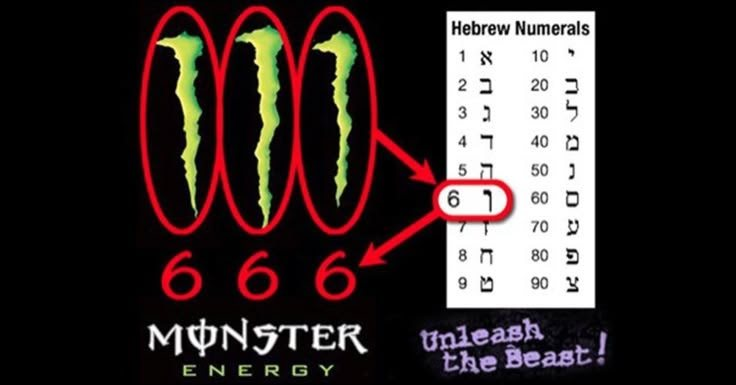
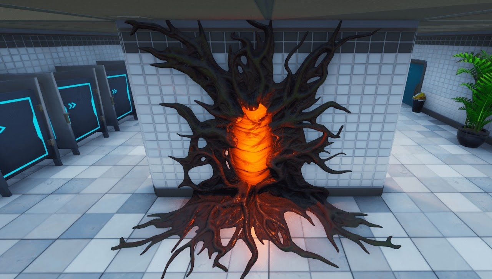
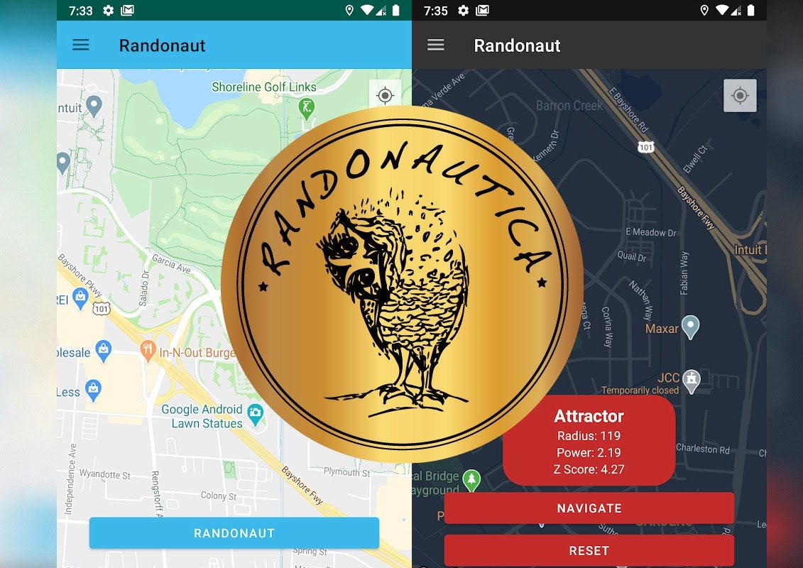

Today I'll tell you how my synchromystic research with the [Randonautica](https://www.randonautica.com/) app began.

**Randonautica** is an app that uses a **quantum random number generator (QRNG)** to generate coordinates and encourages users to explore unfamiliar places around them. The core idea is that by setting an **intention** (a thought, word or concept) the user can influence randomness and experience synchronicities or meaningful events at the chosen spot. The app started a whole movement – **randonauts**, people who believe they can **break out of the matrix** this way. Randonautica is really the technical side of [Synchromysticism](/en/portal). Only instead of your Higher Self and your brain doing the complex calculations of quantum points in space-time, here the power is handed to a quantum computer... which, on top of everything, is called [ANU](https://qrng.anu.edu.au/) (no joke). Which is already extremely sus, but... whatever.

Randonautica deserves a whole section of its own, but I'll most likely just start a series here, describing my own journeys. The subject definitely deserves more detailed research, though, and I'll see where to publish it later.

But back to the synchronicity. Here, straight from my notes, is the day I installed the app.

> I used to use the Fatum bot on Telegram, and I can't say it gave any remarkable results beyond the usual synchronicities, but about a year ago it stopped working. Today I installed the Randonautica app and... oh, boy... things got creepy the moment I left home. First there was the typical random creepy dude who, as we passed each other on the street, made a very strange touch with his index finger right on the outer part of my collarbone, like a "tap", and I felt a very strange energy – besides the wtf of someone touching me so demonstratively in front of everyone on the street... I was shocked, to put it mildly. I turned to him hoping he'd at least explain, and the creepy dude waved at me cheerfully, as if we knew each other, and said: "*Welcome*". Uh-huh. Wow. The quantum computer has just generated an NPC to welcome me to the Game. It's gonna be fun.

> Then, on my way to the bus stop, I saw a car with an unusual plate – XXXXXX (six Xs) – with some strange people in it, and the stop itself had been vandalised: the wall was smashed and had a hole in it (yes, a whole hole, like in a Marvel movie), and right above the hole someone had placed a crushed can of... Monster. Yes, that one, with the Hebrew letters 666 and the mark of the Beast...

I think I just got a "Welcome to the Game" from the Dark Side... 🫠

This is actually extremely powerful symbolism, showing that the purpose of this quantum computer is to break through reality (666 is material reality) and open portals (that's what the hole symbolises). A bus stop in the [astral](/en/blog/categories/astral) symbolises the passage from one density (reality) to another. Interestingly, in the astral a stop is linked to waiting and to complying with [archon](/en/blog/archons) programs – you can't just wander off into some other astral space. Metaphorically, the hole in the wall of the stop tells me that whoever is behind this app and the quantum generator has learned to cross these limits in the astral and instead open direct routes to other local spaces – in material reality too, not only non-local ones in the astral. Back to the breakthrough into reality I mentioned. It's clear to me that the purpose of creating such portals – besides bypassing archon programs and travelling faster in the astral – is also to connect something in the astral with something in material reality and open a little door for it... Quite the Stranger Things vibes, and for now I won't speculate about what it is they want to give access to our reality...

*Stranger Things' portals invade 'Fortnite' ahead of season 3 release*

X – I'm still not sure what it means, but since Elon Musk uses it as the name of his platform, it's definitely something symbolic (you can see the symbolism here too, and personally I've had many more synchronicities featuring the "X" symbol).

Also, this app appeared in February 2020, which makes me see recent events in a new light... Anyway, I could say a lot more about randonauting, manifestation, intention, magick, the dark side... but I will let you wonder ;)

Still, I will say that the timing of all this is not, not at all, random, and I'm more and more convinced that the purpose of the whole cacophony from 2020 onwards has been to open a portal for entities of the [Black Oil](/en/blog/categories/gnosticism) of a higher polarity to come in, as well as Archons...

*Edit: as of 2025 I'm convinced this is so, although the process has slowed down considerably.*

The Masonic owl, of course, as the app's symbol :) The same animal is used in the film [The Fourth Kind (2009)](https://www.imdb.com/title/tt1220198/) as the sign of the alien Greys, appearing right before the abductions.

And here are a few warnings from the Randonautica website:

*Don't fuck with the code of the simulation if you don't know what you're doing and can't handle the consequences ;)*

> *Be cautious, you're dabbling in quantum manipulation destined to cause unnatural shifts in the space-time continuum. Basically, you're opening doors you cannot close. Be careful what you wish for, the Universe will grant you every wish, but not as intended to be.*

I think that makes things clear :)

2020
