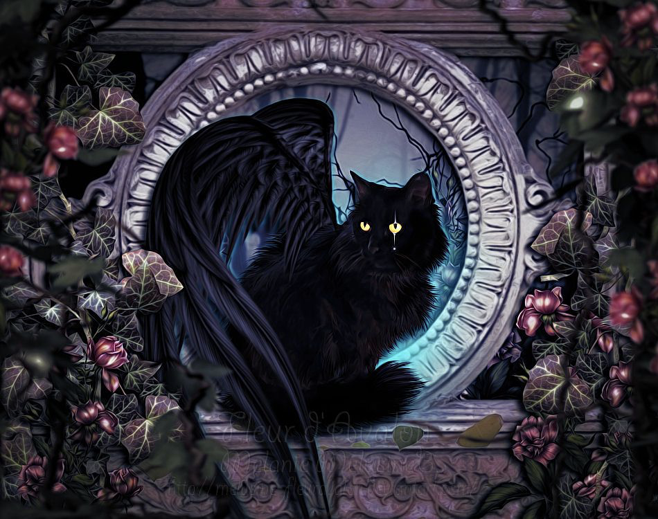
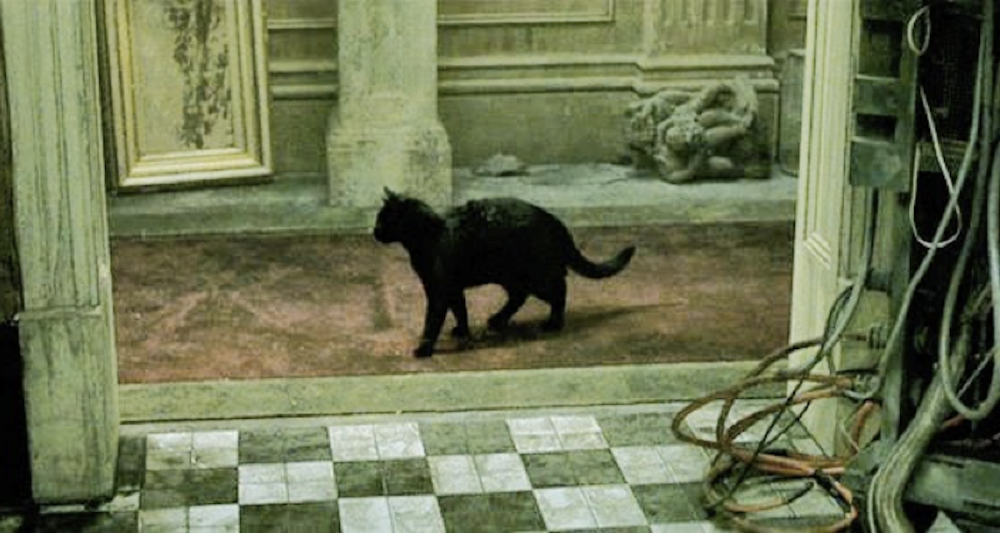
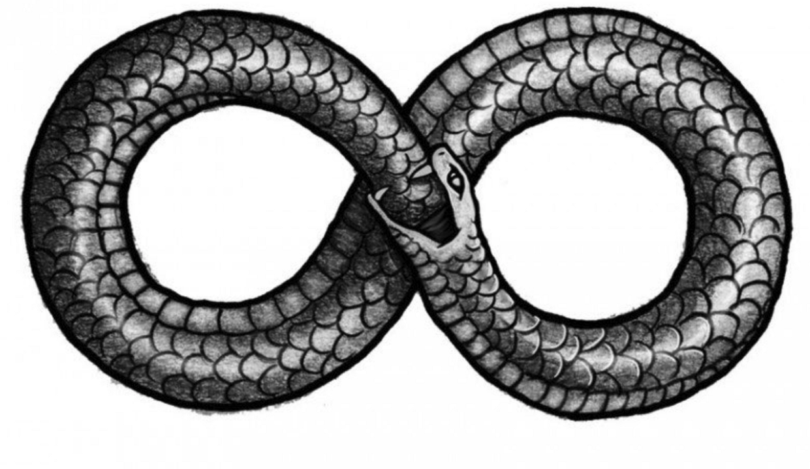
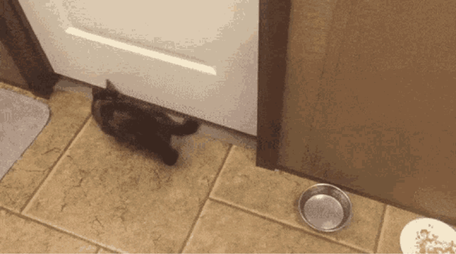

Something rather strange happened today... And by "strange" I mean that I now have fairly clear proof (at least for myself) that our consciousness travels through different time windows and can choose a time reality. I've had many experiences like this before, but I don't remember them being this clear, with such a precise synchronicity reaching even beyond the range of my own consciousness.

Let me explain.

After waking up in a pretty decent mood, I had a peculiar premonition from the morning on. I'd set my mind on buying a big sphere of gemstone (cherry quartz), and my cards for the day were the **Two of Pentacles** and **Strength**, so _I was like: let's go_! Gradually my day started charging up with higher and higher vibrations. Afterwards I had a very pleasant conversation with the saleswoman at the shop where I bought the sphere. I'll keep the conversation secret, though, as it was quite personal (we talked about the new path in my life), but from then on synchronicities began to shower down on me, fitting together extremely precisely like pieces of a puzzle. I decided to take a metaphysical-meditative walk through the old part of the city (Veliko Tarnovo), and on walks like this I always follow the direction my Higher Self leads me in, without letting my Mind and its "must" commands interfere, carefully watching my thoughts and sensations as I pass through spatial windows... As I wandered around, picking up the energy and experiences of my parallel Self-incarnations in a neighbouring time reality, who live in the houses and streets of a similar city (I really don't know how to explain it, but long story short, Val Valerian is right...), I was falling into an ever deeper layer of my consciousness. Which meant the Matrix would try to wake me up. And sure enough, a black cat tried to cross my path, and I decided I wouldn't let it, because I knew very well it would be a **restart** – and I'd only just felt myself moving into higher vibrations and starting to open portals to the timeline I wanted, one outside the matrix of the Dark Ones.

Long story short, the Dark Ones who currently rule the Earth and try to control all its potential and real timelines want us, every time, to "choose" the worst and most traumatic of the options available to us under our design and program, so as to manipulate us into ever deeper trauma, which leads to ever deeper anchoring and looping in the matrix and fewer and fewer degrees of free will – all so they can drain our biophotons, our life energy. For many people all this turns into an ever deeper loop process that is very hard to stop.

**A little about the loop.**

Repetition of history is all a loop needs. Every time, the program of the Dark Ones will try to shove us into a cycle of traumatic repetition of mental patterns that lead us further down the spiral of the Mind, into the predictable reality we generate this way, which becomes more and more negative, where Love (as energy and manifestation) disappears more and more and fear reigns as the main emotion and perception of reality. And it (Love) disappears because the biophotonic potential of our DNA is directly linked to the possibility of exercising **freedom and love**, or of **choosing between the different potential states, a.k.a. collapsing the wave function**. It's no accident that the [Astral body](/en/blog/categories/astral) is also known as the Emotional body – the aspect *closest* to that original Love (_and we all know there's much more hidden behind that word_).

The positive reality of the Source is Love – Light – Will; the Dark one is Apathy – Darkness – Fear.

The Dark Ones make sure this collapse always happens at the crest of the wave, when the body is most charged with biophotonic potential, so that the maximum energy can be drained. Then the individual who has fallen victim to this draining is shoved into the desired reality by repeating/recycling an old trauma, replayed by the program in a new way, which has something to latch on to (_I'll explain in detail how that works another time_). In pop-esotericism this is called "not having learned your lesson". Either way, on the road to gradually reaching the peak of the biophotonic wave there are various crossings where the program will try to "catch" you or track you. This is part of the Universe's mechanism for warning you of coming danger or of the path you've set out on – something the Dark Ones can't avoid including in the code of their Matrix, simply because that's how things work.

Remember when a black cat appeared in [The Matrix](https://en.wikipedia.org/wiki/The_Matrix)?

Meow, meow…

In the film it meant that someone was changing something in the matrix, tinkering with the code, and it was linked to the phenomenon of déjà vu. Exactly – déjà vu. You don't even remember it, but the program has restarted you and is giving you the chance to set off on a new path and make new choices. Or someone has deliberately restarted you on a new interactive line of the program. This is part of the protective mechanism, which can, however, be hacked by experienced "admins" if you let them.

However, things are a bit more complicated with the phenomenon of déjà vu, and it definitely deserves [a separate article](/en/blog/categories/magick). In any case, remember that this "admin", currently in charge of the register of the larger program that intercepts yours, may not be well-meaning at all. However high your vibration and however connected you are to your Higher Self, there's always someone above you who has your number (ed. 31.07.2022 – _a year later I'm convinced the change is a bad one, i.e. they're trying to knock you off the line of free will and restart the program from the last level you were at before you raised your biophotonic potential. However, I remain optimistic that eventually some mental Alchemy is possible through which we could have our own admin control over Our reality, without some alien player or archon with higher admin rights intercepting and manipulating Us..._).

Seen this way, there's logic in the popular superstition that a black cat crossing your path is bad luck (someone is turning the wheel of life against us). It's through this very "folk tale" that the collective subconscious tries to warn us that something is messing with us.
And still, don't forget that déjà vu was originally a mechanism of the Universe's original program to protect us from our own choices and give us a new chance to make new choices and take a new path. It is simply **a glitch in the matrix that shows an "open gate" for changing the code** – which player gets hold of it, and for what purpose, is another question. The fact is that at the moment very few people have even semi-conscious control over the process. It's definitely advanced aerobatics to step into the role of administrator and displace the archon, or whatever is trying to reprogram you back into the loop.

So, at the moment a black cat appears, it's only an indicator that you've opened such a gate (a.k.a. a **portal**).
A portal to what? To more degrees of freedom and the chance to manifest the scenario you want but which isn't in the program, or a scenario that will pull you out of a toxic loop – or even to enter a state where you don't need a scenario at all!!! :))) If you meet a black cat, it's a sign that you're at a very high degree of free will and have considerable control over the program, which is why the archons are now trying to intercept you. Your "thread" of consciousness is moving unpredictably through space-time, and they need to locate you in order to restrict you and impose a new loop – that is, keep you running in the same place like a hamster in a wheel.
Or something else:

The familiar [Ouroboros](https://en.wikipedia.org/wiki/Ouroboros) with the Serpent-[Archon](/en/blog/archons). Its true meaning is the archon that has caught you in a traumatic loop.

My instinctive reaction when I see a black cat has always been to run away from it and not let it cross my path. It's really very funny how these little beasts jump out at the most delicate moment of a meditative or trance state, just as I'm passing through a "corridor" into a new space of awareness :) I'll never stop being amazed at the speed and precision of the mechanism :) So I took the necessary action – to carry on along the path I wanted, uphill, but abruptly change my trajectory (_which, btw, is a really cool exercise on a meditative walk, because it takes you out of predictability – it's part of the mechanism of [Randonautica](/en/portal/randonautica-the-beginning)_).
As expected, this turned out to be a pretty good decision.

*Ed. 31.07.2022:* ABSOLUTELY ALWAYS DO THIS! I'M NOT JOKING! AVOID THE PATH OF THIS CREATURE IN ABSOLUTELY EVERY WAY POSSIBLE, F CAPS LOCK, FOR CHRIST'S SAKE! I couldn't care less how loony you look to some completely irrelevant passer-by (f\*\*\* them NPCs).

After deftly slipping out of the predictable trajectory, escaping the black cat and re-entering **randomness**, I sank into an even deeper **focus**, and so into an even higher level of consciousness. That's when something interesting happened, which will tie in with the ending of this article. I decided to take a little side street, because I'd seen an interesting grave-monument to rebels that caught my eye, and an over-enthusiastic cat instantly popped out onto my path ☺ Not a black one :D Street cats that are open to contact with you are always a very good sign. It means **high vibrations and entry into the Astral! A higher-order consciousness, with the possibility of controlling time windows and portals through the astral field**. The Gods are smiling at you and are happy for you :)

_Cats carry genes from the Sirius races, which is why they have reptilian pupils and unusual astral abilities – and not only that ;)_

I decided to pet the little lady and take her picture, since she was literally throwing herself at me :D It was as if she wanted to tell me something and protect me, that's how it felt... While we were enjoying each other, another cat watched us rather fearfully and shyly, as if it wanted to say something... These creatures are very intelligent for the simple reason that their bodies are vessels in which other entities can incarnate through the astral. More interesting still, these entities are always benevolent, and rarely does anything negative manifest through them. The reason is the genetic program laid down by Sirian factions. Yes, there are some who wish us well :0

In any case, **I could feel the moments changing like frames, and each frame carrying an energetic vibration and information, wanting to tell me something; like a kind of picture-puzzle my consciousness was putting together moment by moment.**

**The window of choices was open.**

And just as I was feeling absolute peace and calm, sensing that I'd rearranged my past and squeezed the most out of it, that the traumas were resolved and forgotten, the mental programs reprogrammed or formatted, and I could already see the new path I was taking, on which all my dreams could come true, the program broken, the repetition-LOOP removed, everything falling into place... HALLELUJAH!

... along comes that nasty thing again... I had a peculiar premonition...

Before I knew it, it had crossed my path quite demonstratively. Interestingly, the spot I was in was so out of the way (anyone who's been through the little streets of Veliko Tarnovo knows...) that, like it or not, I had no other escape route.

Up to that moment I'd been filming the whole episode on my phone (I forgot to say I'd taken it out to film the whole charming experience the moment the sweet cat started throwing herself at me); but exactly when the black cat managed, literally in less than a second, to cross my path (it shot past like lightning, out of nowhere!), for some strange reason my camera stopped recording... like... I mean, that moment is missing, and I saw it and filmed it, HUH??? Besides, I swear, it all happened so fast that I could definitely feel someone's very fast programmer's reaction... At that moment I wasn't reading only my own Consciousness, but something much bigger, and it was as if I could see through those other "eyes" too – the eyes of the admin changing my program.

The black cat covered those almost 10 metres in an instant, and that's actually startling – I had completely lost focus for some period of time. (This is what I mean when I say that time flows through frames and elements of our Consciousness and isn't a fixed constant outside us, and that depending on the frequency and number of frames and our perception, we ourselves actually determine how it flows.)
Literally shock and disappointment. I felt something slipping away from me... and I was back in a loop-restart state. The key moment in the story here is that I'd recently gone through an extremely painful break-up with enormous traumatic potential, which I had nevertheless managed to overcome – I had restored my heart chakra and from there I could already visualise the new time reality for myself. I could see that I could move forward on my path and manifest what I really want this time, but...

The next moment I remembered to look at my phone's camera again, and there had been some kind of frame switch, and the camera wasn't working any more – it had turned itself off. (This is also connected to the phenomenon of UFOs not being capturable on camera – they simply change the frame, because they move outside linear space-time; click, and they're in one frame and you're in another, it takes milliseconds.) In short, to make it clear: I filmed the whole experience, including the black cat passing, and I remember that VERY CLEARLY, but not only is it missing from the clip afterwards, a frame has also been "stuffed" into my reality in which my camera turns itself off, though I have no memory of either that or what came before. Do you see how important our memories are? They change the frames of what we see/experience, but not our memories! The eyes lie.
Now think about what this really means for the nature of the "reality" we live in, and whose it is – including the Consciousness/brain/mind we consider "ours"?

All this probably sounds a bit confused, but, for Christ's sake, moments and states of consciousness like these are very hard to describe. People who have experienced them will understand me...

And so, once again, it was as if I'd ended up in a trap, and this time the program caught me... You just sense these things... Words can hardly describe the depth of the feeling. After that I decided it was time to continue on my way by going back (in the direction the black cat went). But I won't give up. I will understand the code of the program and steer my timelines in the direction I want, towards my highest reality, in which I get everything I want.

✨
END OF STORY.

For Now…

P.S. Later I had a synchronicity with this video ❤️ :

https://youtu.be/Z-bohBW8BmQ
