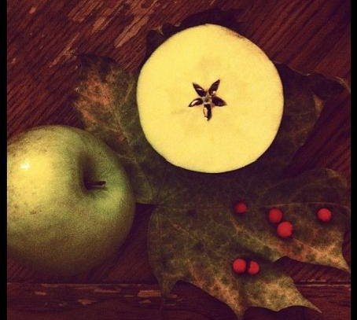
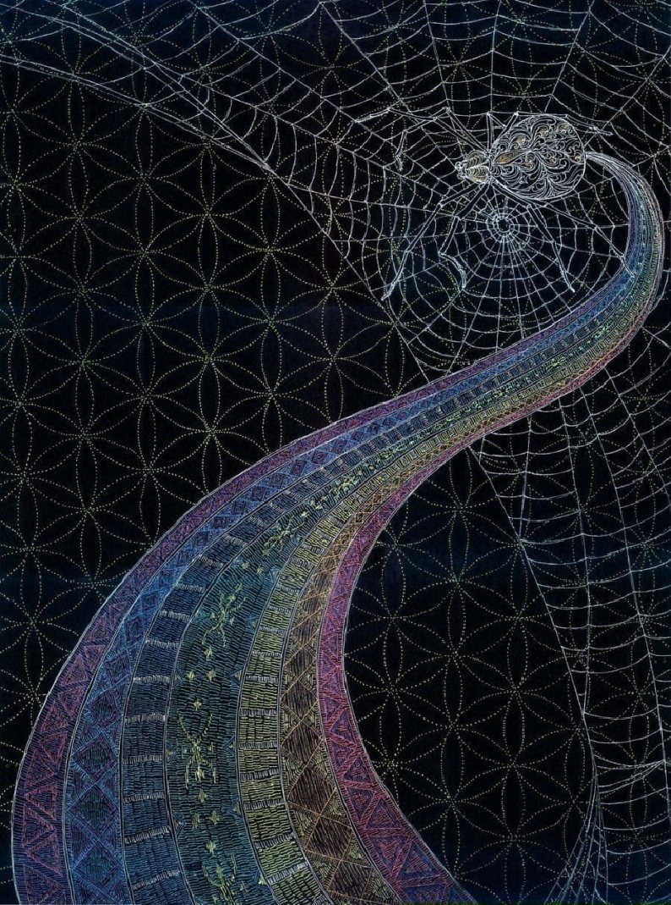
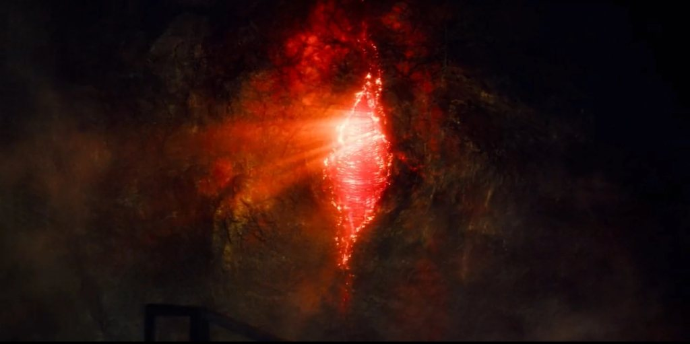

Today's topic is the [black goo](/en/blog/categories/gnosticism) parasite and the [archon](/en/blog/archons) whose essence I ran into while travelling... Its symbol in esotericism is **the spider** – the "god" worshipped by the Freemasons – **Jabulon**.

Joke's on me: only now do I realise that the old Russian word for **apple** is exactly... yabolon :))) Ah, that Russian trail...

By the way, the image above shows the demon **BAAL** from the [Goetia](https://en.wikipedia.org/wiki/The_Lesser_Key_of_Solomon).

The image below shows the reason we're not in Paradise ;)

Is anyone else connecting **the myth of Eve and the apple, Apple, and the spider-god of the black Freemasons, Jabulon or BAAL (Ba-Al – Barium-Aluminium ;)**?

So, connecting all of this – **the loss of smell** with **c\*rona v\*rus** and **Gate 44** in Human Design (which is part of the centre of the **immune system** and governs **the cognition of smell, as well as memory**) – I happened upon [this article on psychic abilities and the gates](https://www.barneyandflow.com/psychic-abilities). Led by my thought and my feeling that the virus destroys not only the crown chakra but psychic abilities too, lo and behold – I immediately land on an article linking psychic skills to those very gates in Human Design. THAT'S WHAT I CALL THE UNIVERSE TALKING TO YOU! HELLOOO... not your ex calling you (that's from the devil – lowercase on purpose, hee-hee).

🌚👾

Right, let's carry on along the [synchromystic](/en/portal) thread. I open Facebook, and the first post I see is this picture:

🤯 We're on the right track ;) **The program of the matrix speaks through synchronicities**. Or someone who wants to send a message does. More likely my Higher Self is poking around in the code to show me the Truth.

Signs of how things work. That's what synchronicities are. So far we have clear confirmation.

A few insights from these days that reinforced my picture of everything going on:

1. First, this is no vir\*\* at all, but a parasite that also has its own etheric component. It lives in the gut but also attacks the nervous system. That's why the most effective remedy against it (at least to some extent) was ivermectin.

*(Author's note, 2025: it is exactly a virus that opens the thyroid gland and attacks the immune system – that's why it has an HIV component, so that this particular archon can enter the human body and settle in comfortably. God help us. As of 2025 the picture is dire. Mass possessions.)*

2. Second, I had a peculiar experience half-asleep, which for me confirmed 100% the research of Harald Kautz-Vella – namely, I watched this etheric component of the parasite climb up a person's back. Up mine – I don't know how to describe it, it was super strange, as if I were watching an avatar projection of myself, but only as a blue shadow, hunched and sitting sideways, which on top of that looked like a man, though I knew it was me. Anyways, the parasite was pretty big, which freaked me out, and it was shaped like a spider. It crawled quickly up the spine to the head and settled on the crown chakra (on top of the head) to siphon energy and biophotons... The good thing is that I'm now becoming aware of this process, and when I get depressed and dark thoughts suddenly come over me, I can feel it and see it. That's exactly the kind of black, sticky mental slime I felt in my mind back then, half-asleep, but this time I managed to see what it was. At that moment I was sure Harald Kautz-Vella was right about everything.

*(Author's note, 2025: WOW, WOW, how could I forget this! Only now, after 2 years of brutal torment – health-wise and astral – I also had severe seborrhoea on my scalp, ADHD and depression, which I started treating. It seems the spider was influencing me to forget this information from 2021, and only now, editing this article, does everything make sense 🤯)*

3. Third, a little while ago I had an extremely strange experience. I came home from a long run, and while I was sitting and resting I felt a very, very sinister energy. Truly mega creepy. My consciousness suddenly "clicked", I managed to enter a state of "clear seeing", and I was literally shown what this feeling was – it was like a long, widening black trail, a shadow, walking right behind my neck that didn't disappear but grew instead. I said to myself: "Aha, that's why they wouldn't let us go out – we carry this thing around and amplify its presence in this space." It reminded me of a story an ex had told me.

4. Fourth, besides smell, Gate 44 also governs memory – more precisely, memory as a link to the past. The disappearance of smell after going through the "illness" (as happened to me) points to an obvious link with manipulation of the collective memory of the species, and apparently this is unlocked only in certain genotypes, which activate this mutation in the collective consciousness too. As we know from physics, memory is tied to cause-and-effect chains – does manipulating the species' memory aim to break certain chains or to create new ones, and to what end? Yes, a new timeline. They want to create a new timeline and reality to house this satanic consciousness and archon. *(Author's note, 2025: it's quite possible we've lived through multiple Mandela effects in recent years.)*

5. Fifth, after everything I've lived through and read in recent years, it's crystal clear to me that we're dealing with a vast, complex picture involving technology far beyond the capacity of the human brain. Worse, I have the hundred-percent feeling that it far exceeds the capacities of the alien players we know too. As Horus says, they're just empty executors of the Black Oil's agenda, or as Harald points out about the earthly players and the biolabs: "They think they control it, but they are badly mistaken." Just remember the film ["Sputnik"](https://en.wikipedia.org/wiki/Sputnik_(2020_film)), released in that momentous year of 2020... *(Author's note, 2025: or what they're fighting over in Ukraine – the biolabs.)*

6. Sixth, this consciousness is starting to go wild with hunger, and looking at the empty, dulled eyes of the people around me, I understand why. The food is running out. Practically at least 70–80% of people today have been almost gnawed through by it, and there's nothing more to "eat", and what's left is poor quality. Very soon it will go feral with hunger, which means it will turn even more fiercely on spiritual people and people with higher vibrations. I don't know about you, but over the last 2 years I personally had pretty serious problems with it, and I'm still fighting.

*(Author's note, 2025: damn, I'm a prophet... my little family scattered over the last few years.)*

7. Seventh and last, it's clear to me that this is the biotechnology of an alien race that is now extinct (according to Harald they're from Sirius B, anyway...), created with technology for transferring consciousness through dark matter, with the aim of controlling free will and breaking the cause-and-effect chains of the original program. However, while poking around in space-time and the quantum in-between spaces, searching for the etheric component of this technology, they opened the door to some "consciousness" which, to me, is something like the native inhabitant of the quantum factory and, in a sense, "eats" life. Precisely because of the light nature of the matrix we live in, it is experienced as primal horror and Darkness – it's simply beyond every notion of life as such. Being swallowed by consciousness is horror.

I immediately thought of the key scene from the famous series (based on a true story) *Stranger Things*.

Here is the Portal in *Stranger Things*:

