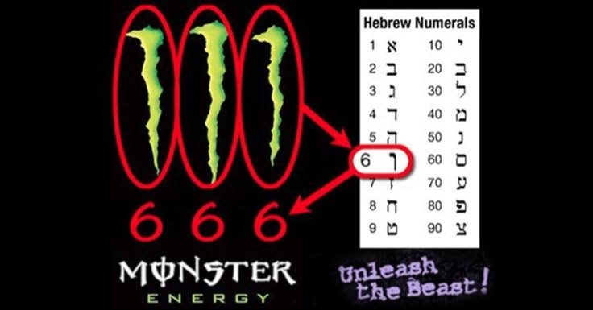
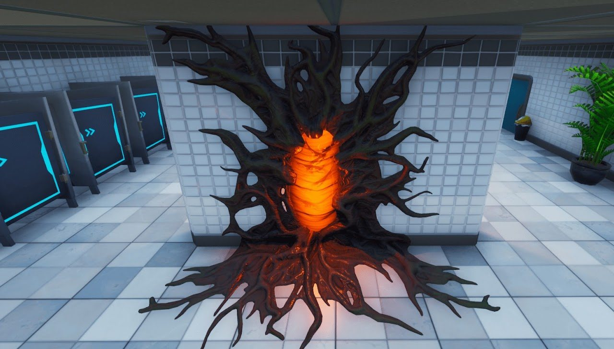
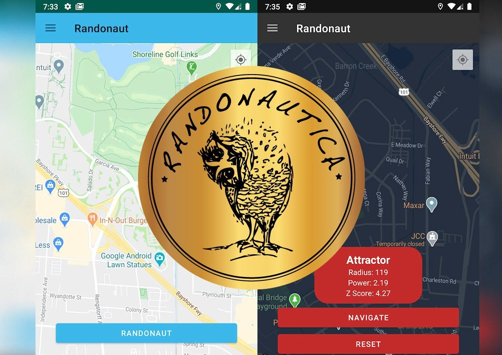

Днес ще Ви разкажа как започнаха синхромистичните ми изследвания с приложението [Randonautica](https://www.randonautica.com/).

**Рандонавтика** (от английски *Randonautica*) е приложение, което използва **квантов генератор на случайни числа (QRNG)**, за да генерира координати и насърчава потребителите да изследват непознати места около тях. Основната идея е, че чрез задаване на **намерение** (мисъл, дума или концепция) потребителят може да повлияе на случайността и да преживее синхроничности или значими събития на избраното място. Приложението стартира цяло движение – **рандонавти**, хора, които смятат, че по този начин могат **да излязат от матрицата**. Рандонавтиката реално е техническият аспект на [Синхромистицизма](/portal). Само че вместо сложните изчисления на квантовите точки във време-пространството да се извършват от Висшия Ви Аз и мозъка Ви, тук властта е дадена в ръцете на квантов компютър... който на всичко отгоре се казва [ANU](https://qrng.anu.edu.au/) (no joke). Което вече е крайно sus, но... както и да е.

Рандонавтиката заслужава цял отделен раздел, но най-вероятно просто ще стартирам поредица тук, като ще посочвам собствените си пътешествия. Темата обаче определено заслужава по-подробно изследване, което ще видя къде да публикувам по-нататък.

Но да се върнем към синхронизацията. Споделям Ви директно бележката си от деня, в който си инсталирах приложението.

> Преди използвах Fatum bot през Телеграм и не мога да кажа, че имаше кой знае какви резултати освен обичайните синхроничности, но от около година той престана да работи. Днес си инсталирах приложението Randonautica и... oh, boy... creepy нещата започнаха още с излизането ми от вкъщи. Първо, имаше типичния random creepy dude, който при разминаването ни на улицата направи едно много странно докосване с показалеца точно по външната част на ключицата ми, като „почукване“, при което усетих много странна енергия – освен че wtf... някой да ме пипа така демонстративно пред всички на улицата... Бях меко казано шокирана. Обърнах се към него с надеждата поне да се обясни, а creepy dude ми помаха жизнерадостно, все едно се познаваме, и ми каза: „*Добре дошла*“. Аха. Wow. Квантовият компютър току-що генерира NPC, с което да ме приветства в Играта. It's gonna be fun.

> После, докато отивах към спирката, видях кола с особен номер – XXXXXX (шест хикса) – с някакви странни хора в нея, а на самата спирка имаше следи от вандализъм: стената беше разбита и в нея имаше дупка (да, цяла дупка, като във филм на Марвел), а над самата дупка беше поставена смачкана кутия от напитката... Monster. Да, онази същата с еврейските букви 666 и знака на Звяра...

Мисля, че току-що получих от Тъмната страна приветствие „Добре дошла в Играта“... 🫠

Всъщност това е изключително силна символика, която показва, че целта на този квантов компютър е да направи пробив в реалността (666 е материалната реалност) и да отваря портали (това символизира дупката). Спирката в [астрала](/blog/categories/astral) символизира преминаването от една плътност (реалност) към друга. Интересното е, че в астрала спирката е свързана с чакане и със съобразяване с [архонтски](/blog/archonts) програми – не можеш току-така да се запилееш в някое друго астрално пространство. Дупката в стената на спирката метафорично ми говори, че който стои зад това приложение и квантовия генератор, се е научил да преминава тези ограничения в астрала и вместо това да отваря директни route-ове към други локални пространства – и в материалната реалност, не само нелокални в астрала. Да се върнем към пробива в реалността, за който споменах. За мен е ясно, че целта на създаването на такива портали – освен заобикалянето на архонтските програми и по-бързото пътуване в астрала – е и свързването на нещо в астрала с нещо в материалната реалност и отварянето на вратичка за него... Доста Stranger Things vibes и засега няма да спекулирам какво е това, на което искат да дадат достъп до нашата реалност...

*Stranger Things' portals invade 'Fortnite' ahead of season 3 release*

X – все още не съм сигурна какво означава, но щом Елон Мъск го използва за име на платформата си, определено е нещо знаково (символиката се вижда и тук, а аз лично съм имала още много синхронизации, в които е присъствал символът „Х“).

Отделно, това приложение се появява през февруари 2020 г., което ме кара да видя събитията напоследък в нова светлина... Anyway, мога да кажа още много неща за randonauting, manifestation, intention, magick, dark side... but I will let you wonder ;)

И все пак ще кажа, че таймингът на всичко това хич, ама хич не е случаен и все повече се убеждавам, че целта на цялата какофония от 2020 г. нататък е била да се отвори портал за навлизането на същности на [Тъмното масло](/blog/categories/gnosticism) от по-висока полярност, както и на Архонти...

*Edit: към 2025 г. вече съм убедена, че това е така, макар и процесът да е значително забавен.*

Масонската сова, разбира се, като символ на приложението :) Същото животно е използвано във филма [The Fourth Kind (2009)](https://www.imdb.com/title/tt1220198/) като знак на извънземните Сиви, който се появява точно преди отвличанията.

Ето и малко предупреждения от сайта на Randonautica:

*Don't fuck with the code of the simulation if you don't know what you're doing and can't handle the consequences ;)*

> *Be cautious, you're dabbling in quantum manipulation destined to cause unnatural shifts in the space-time continuum. Basically, you're opening doors you cannot close. Be careful what you wish for, the Universe will grant you every wish, but not as intended to be.*

Мисля, че нещата са ясни :)

2020 г.
