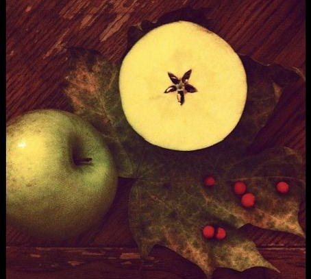
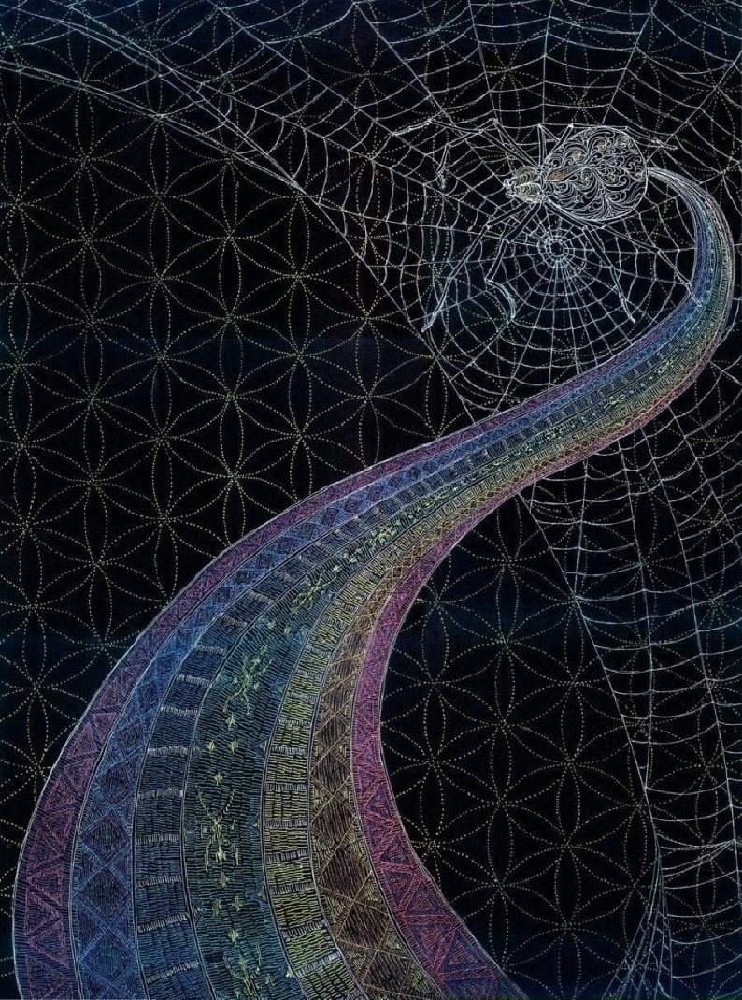
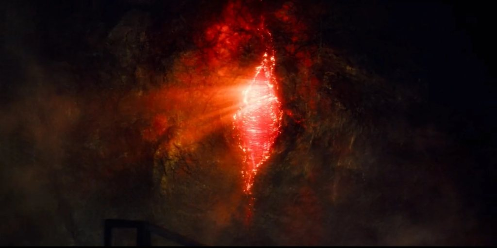

Темата днес е за [black goo](/blog/categories/gnosticism) паразита и [архонт](/blog/archonts), с чиято есенция се сблъсках, докато пътешествах... Неговият символ в езотериката е **паякът** – „богът“, почитан от фримасоните – **Ябулон**.

Jokes on me, чак сега разбирам, че думата за **ябълка** на староруски е точно... яболон :))) Ех, тази руска следа...

На картинката по-горе, btw, е изобразен демонът от [Гоетия](https://en.wikipedia.org/wiki/The_Lesser_Key_of_Solomon) **BAAL**.

На картинката по-долу – причината да не сме в Рая ;)

Някой вече прави ли връзка с **мита за Ева и ябълката, Apple и бога-паяк на черните фримасони Ябулон или БААЛ (Ba-Al – Barium-Aluminium ;)**?

Та, правейки връзка между всичко това, **загубата на обоняние** при **к\*оронаВ\*рус** и **гейт 44** в Хюман дизайн (който е част от центъра на **имунната система** и отговаря за **когницията smell (мирис), както и за паметта**), случайно попаднах на [тази статия за пси способностите и гейтовете](https://www.barneyandflow.com/psychic-abilities). Водена от мисълта и усещането си, че вирусът разрушава не само коронната чакра, но и пси способностите, о, чудо – веднага попадам на статия, свързваща пси уменията с дадените гейтове в Хюман дизайн. НА ТОВА МУ СЕ КАЗВА ВСЕЛЕНАТА ДА ТИ ГОВОРИ! АЛОООО... не бившият да ти звънне (това е от дявола – нарочно с малка буква, хи-хи).

🌚👾

Така, продължаваме със [синхромистичната](/portal) нишка. Отварям си фейсбука и първата публикация, която виждам, е ето тази снимка:

🤯 На прав път сме ;) **Програмата на матрицата говори посредством синхронизации**. Или някой, който иска да изпрати съобщение. По-вероятно Висшият ми Аз ровичка кода, за да ми покаже Истината.

Знаци за това как работят нещата. Това са синхронизациите. Дотук имаме ясно потвърждение.

Няколко прозрения от тези дни, които затвърдиха представата ми за всичко случващо се:

1. Първо, това не е никакъв вир\*\*, а паразит, който има и свой етерен компонент. Живее в червата, но поразява и нервната система. Затова и най-ефикасното средство (поне донякъде) срещу него беше ивермектинът.

*(Бел. авт., 2025: това е точно вирус, който отваря щитовидната жлеза и поразява имунната система – затова има компонент от СПИН, за да може точно този архонт да влезе в човешкото тяло и да се настани удобно. Бог да ни е на помощ. Към 2025 г. картинката е плачевна. Масови обсебвания.)*

2. Второ, имах особено преживяване в просъница, което за мен затвърди на 100% изследванията на Харалд Кауц-Вела (Harald Kautz-Vella), а именно – наблюдавах този етерен компонент на паразита да се изкачва по гърба на човек. На мен – не знам как да го опиша, беше супер странно, все едно наблюдавах аватарна проекция на себе си, но само като синя сянка, пригърбена и седнала странично, която на всичко отгоре приличаше и на мъж, но знаех, че това съм аз. Anyways, паразитът беше доста голям, което ме стресна, и беше във формата на паяк. Пропълзя бързо по гръбнака към главата и се настани на коронната чакра (отгоре на главата), за да точи енергия и биофотони... Хубавото е, че вече ставам осъзната за този процес и когато се депресирам и черните мисли внезапно ме налегнат, мога да го усетя и видя. Точно такава черна лепкава ментална слуз усещах тогава в съзнанието си в полусън, но този път успях да видя за какво става въпрос. В този момент вече бях сигурна, че Харалд Кауц-Вела е прав за всичко.

*(Бел. авт., 2025: WOW, WOW, как можах да забравя това! Чак сега, след 2 години зверски мъки – здравословни и астрални, имах и тежка себорея на главата, ADHD и депресия, които започнах да лекувам. Изглежда, паякът ми е въздействал да забравя тази информация от 2021 г. и чак сега, като редактирам статията, всичко makes sense 🤯)*

3. Трето, преди малко имах изключително странно преживяване. Прибрах се от дълго бягане и докато си седях и почивах у нас, усетих много, ама много зловеща енергия. Наистина mega creepy. Съзнанието ми внезапно „прещрака“, успях да вляза в състояние на „ясно виждане“ и буквално ми се показа какво представлява това усещане – беше като дълга, разширяваща се черна следа, сянка, която вървеше точно зад врата ми и не изчезваше, а вместо това се разрастваше. Казах си: „Аха, затова не ни пускаха да излизаме – ние разнасяме това нещо и усилваме неговото присъствие в това пространство.“ Напомни ми за една история, която ми беше разказал един бивш.

4. Четвърто, гейт 44 освен за обонянието отговаря и за паметта, и по-точно за паметта като връзка с миналото. Изчезването на обонянието след прекарване на „заболяването“ (както при мен) говори за явна връзка с манипулация на колективната видова памет, като явно това се отключва само при определени генотипове, които активират тази мутация и в колективното съзнание. Както знаем от физиката, паметта се свързва с причинно-следствените връзки – дали манипулацията на видовата памет цели нарушаване или създаване на нови определени връзки и с каква цел? Да, нова времева линия. Искат да създадат нова времева линия и реалност, която да приюти това сатанинско съзнание и архонт. *(Бел. авт., 2025: твърде възможно е да сме преживели множество Мандела ефекти през последните години.)*

5. Пето, след всичко преживяно и прочетено през последните години, за мен е пределно ясно, че става въпрос за доста обемна и сложна картина с технология, която далеч надхвърля възможностите на човешкия мозък. По-лошото е, че имам стопроцентовото усещане, че тя далеч надхвърля и възможностите на познатите ни извънземни играчи. Както казва Horus, те са просто празни изпълнители на аджендата на Тъмното масло, или както Харалд посочва за земните играчи и биолабораториите: „Те си мислят, че го контролират, но се лъжат жестоко.“ Спомнете си само филма [„Спутник“](https://en.wikipedia.org/wiki/Sputnik_(2020_film)), пуснат през знаменателната 2020 година... *(Бел. авт., 2025: или за какво се бият в Украйна – биолабораториите.)*

6. Шесто, това съзнание започва да озверява от глад и гледайки празните и затъпели погледи на хората наоколо, разбирам защо. Храната свършва. На практика поне 70–80% от хората към днешна дата са почти изгризани от него и няма какво повече да се „яде“, а каквото има, не е качествено. Съвсем скоро то ще подивее от глад, което означава, че ще се насочи още по-яростно към духовните хора и хората с по-висока вибрация. Не знам за Вас, но аз лично през последните 2 години имах доста тежки проблеми с него и все още се боря.

*(Бел. авт., 2025: баси пророка съм... разгони ми се фамилийката през последните години.)*

7. Седмо и последно, за мен е ясно, че това е биотехнология на вече изчезнала извънземна раса (според Харалд те са от Сириус Б, anyway...), създадена с технология за трансфер на съзнанието през тъмна материя, с цел контрол на свободната воля и нарушаване на причинно-следствените връзки на първоначалната програма. However, при ровичкането във време-пространството и квантовите междупространства и търсенето на етерния компонент на тази технология са отворили вратата за някакво „съзнание“, което за мен е нещо като естествения обитател на квантовата фабрика и един вид „яде“ живота. Точно поради светлинната природа на матрицата, в която живеем, то се преживява като първичен ужас и Тъмнина – то просто е отвъд всички представи за живота като такъв. Поглъщането на съзнанието е ужас.

Веднага се сетих за ключовата сцена от знаменития сериал (по действителен случай) *Stranger Things*.

Ето го и Портала в *Stranger Things*:

